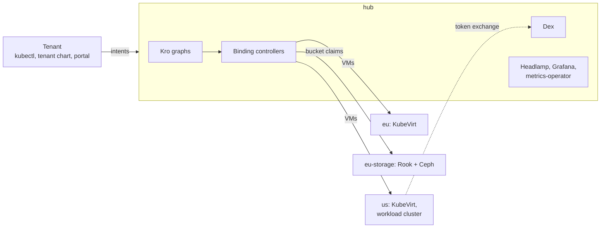

# Platform MVP: Kro + multicluster-runtime on kind

A test-driven multi-cluster platform on four local kind clusters. Kro exposes customer APIs on a hub; binding controllers place each intent on the spoke that offers the service and report status back. 34 Chainsaw tests prove it.

| Service | Intent | Runs on |
|---------|--------|---------|
| VMs | `VmSetIntent`: 1-3 VMs per region, tier S or M | spokes `eu` and `us` (KubeVirt on KVM) |
| S3 buckets | `BucketIntent`: tier S or M with a quota | spoke `eu-storage` (Rook + Ceph RGW) |



A tenant logs in with `kubectl` through Dex, orders buckets and VMs with its own chart, watches them become Ready, then reaches its VM with `ssh` and its bucket with `curl`. The [demo](docs/platform-mvp/use-cases.md) walks through it; the [documentation index](docs/platform-mvp/README.md) lists the rest.

## Prerequisites

Go 1.23+, Docker, kind, kubectl, Helm, the Flux CLI, `ssh` and `curl`, on a host with `/dev/kvm`. Developed with Docker 29, kind 0.32, kubectl 1.30, Helm 3.16 and Flux 2.9.

```bash
make install-chainsaw install-flux install-kubelogin install-virtctl
```

## Quick start

```bash
make all        # lint, test, build, deploy, validate
make grafana    # port-forward Grafana to http://localhost:3000 (admin/admin)
make clean      # destroy everything
```

Step by step:

```bash
make lint       # repository checks, go vet, gofmt
make test       # unit tests
make deploy     # images, clusters, 4 waves, management plane (about 8 minutes)
make validate   # the 34 tests (about 7 minutes)
make deploy-cd verify-flux   # optional: Flux takes over the hub releases
```

Test first: a failing unit or Chainsaw test, minimal code, refactor. `make lint test` before and after every change.

## Makefile targets

`make help` lists them all. The ones to know:

| Target | Does |
|--------|------|
| `make lint` | `check-*` targets (tests, runner list, Flux, tenants, tenant charts, portal trust, guardrails, docs, service hosts), `go vet`, `gofmt` |
| `make deploy`, `deploy-wave1`..`4` | everything, or one wave |
| `make tenant-kubeconfigs` | a kubeconfig per tenant with a Dex login for every cluster |
| `make deploy-cd`, `verify-flux` | Flux on the hub, adopting the releases; check it changed nothing |
| `make verify-all` | clean room: clean, deploy, validate, deploy-cd |

## Project structure

```
.
├── deploy/platform-mvp/
│   ├── chart/{crds,infrastructure,hub-services,spoke}   # one Helm chart per wave
│   ├── chart/management-plane   # Headlamp, metrics-operator, adoption dashboard
│   ├── chart/tenant     # a tenant's order (buckets, VM sets), applied by the tenant
│   ├── tenants.yaml     # tenants and the workload identity
│   ├── kind/ rook/ flux/ crds/ observability/
├── platform-mvp/        # vm-binding-controller, bucket-binding-controller, oidc-verifier (Go)
├── providers/cluster-inventory-api/   # ClusterProfile multicluster provider (Go)
├── tests/e2e/           # Chainsaw suite
├── hack/platform-mvp/   # kubeconfigs, cluster wrappers, token helper
├── docs/platform-mvp/
└── Makefile
```

---

© 2026 sojoner
