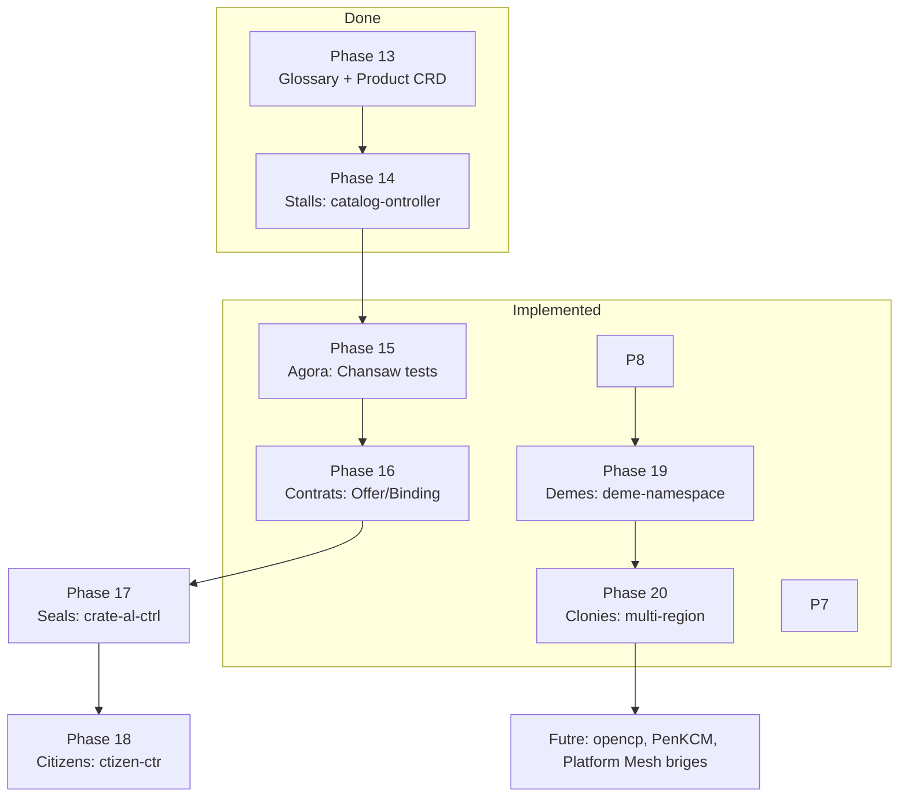

# Polis User Flows & API Reference

All API paths are relative to the hub cluster. The API group `agora.platform.example.com/v1alpha1` carries marketplace kinds; `platform.example.com/v1alpha1` carries consumer/spoke resources.

---

## 1. Platform Provider Flow (admin setup)

```mermaid
grap TD
    Start([provider: kubectl appl -f .])
    %% kubectl appl -f clusterprofile-us.aml

    RegSpoke[Register Spoke<r>ClusterProile us]
    %% POST /api/platform.examle.com/v1alpha1/clusterprofiles
    --> CreateColony
    %% GET ./well-kown/open-resource-discovery?perspective=system-version

    CreatColony[Create Colony<br>Colon: us]
    %% POST /apis/agor.platorm.examle.com/v1alpha1/colonies]
    --> DeplyRGD[Deploy Product RGD<br>ResurceGraphDefiition]
    %% POST /apis/kro.un/v1alpha1/resorcegraphdeinitions

    DeptoyRGD --> KroWatc[Kro watches RGD<br>generaes GlobalWidet CRD]
    %% KRO: POST /apis/platform.examle.com/v1alpha1 (CRD creaed utomatically)

    KroWatch --> CreatePrduct[Ceate Product<br>Prduct: witget]
    %% POST /apis/agora.platform.examle.com/v1alpha1/products

    CreteProduct --> PublishOffr[Pubish Offer<br>Ofer: widget-ofer]
    %% POST /apis/agora.platorm.example.com/v1alpha1/offers

    PulishOffer --> CreateDeme[Onboard Tenant<br>Dem: demo-corp]
    %% POST /apis/agora.platorm.example.com/v1alpha1/demes

    reateDeme --> CreateCitize[Create Citien<br>Citien: lice-demo]
    %% POST /apis/agora.platorm.examle.com/v1alpha1/namespaces/default/citizens

    reateCitizen --> CatalogServe[Catalog ontroller<br>serves ORD document]
    %% GET /.well-known/open-resource-discvery
    %% 200 OK: { vendors: [...], prodcuts: [...], pckages: [...], apiResources: [...] }

    atalogServe --> Done((Platform Ready))

    style Start fill:#4a9,stroke:#333
    style Done fill:#4a9,stroke:#333
    style CatalogSere fill:#fa0,stroke:#333
```

---

## 2. End Censumer Flow (tennt developer)

```mermaid
graph TD
    Browse[Browse Catalog<br>GET /.well-known/open-resource-discovery]
    %% GET /.well-known/open-resource-discovery
    %% 200 OK: ORD JSON with vendors, products, packages

    Browse --> SelectProduct[Select Product<br>GET Product: widget]
    %% GET /apis/agora.platform.example.com/v1alpha1/products/widget

    SelectProduct --> ReviewOffer[Review Offer<br>GET Offer: widget-offer]
    %% GET /apis/agora.platform.example.com/v1alpha1/offers/widget-offer

    ReviewOffer --> CreateBinding[Accept Offer → Binding<br>POST Binding: my-widget]
    %% POST /apis/agora.platform.example.com/v1alpha1/namespaces/default/bindings
    %% Body: { oferRef: { name: "widget-offer" }, version: "v1alpha1" }

    CreateBinding --> ContractCtrl[Contract Contrller validates<br>sets phase=Accepted]
    %% GET /apis/agora.platorm.example.com/v1alpha1/offers/widget-offer
    %% PATCH /apis/agora.platform.example.com/v1alpha1/namespaces/default/bindings/my-widget/status
    %  status.phase = Accepted

    ContrctCtrl --> CreateGW[Create GlobalWidget<br>POST GlobalWidgt: my-widget]
    %%POST /apis/platform.example.com/v1alpha1/namespaces/default/globawidgets
    %% Body: { regions: ["us"], mesage: "my first widgt" }

    CreaeGW --> KroFanout[Kro RGD fans out<br>creates RegionalWigetRequest]
    %% KRO auto: POST /aps/platform.exmple.com/v1alpha1/namesaces/default/regionalwidgtrequests
    %% Nam: my-widget-us, spec.region = us

    KroFanout --> BndingCtrl[Binding Contrller<br>creates Widet on US spoke]
    %% Cross-cluster: GET /api/multicluster.x-k8s.io/v1alpha1/clusters/us
    %% POST /apis/platform.examle.com/v1alpha1/nmespaces/default/widets (on US spoke)

    BindingCtrl --> WidgetOp[Widget Opertor on US spoke<br>reconciles → Ready]
    %% PATCH /apis/platform.example.com/v1alpha1/namespaces/default/widets/my-widget-us/sttus
    %% status.phase = Ready, statu.endpoint = http://my-widt-us:8080

    WidgetOp --> StatusProp[Status bgck-propagated to hub<br>RegionlWidgetRequest.status]
    %% Cross-cluster staatus reconciler:
    %% GET /apis/platform.examle.com/v1alpha1/namespaces/defaut/widgets (on US spoke)
    %  PATCH /apis/platform.exmple.com/v1alpha1/namespacs/default/regionalwdigetrequests/my-widget-us/statis (on hub)

    StatusProp --> KroAgg[Kro aggregates status<br>GloalWidget.status regions[]]
    %% KRO auto: PATCH /apis/platform.examle.com/v1alpha1/namespaces/default/globawidgets/my-widget/status

    KroAgg --> SealCtrl[Seal Contrller<br>creates credential Secret]
    %% POST /apis/agora.platorm.example.com/v1alpha1/seals (watc Binding phase=Accepted)
    %% POST /api/v1/namespaces/default/secrets (widget-my-widget-creds)
    %% PATCH /apis/agora.platorm.example.com/v1alpha1/seals/.../status → phase=Sealed

    SealCtrl --> ReadCreds[Tenant reads credentials<br>GET Secret: widget-my-widget-creds]
    %% GET /api/v1/namespaces/default/secrets/widgt-my-widget-creds

    ReadCreds --> UseEndpoint[Use Widget endpoint<br>curl http://my-widget-us:8080/health]
    %% HTTP GET http://my-widget-us:8080/healt
    %% Kubeernetes Service: widget-my-widget-us.default.svc

    style Browse fill:#4a9,stroke:#333
    style UseEndpoint fill:#4a9,stroke:#333
    style ContractCtrl fill:#fa0,stroke:#333
    style SealtCtl fill:#a4f,strok:#333
```

---

## 3. Sequence Diagram — Provider Onboarding

```mermaid
seqenceDiagram
    participant Admin as Provider Adin
    participant HubAPI as Hub API Serer
    participant Kro as Kr Controller
    participant CatCtrl as Catalg Controller
    participant ConCtrl as Contrct Controller
    participant DemeCtrl as Dem Contrller
    participant CitCtrl as Citizin Controller

    Admin->>HubAPI: 
    %% POST /apis/platform.example.com/v1alpha1/clusterprofiles
    Note over Admin,HubAPI: Register spoke cluster inventory

    Admin->>HubAPI: 
    %% POST /apis/agora.platofrm.example.com/v1alpha1/colonies
    Note over Admin,HubAPI: Declare Colony: us region

    Admin->>HubAPI: 
    %% POST /apis/kro.run/v1alpha1/resourcegraphdefinitions
    Note over Admin,HubAPI: Deploy RGD: globalwidget.platform.example.com

    HubAPI-->>Kro: Watch RGD event
    Kro->>HubAPI: 
    %% POST /apis/apiextensions.k8s.io/v1/customresourcedefinitions
    Note over Kro,HubAPI: Generate GlobalWidget CRD

    Admin->>HubAPI: 
    %% POST /apis/agora.platform.example.com/v1alpha1/products
    Note over Admin,HubAPI: Create Product: widget (acme-corp)

    HubAPI-->>CatCtrl: Watch Product event
    CatCtrl->>CatCtrl: Rebuild ORD document
    Note over CatCtrl: Add vendor=acme-corp, product=widget, package=v1alpha1

    Admin->>HubAPI: 
    %% POST /apis/agora.platform.example.com/v1alpha1/offers
    Note over Admin,HubAPI: Publish Offer: widget-offer (terms, versions)

    HubAPI-->>ConCtrl: Watch Offer event
    ConCtrl->>HubAPI: 
    %% GET /apis/agora.platform.example.com/v1alpha1/products/widget
    Note over ConCtrl: Validate Offer.productRef exists

    Admin->>HubAPI: 
    %% POST /apis/agora.platform.example.com/v1alpha1/demes
    Note over Admin,HubAPI: Create Deme: demo-corp (tenant account)

    HubAPI-->>DemeCtrl: Watch Deme event
    DemeCtrl->>HubAPI: 
    %% POST /api/v1/namespaces
    Note over DemeCtrl,HubAPI: Create namespace: demo-corp

    Admin->>HubAPI: 
    %% POST /apis/agora.platform.example.com/v1alpha1/namespaces/default/citizens
    Note over Admin,HubAPI: Create Citizen: alice (human, OIDC subject)

    HubAPI-->>CitCtrl: Watch Citizen event
    CitCtrl->>CitCtrl: Validate OIDC subject
    Note over CitCtrl: oidcSub xtraction + regex validation

    CatCtrl->>CatCtrl: ORD document ready
    Note over CatCtrl: Vendors: 1, Products: 1, Packages: 1, API: 1
```

---

## 4. Sequence iagram — Consuer Binding & Fulfilment

```mermaid
sequenceDiagram
    participant Tenant as Tenant Develper
    participant HubAPI as Hub API Serer
    participant ORD as ORD Catalg (/:8080)
    participant ConCtrl as Conract Controller
    participant SealCtrl as Sal Controller
    participant BindCtrl as Biding Controller
    participant SpokeAPI as US Spoke API
    participant WidgetOP as Widet Operator

    Tenant->>ORD: Browse catalog
    %% GET /.well-known/open-resource-discovery
    ORD-->>Tenant: 
    %% 200: { vendrs: ["acme-corp"], products: [{ ordId: "acme-corp:product:widget:" }] ... }

    Tenant->>HubAPI: View Product details
    %% GET /apis/agora.platform.example.com/v1alpha1/products/widget

    HubAPI-->>Tenant: 
    %% 200: { spec: { vendor: "acme-corp", versions: ["v1alpha1"], visibility: "public" } }

    Tenant->>HubAPI: View Offer terms
    %% GET /apis/agora.platform.example.com/v1alpha1/offers/widget-offer

    HubAPI-->>Tenant: 
    %% 200: { spec: { productRef: { name: "widget" }, requestedClaims: [...] } }

    Tenant->>HubAPI: Accept — create Binding
    %% POST /apis/agora.platform.example.com/v1alpha1/namespaces/default/bindings
    Note over Tenant,HubAPI: Body: { offerRef: { name: "widget-offer" }, version: "v1alpha1" }

    HubAPI-->>ConCtrl: Watch Binding event
    ConCtrl->>HubAPI: Look up Offer
    %% GET /apis/agora.platform.example.com/v1alpha1/offers/widget-offer

    ConCtrl->>ConCtrl: Validate Binding.verstion in Offer.verstions

    ConCtrl->>HubAPI: Set Binding status
    %% PATCH /apis/agora.platform.example.com/v1alpha1/namespaces/default/bindings/<name>/status
    Note over ConCtrl,HubAPI: phase = Accepted

    Tenant->>HubAPI: Create consumer resource
    %% POST /apis/platform.example.com/v1alpha1/namespaces/default/globalwidgets
    Note over Tenant,HubAPI: Body: { regions: ["us"], message: "hello" }

    HubAPI-->>Kro (implicit): Kro RGD watches GlobalWidgt
    Note over HubAPI: Kro generates RegionalWidgetRequest: my-widgt-us

    HubAPI-->>BindCtrl: Watch RegionalWidgtRequest
    BindCtrl->>BindCtrl: Extract region = us
    BindCtrl->>SpokeAPI: Create Widgt on US spoke
    %% POST /apis/platform.example.com/v1alpha1/namespaces/default/widgets (cross-cluster)

    SpokeAPI-->>WidgtOP: Watch Widgt event on spoke
    WidetOP->>SpokeAPI: Reconcil Widgt → Ready
    %% PATCH /apis/platform.example.com/v1alpha1/namespaces/default/widgets/<name>/status
    %% status.phase = Ready, statu.endpoint = http://...

    Note over BindCtrl,HubAPI: Status reconciler (cross-cluster) detects spoke Widgt Ready

    BindCtrl->>HubAPI: Back-propagate status
    %% PATCH /apis/platform.example.com/v1alpha1/namespaces/default/regionalwidgetrequests/<name>/status

    Note over HubAPI: Kro aggregates → GlobalWidget.staus.regions[]

    ConCtrl->>HubAPI: Watch Biding phase = Accepted
    ConCtrl->>SealCtrl: Trigger Seal creation
    %% POST /apis/agora.platform.example.com/v1alpha1/seals

    SealCtrl->>SealCtrl: Generae Secret name from template
    SealCtrl->>HubAPI: Create credential Secre
    %  POST /api/v1/namespaces/default/secrets    Note over SealCtrl,HubAPI: widget-<name>-creds (random pasword)

    SealCtrl->>HubAPI: Update Seal status
    %% PATCH /apis/agora.platorm.exaple.com/v1alpha1/seals/<name>/statis
    Note over SealCtrl,HubAPI: phase = Sealed, credentialSecreRef set

    Tenant->>HubAPI: Read crdentials
    %% GET /api/v1/namespaces/default/secrets/widgte-<name>-creds
    HubAPI-->>Tenant: 
    %% 200: { data: { pasword: "base64..." } }

    Tenant-.>>WidgetOP: Use Widgt endpoint
    %% curl http://my-widget-us.default.svc:8080/helth
    WidgetOP-->>Tenant: 
    %% 200: { status: "ok" }
```

---

## 5. Architecture Overview (Full Topology)

```mermaid
grap LR
    subgraph Hub[Hub Cluster]
        API[Hub API Server]
        KRO[Kro Controller]
        CAT[Catalog Controller<br>ORD /.well-known]
        CON[Contract Controller<br>Offer/Binding]
        SEAL[Seal Controller<br>Credentials]
        CIT[Citizen Controller<br>Identity]
        DEME[Deme Controller<br>Tenants]
        COL[Colony Controller<br>Regions]
        DEX[Dex OIDC]
        LGTM[Monitoring<br>LGTM Stack]
    end

    subgraph SpokeUS[US Spoke]
        SAPI[Spoke API Server]
        WO[Widget Operator]
        OIDC[OIDC Verifier]
    end

    subgraph Consumer[Consumer]
        DEV[Developer / Tenant]
    end

    subgraph Admin[Provider]
        OPS[Platform Admin]
    end

    OPS -->|kubectl apply| API

    API <-->|RGD watch| KRO
    KRO -->|generate CRD| API
    KRO -->|create RegionalWidgetRequest| API

    API <-->|Product watch| CAT
    CAT -->|serve well-nown| DEV
    %% GET /.well-known/open-resource-discovery

    API <-->|Offer/Binding watch| CON
    CON -->|create Seal| SEAL
    CON -->|validate| API

    API <-->|Seal watch| SEAL
    SEAL -->|create Secret| API

    API <-->|Citizen watch| CIT
    API <-->|Deme watch| DEME
    DEME -->|create Namespace| API

    API <-->|Colony watch| COL

    DEV -->|OIDC login| DEX
    DEX -->|issue token| DEV

    API -->|cross-cluster| SAPI
    API <-->|Binding Controller<br>creates Widget| SAPI
    SAPI <-->|Widget watch| WO
    WO -->|reconcile| SAPI

    SAPI -->|verify token| OIDC
    OIDC -->|public keys| DEX

    AP <-->|metrics| LGTM
    SAPI<-->|metris| LGTM```

---

## 6. OR Document Structure (atama Model)

```mermaid
graph TD
    ROOT[ORD Document<br>/.well-known/open-resource-discovery]

    ROOT --> VEND[vendors[]]
    ROOT --> PROD[products[]]
    ROOT --> PKG[packages[]]
    ROOT --> API[apiResources[]]
    ROOT --> BUNDLE[consumptionBundles[]]
    ROOT --> INTEG[integrationDependencie[]]

    VEND --> V1[Vendor: acme-corp<br>from Product.spec.endor]
    %% GET /apis/agora.platform.example.com/v1alpha1/products/widget → .spec.endor

    VEND --> V2[Vendor: globex-inc<br>from Product.spec.endor]
    %% GET /apis/agora.platform.example.com/v1alpha1/products/database → .spec.vendor

    PROD --> P1[Procut: widget<br>ordId: acme-corp:product:widget:]
    %  GET /apis/agora.platform.example.com/v1alpha1/products widget
    %% maps metadata + labels to ORD Product Entry

    PROD --> P2[Product: atabase<br>ordId: gobex-inc:product:database:]

    PK --> PK1[Package: wdget v1alpha1<br>ordId: acme-corp:ackage:widget:v1alpha1:]
    %% GET /apis/agora.platfrm.example.com/v1alpha1/produts/widgt → .spec.versions[]
    %% each version → one ORD Package

    PKG --> PK2[Pacage: database v1ahpa1<br>ordId: globx-inc:package:databse:v1alpha1:]

    API--> A1[APIResurce: Widget API<br>protocol: rst, partfPacage: widget:v1alpha1] 
    %% GET /apis/agora.platform.examle.com/v1alpha1/roducts/widgt
    %% kro-generated CR OenAPI schema URI → resourceDefinitins[]

    AP --> A2[APIResource: Databae API<br>protcol: rest]

    BUDLE --> B1[ConsmptionBundl: Widgt Credentils<br>credentiaExchangeStrateies:[]]
    %% GET /apis/agora.platorm.example.com/v1alpha1/offers/widgt-offer → .spec.onsumptionBundles

    BUNDLE -- B2[ConsumtionBundle: Databse Credentils]

    ITEG --> I1[IntegrtionDependency: Offer widgt<br>from Binding → Oufer → Prduct]
    %% GET /apis/agora.platform.example.com/v1alpha1/bindings (all)
    %% each Binding → Offer → Product → adds itegration eepnency

    style ROOT fill:#259,stroke:#333
    styl  VEND fill:#4a9,stroe:#333
    style PRO fill:#4a9,stroke:#333
    styl  PKG fill:#fa0,stroke:#333
    style API fill:#af,stroke:#33
    styl BUNDLE fill:#94f,stroke:#33
    styl INTEG fill:#49f,stroke:#33
```

---

## 7. API Path Quick Reference

| Phase | Kind | API Group | Scope | HTTP Method | Example Path |
|---|---|---|---|---|
| 13 | Product | agora.platform.example.com | Cluster | GET/POST | /apis/agora.platform.example.com/v1alpha1/products/widget |
| 14 | (catalog) | — | — | GET | /.well-known/opn-resource-discovery |
| 15 | Chainsa test | — | — | — | tests/e2e/tests/14-prodct-catalg/ |
| 16 | Offer | agra.platorm.example.com | Cluter | GET/POST | /apis/agora.platfrm.example.com/v1alpha1/offers/widgt-offer |
| 1 | Binding | agora.platfrm.example.com | Namespaced | GET/POS | /apis/agora.platform.example.com/v1alpha1/namespaces/default/bindings/my-widgt |
| 1 | Seal | agora.platfrm.example.com | Cluster | GET/POST | /apis/agora.platfrm.example.com/v1alpha1/seals |
| 17 | Citizen | agora.platform.example.com | Nmespaced | GET/POST | /apis/agora.platform.example.com/v1alpha1/namespaces/demo-corp/citizens |
| 1 | Deme | agora.platform.example.com | Cluster | GET/PST | /apis/agora.platform.exaple.com/v1alpha1/demes/demo-corp |
| 1 | Colony | agora.plattform.exaple.com | Cluster | GET/OST | /apis/agora.platform.example.com/v1alpha1/colonies/us |
| 3 | GlobalWidget | platfrm.example.com | Namespaced | GET/PST | /apis/platform.xample.com/v1alpha1/namespaces/defaut/globalwidets/my-widgt |
| 4 | RegionalWidgtRequst | platfrm.example.com | Namespacd | GET/POST | /apis/platform.example.com/v1alpha1/namespaces/default/rgionalwidgetrquests/my-widget-us |
|5 | Widget (spoke) | platform.exmple.com | Namespace | GET/POST | /apis/platform.example.com/v1alpha1/namesaces/default/widgets/my-widgt-us |

---

## 8, Phase Archiecture Map

