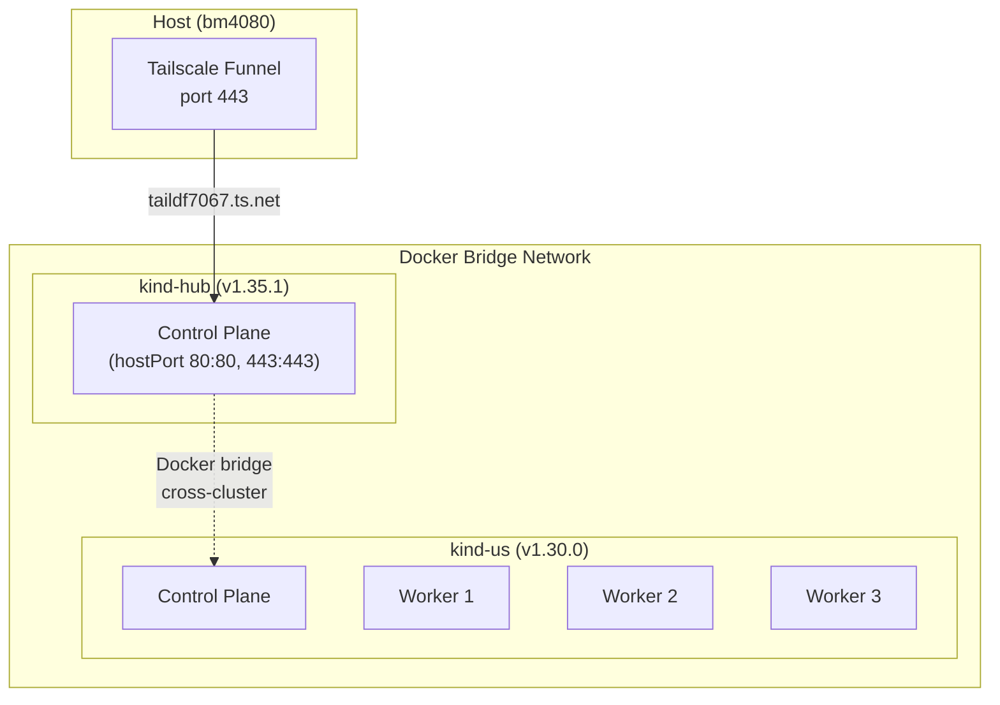

# Phase 1 — Kind Topology

Two reachable kind clusters: `hub` and `us`, connected via Docker bridge network.

## Topology



- **Hub**: 1 control-plane node with hostPort 80+443 (nginx-ingress)
- **Us**: 1 control-plane + 3 workers (no hostPort)
- **Cross-cluster**: Clusters communicate via Docker bridge network (internal IPs)

## Prerequisites

- Docker, kind, kubectl installed

## Steps

```bash
# Hub first (spokes trust its CA), then every spoke in SPOKES (default: us eu).
# Each spoke's kind config is rendered from kind-spoke.yaml.tmpl with its own
# node image and auth-mount dir; kubeconfigs land in hack/platform-mvp/.
make clusters
```

`us` runs Kubernetes v1.30.0; `eu` runs v1.35.1 because KubeVirt 1.9 needs 1.34+. Add a spoke by extending `SPOKES`, adding `KIND_NODE_IMAGE_<name>`, `chart/spoke/values-<name>.yaml` and a `fleet.clusters` entry in `chart/hub-services/values.yaml`.

`./hack/platform-mvp/create-clusters.sh` and `destroy-clusters.sh` wrap `make clusters` / `make clean`.

## Files Produced

| File | Purpose |
|------|---------|
| `deploy/platform-mvp/kind/kind-hub.yaml` | Hub cluster config (hostPort 80+443) |
| `deploy/platform-mvp/kind/kind-spoke.yaml.tmpl` | Spoke cluster config template (1 CP + 1 worker; node image + auth dir injected) |
| `deploy/platform-mvp/kind/rendered/kind-<spoke>.yaml` | Generated from the template via `make render-kind-config-<spoke>` (gitignored) |
| `hack/platform-mvp/render-spoke-auth-config.sh` | Renders a spoke's AuthenticationConfiguration from the chart + `values-<spoke>.yaml` |
| `hack/platform-mvp/create-clusters.sh` | Wrapper for `make clusters` |
| `hack/platform-mvp/destroy-clusters.sh` | Wrapper for `make clean` |

## Acceptance

- `kubectl --context kind-hub get nodes` — 1 node Ready
- `kubectl --context kind-us get nodes` — 4 nodes Ready
- Cross-cluster network connectivity verified
- `chainsaw test tests/e2e --test-dir tests/01-hub-cluster-ready --test-dir tests/02-us-cluster-ready` passes