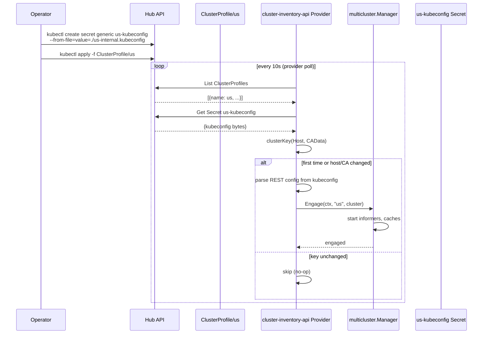

# Phase 3 — Fleet Registration

Registering spoke clusters (`us`, `eu`) on the hub via `ClusterProfile` CRD and the `cluster-inventory-api` multicluster provider.

---

## How It Works



## Provider Implementation

The provider at `providers/cluster-inventory-api/provider.go` implements `sigs.k8s.io/multicluster-runtime`'s `Provider` interface:

```go
type Provider interface {
    Get(ctx context.Context, clusterName string) (cluster.Cluster, error)
    IndexField(ctx context.Context, obj client.Object, field string, extractValue client.IndexerFunc) error
}
```

Plus the convention-based `Run(ctx, mgr)` method for cluster discovery.

### Poll Loop (`provider.go:120-222`)

1. **Discover** — `hubClient.List(ctx, &clusterProfiles)` at configured interval (default 10s)
2. **Locate kubeconfig** — Look up `<name>-kubeconfig` Secret in same namespace as ClusterProfile
3. **Change detection** — Compute clusterKey from server URL + CA certificate data; skip if unchanged (v2: token changes are irrelevant — tokens come from BearerTokenFile, not kubeconfig)
4. **Disengage old** — If clusterKey changed (server URL or CA), cancel old cluster's context
5. **Build cluster** — Parse kubeconfig → `cluster.New(restConfig, scheme)`, override auth with `BearerTokenFile`
6. **Engage** — `mgr.Engage(ctx, name, cl)` registers the spoke
7. **Replay indexes** — Replay any registered `IndexField` calls against the new cluster
8. **Cleanup** — Remove clusters whose ClusterProfile has been deleted

### Change Detection (v2: clusterKey)

In v2, the provider uses a clusterKey (SHA256 of `Host + CAData`) instead of the full kubeconfig hash. This means:

- **Server URL change** → disengage + re-engage with new credentials
- **CA certificate change** → disengage + re-engage
- **Token change** → **no-op** (tokens come from `BearerTokenFile`, Kubelet-managed)

This decouples credential rotation from cluster engagement, eliminating the tight coupling between the token-rotator and the multicluster provider.

## ClusterProfile CRD

Rendered from `fleet.clusters` in `chart/hub-services/values.yaml`, one object per spoke. Labels are optional:

```yaml
apiVersion: multicluster.x-k8s.io/v1alpha1
kind: ClusterProfile
metadata:
  name: eu
  namespace: default
  labels:
    platform.example.com/offers-vms: "true"
```

The kubeconfig Secret is `<name>-kubeconfig` in the same namespace, with the kubeconfig under the key `value`.

### Scoping a controller to some spokes

A controller can engage only the ClusterProfiles whose labels match (`Provider.SetLabelSelector`). The VM binding controller uses `platform.example.com/offers-vms=true`, so it sees `eu` and never `us`. A profile that stops matching is disengaged on the next poll. No selector engages every profile, which is what the widget binding controller does.

The `status` subresource includes:

| Field | Purpose |
|-------|---------|
| `conditions[type=ControlPlaneHealthy]` | v1: Gated by token-rotator; v2: no longer required (auth via BearerTokenFile + Kubelet) |
| `accessProviders[*].cluster` | Contains `server` URL and `certificateAuthorityData` for kubeconfig assembly |

In production, a control plane health controller would populate `ControlPlaneHealthy` based on actual spoke API reachability. For E2E testing, this is patched manually.

## Acceptance

- `ClusterProfile us` visible on hub
- Provider discovers and engages the spoke
- `multicluster.Manager.GetCluster(ctx, "us")` returns a working cluster client
- `04-fleet-registration` Chainsaw test passes

## Key Files

| File | Purpose |
|------|---------|
| `providers/cluster-inventory-api/provider.go` | Provider: poll loop, engagement, clusterKey change detection (Host+CAData) |
| `deploy/platform-mvp/chart/hub-services/templates/fleet.yaml` | One ClusterProfile per `fleet.clusters` entry |
| `platform-mvp/binding-controller/main.go:123-176` | `staticProvider` — dev fallback (single cluster via kubeconfig flag) |