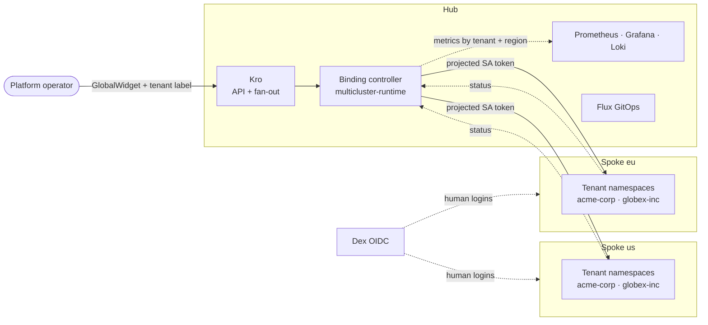
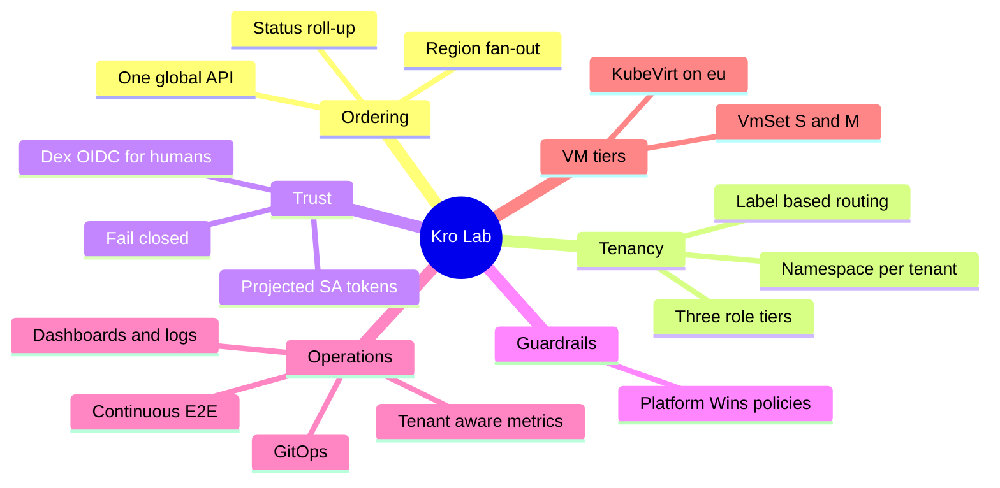
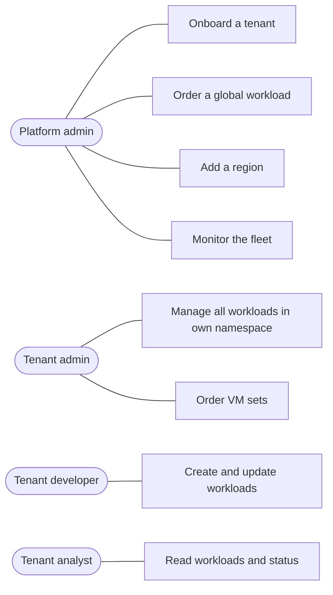

# Capabilities & Use Cases

Kro Lab is a hub-and-spoke, multi-tenant platform on local kind clusters. A customer's workload is ordered once on the **hub**; the platform places it on every requested **spoke**, isolates it per tenant, and reports status back.

Status: ✅ built and tested

## The platform at a glance

One order, many regions: the operator talks only to the hub. Controllers reach spokes with short-lived tokens; humans reach spokes through Dex.

## Capability map

## What each capability gives you

| # | Capability | You get | Proven by |
|---|-----------|---------|-----------|
| C1 | Global ordering ✅ | One `GlobalWidget` becomes one workload per region | tests 05, 06 |
| C2 | Region fan-out ✅ | `regions: [us, eu]` places a Widget on each spoke; status rolls up per region | tests 23, 30 |
| C3 | Tenant isolation ✅ | Tenant label → own namespace on every spoke | tests 13, 19 |
| C4 | Role tiers ✅ | admin / developer / analyst per tenant | test 20 |
| C5 | Split identity ✅ | Controllers: rotating SA tokens. Humans: Dex OIDC | tests 10, 11, 16, 17 |
| C6 | Guardrails ✅ | Non-admins cannot touch ClusterRoles, system namespaces or auth config | tests 18, 21 |
| C7 | Observability ✅ | Metrics per tenant and region, 3 dashboards, audit logs in Loki | tests 07, 09, 12, 15 |
| C8 | Continuous verification ✅ | Chainsaw suite every 2 min in-cluster, or `make validate` | test 08 |
| C9 | GitOps ✅ | Flux reconciles the hub charts (`make deploy-cd`) | manual |
| C10 | VM tiers ✅ | `VmSet` of S (1 vCPU, 1 GiB) or M (2 vCPU, 2 GiB) CirrOS VMs on KVM, per tenant; cloud-init Secret with the customer SSH key; console access by role | tests 24–29 |

## Use cases

Stories and flows for each: [User Stories](16-user-stories.md).

## Who can do what

| Role | Dex group | Widgets in own tenant namespace | Platform config |
|------|-----------|--------------------------------|-----------------|
| Platform admin | `dex:platform-admin` | everything | ClusterRoles, auth config |
| Tenant admin | `dex:<tenant>-admin` | all verbs | no |
| Tenant developer | `dex:<tenant>-developer` | get, list, watch, create, update, patch | no |
| Tenant analyst | `dex:<tenant>-analyst` | get, list, watch | no |

## Known limits

| Limit | Effect |
|-------|--------|
| No tenant identity on the hub | The operator creates `GlobalWidget`s on a tenant's behalf; tenants log in to spokes only |
| Widget binding controller only creates | Deleting a `GlobalWidget` leaves its Widgets running on the spokes. The VM controller does clean up: deleting a `VmSet` removes its VMs |
| Demo credentials | Dex static users and demo secrets; not for production |
| Widget status only for `default` | The widget status reconciler maps spoke Widgets to hub requests in the `default` namespace only; a `GlobalWidget` elsewhere still creates Widgets but its hub status stays empty |
| Local only | kind clusters on one host, self-signed TLS |
