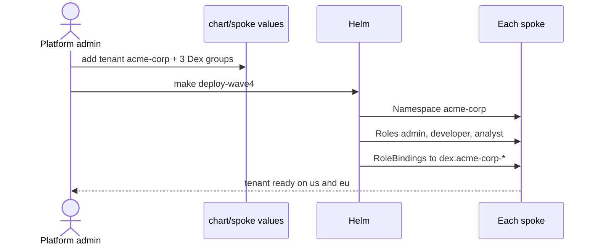
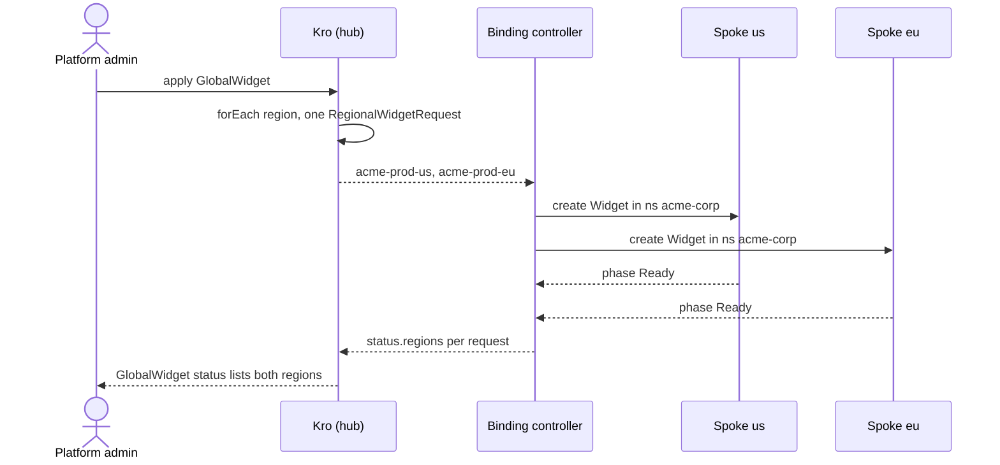
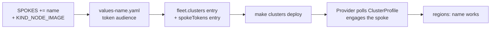
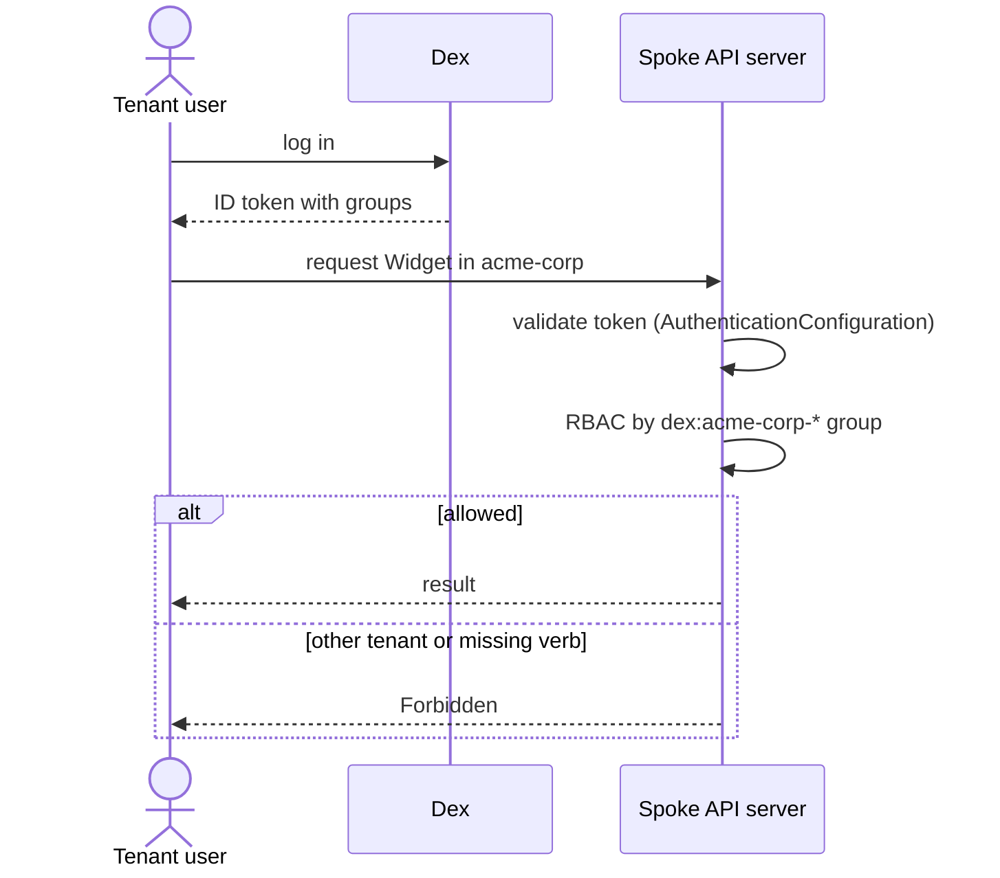
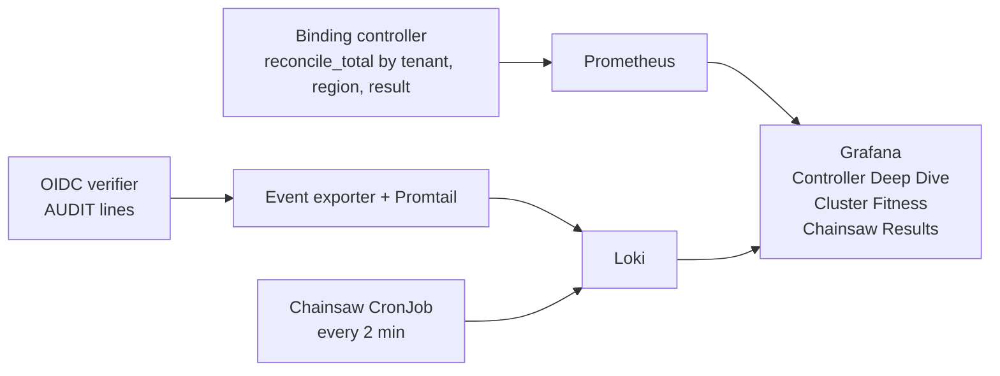
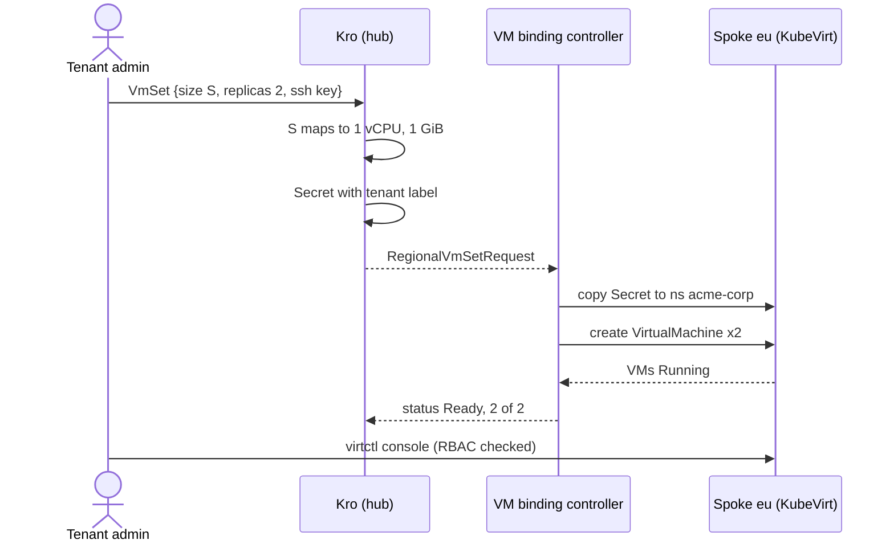

# User Stories

Capabilities are in [Capabilities & Use Cases](15-capabilities.md). This page shows how each role uses them.

✅ built and tested

## Stories

| ID | As a | I want to | So that | Status |
|----|------|-----------|---------|--------|
| S1 | Platform admin | onboard a tenant with one values entry | the tenant gets a namespace and three roles on every spoke | ✅ |
| S2 | Platform admin | order a workload for a tenant in several regions with one object | I do not repeat work per region | ✅ |
| S3 | Platform admin | add a region without changing controller code | the platform grows by configuration | ✅ |
| S4 | Platform admin | see reconcile rates and errors per tenant and region | I can spot a failing tenant or region | ✅ |
| S5 | Tenant admin | manage every workload in my namespace | my team is self-sufficient | ✅ |
| S6 | Tenant developer | create and update workloads but not delete them | I ship safely | ✅ |
| S7 | Tenant analyst | read workloads and status only | I can report without risk | ✅ |
| S8 | Tenant | be unable to see or touch another tenant | my data stays mine | ✅ |
| S9 | Tenant admin | order a set of 1–3 small VMs, size S or M | I get a cheap Linux machine to try things on | ✅ |
| S10 | Tenant developer | open a console on my VM | I can log in without any network exposure | ✅ (RBAC tested; see note) |

## S1 · Onboard a tenant

Add the tenant to `tenants:` in `chart/spoke/values.yaml` and its group to Dex, then `make deploy-wave4`.



## S2 · Order a global workload

```yaml
apiVersion: platform.example.com/v1alpha1
kind: GlobalWidget
metadata:
  name: acme-prod
  labels: { platform.example.com/tenant: acme-corp }
spec:
  regions: [us, eu]
  message: "hello"
```



## S3 · Add a region



No Go code changes. `eu` was added this way. Steps: [Phase 99](99-extending-to-eu-asia.md).

## S5–S8 · Day to day on a spoke



| Role | create | update | delete | read | other tenant |
|------|:------:|:------:|:------:|:----:|:------------:|
| admin | ✅ | ✅ | ✅ | ✅ | ❌ |
| developer | ✅ | ✅ | ❌ | ✅ | ❌ |
| analyst | ❌ | ❌ | ❌ | ✅ | ❌ |

Tests 19 and 20 simulate users with `--as` and `--as-group`; test 16 checks Dex discovery and token issue.

## S4 · Watch the platform



## S9–S10 · Order VMs

The operator creates the `VmSet` for the tenant, like a `GlobalWidget` (tenants have no hub identity). Scaling and deleting work too: replicas scale down highest index first, and deleting the `VmSet` removes its VMs and Secret from `eu`. Tests 24–29.



| Tier | vCPU | Memory |
|------|-----:|-------:|
| S | 1 | 1 GiB |
| M | 2 | 2 GiB |

Console access is enforced by RBAC (admin and developer yes, analyst and other tenants no; test 28). An interactive `virtctl console` session itself is not part of the automated suite.
