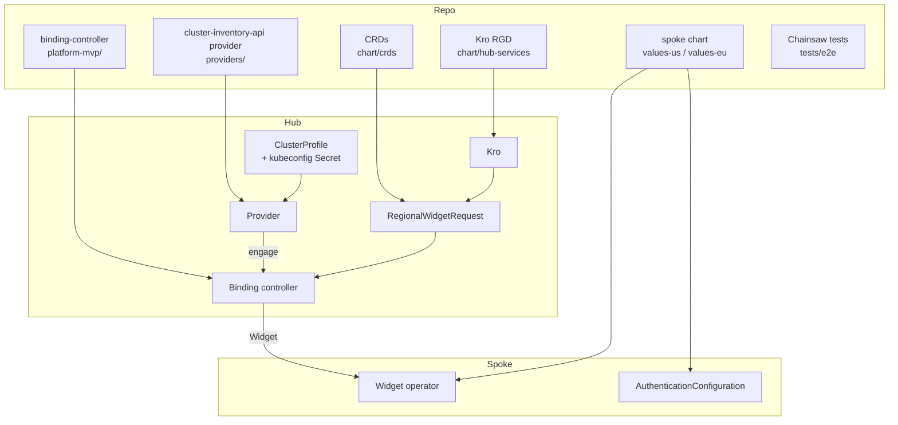
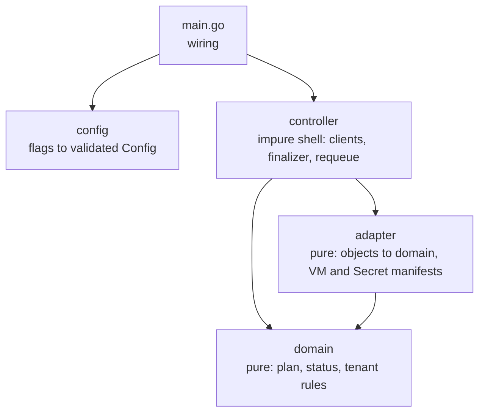
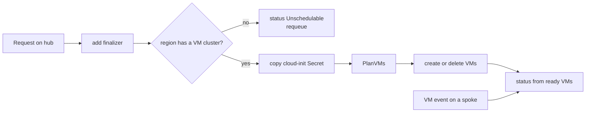
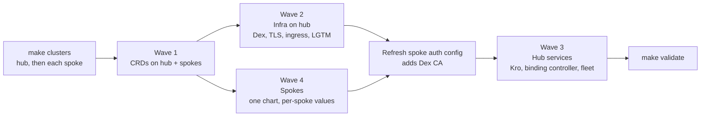
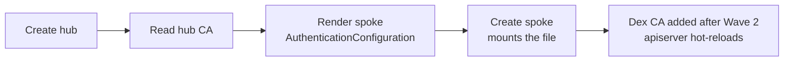
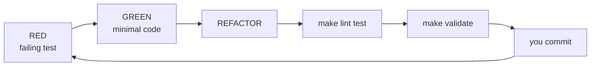

# How the Platform Is Built

Short tour of the moving parts, the deploy order, and the dev loop. Architecture detail is in the [overview](00-overview.md).

## Building blocks

Rule of thumb: **Kro owns the customer API**, **controllers own placement**, **the provider owns "which clusters exist"**.

## The VM binding controller

Built test first in layers. Decisions live in pure packages; only `controller` touches clusters.

Two watches share one manager: requests on the hub, VMs on every engaged spoke. The provider engages only clusters matching `--cluster-selector` (`offers-vms=true`), so `us` never sees VM work.

## Deploy order

`make deploy` builds images, creates clusters, then installs in waves.

## Why hub comes first

A spoke API server reads its auth config at boot, and that config needs the hub's CA. So clusters cannot start in parallel.

## Dev loop

- Unit tests first for pure logic; Chainsaw tests first for cluster behaviour.
- Config lives in Helm values and Makefile variables, never in code.

## Where things live

| Path | What |
|------|------|
| `platform-mvp/*` | Go services: binding-controller, vm-binding-controller, widget-operator, oidc-verifier, dex-auth-plugin |
| `providers/cluster-inventory-api` | Multicluster provider; `SetLabelSelector` limits which clusters a controller engages |
| `deploy/platform-mvp/chart/{crds,infrastructure,hub-services,spoke}` | The four Helm charts |
| `deploy/platform-mvp/kind` | Hub config, spoke template |
| `tests/e2e/tests/NN-*` | One Chainsaw test per directory |
| `.claude/plans`, `.claude/specs` | Local planning notes (gitignored) |

## Extension points

| To add | Touch |
|--------|-------|
| A region | `SPOKES`, node image, `values-<name>.yaml`, `fleet.clusters`, `spokeTokens` |
| A tenant | `tenants:` in spoke values, Dex group |
| A service (e.g. VmSet) | CRD + Kro RGD + a controller that engages a labelled subset of spokes |
