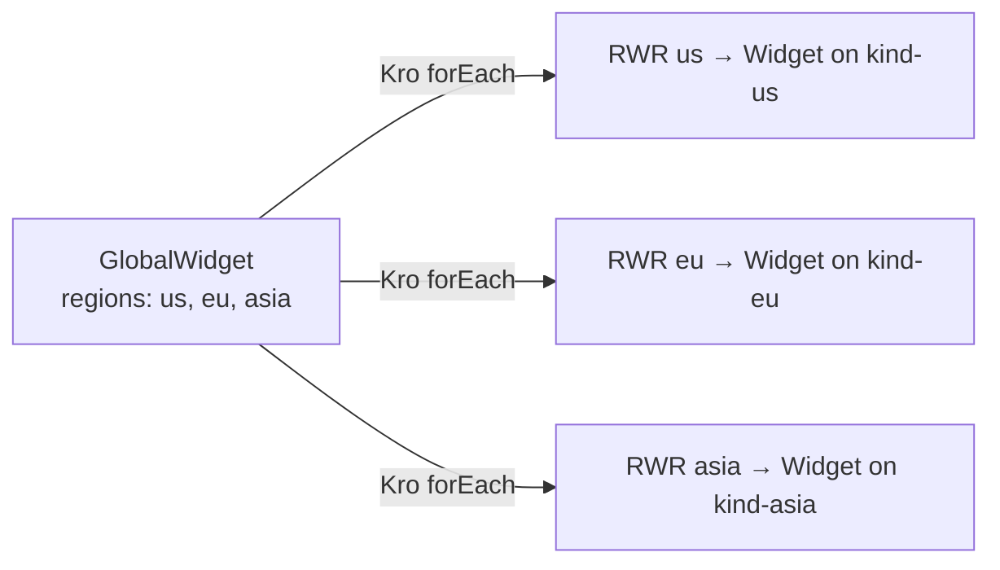
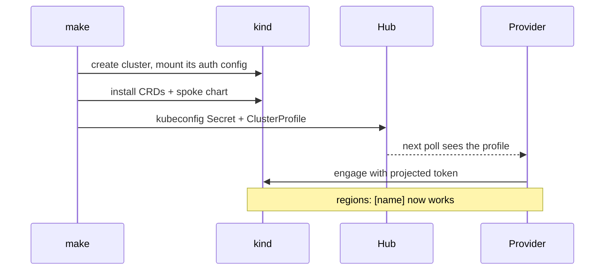

# Phase 99 — Adding a Region

A region is configuration, not code. `eu` was added this way; `asia` follows the same recipe.

## Steps

| # | Where | Change |
|---|-------|--------|
| 1 | `Makefile` | add the name to `SPOKES`; add `KIND_NODE_IMAGE_<name>` |
| 2 | `chart/spoke/values-<name>.yaml` | set `authConfiguration.hubIssuer.audience: homelab:<name>-spoke` |
| 3 | `chart/hub-services/values.yaml` | add a `fleet.clusters` entry (name, displayName, optional labels) |
| 4 | same file | add a `bindingController.spokeTokens` entry with the same audience and path `<name>-token` |
| 5 | `tests/e2e/.chainsaw.yaml` | add the cluster so tests can target it |
| 6 | shell | `make deploy` (or `make clusters deploy-wave1 deploy-wave4 deploy-wave3`) |

## No change needed

| Piece | Why |
|-------|-----|
| Kro RGD | `spec.regions` is a free list |
| Binding controller | resolves clusters with `mgr.GetCluster(region)` |
| Tenant routing | label → namespace works per spoke |
| Observability | one hub serves all regions |

## One catch

`RegionalWidgetRequest.spec.region` is an enum (`us`, `eu`, `asia`) in `chart/crds/templates/regionalwidgetrequest-crd.yaml`. A region with another name needs that enum extended.

## Verified for `eu`

- Test `23-eu-cluster-ready`: nodes Ready, `ClusterProfile eu` and `eu-kubeconfig` present.
- Test `30-globalwidget-eu`: `GlobalWidget{regions:[us,eu]}` for `acme-corp` produces a `Ready` Widget on both spokes and a per-region status on the hub.

## Per-region checklist

| Item | Needed |
|------|:------:|
| kind cluster with auth config mounted | yes |
| Spoke chart (widget operator, OIDC verifier, tenant RBAC, guardrails) | yes |
| `ClusterProfile` + `<name>-kubeconfig` Secret on hub | yes |
| Projected `<name>-token` in the binding controller | yes |
| Hub-side code or RGD change | no |
