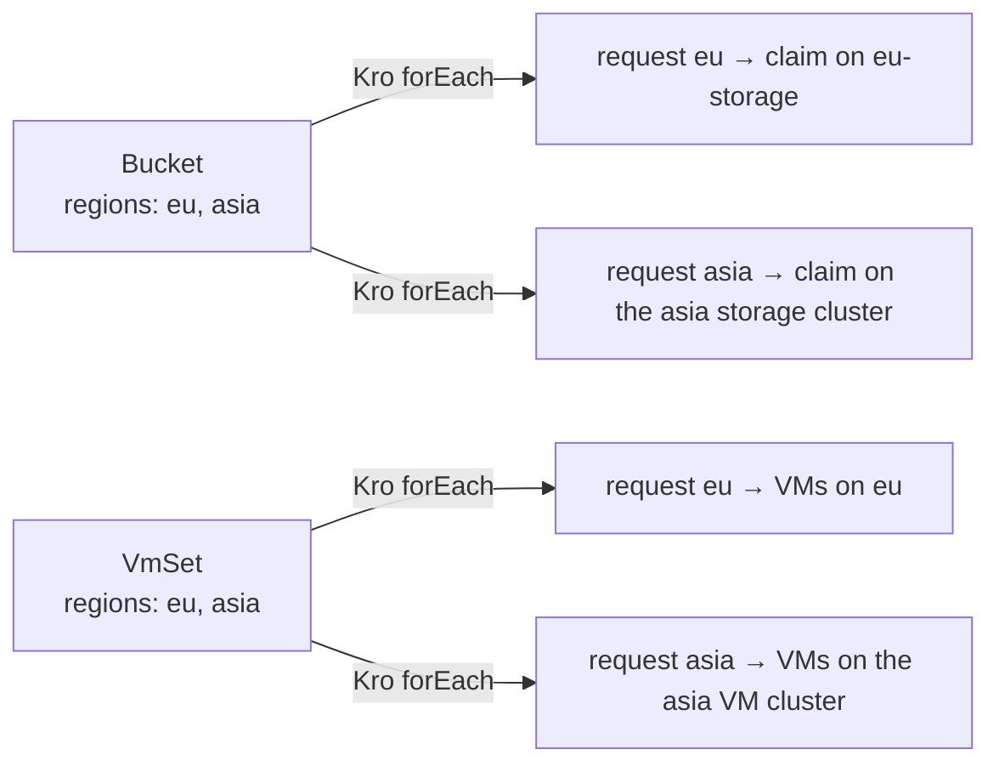
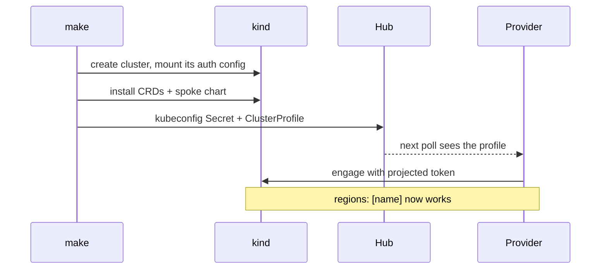

# Adding a region

A region, or a host for a service, is configuration, not code. It is a [`ClusterProfile`](fleet-inventory.md) with labels plus a spoke deployment; `eu` and `eu-storage` are registered this way, and `asia` follows the same recipe.

A region is served per service: `eu` has one cluster for VMs and one for storage, found by ClusterProfile labels.

## Steps

| # | Where | Change |
|---|-------|--------|
| 1 | `Makefile` | add the name to `SPOKES`; add `KIND_NODE_IMAGE_<name>` |
| 2 | `chart/spoke/values-<name>.yaml` | set `authConfiguration.hubIssuer.audience: homelab:<name>-spoke` |
| 3 | `chart/hub-services/values.yaml` | add a `fleet.clusters` entry: name, displayName and labels — `platform.example.com/region: <region>` plus `offers-vms` or `offers-object-storage` for the services it hosts |
| 4 | same file | add a `spokeTokens` entry (same audience, path `<name>-token`) to each controller that engages the spoke: `vmBindingController` and/or `bucketBindingController` |
| 5 | `tests/e2e/.chainsaw.yaml` | add the cluster so tests can target it |
| 6 | `Makefile` | for a VM or storage host also add it to `KUBEVIRT_SPOKES` or `ROOK_SPOKES` |
| 7 | shell | `make deploy` (or `make clusters deploy-wave1 deploy-wave4 deploy-wave3`) |

## No change needed

| Piece | Why |
|-------|-----|
| Kro RGDs | `spec.regions` is a free list |
| Binding controllers | the VM controller resolves by cluster name; the bucket controller by the `region` label |
| Tenant routing | label → namespace works per spoke |
| Observability | one hub serves all regions |

## One catch

`spec.region` is an enum (`us`, `eu`, `asia`) in `chart/crds/templates/regionalvmsetrequest-crd.yaml` and `regionalbucketrequest-crd.yaml`. A region with another name needs both enums extended.

## Verified for `eu`

- Test `17-eu-cluster-ready`: nodes Ready, `ClusterProfile eu` carries `offers-vms`, `eu-kubeconfig` present.
- Test `24-eu-storage-cluster-ready`: every ClusterProfile has a `region` label; `eu-storage` serves region `eu` with `offers-object-storage`.
- Tests `19`–`23` (VMs) and `26`–`29` (buckets) run through the same two clusters.

## Per-region checklist

| Item | Needed |
|------|:------:|
| kind cluster with auth config mounted | yes |
| Spoke chart (OIDC verifier, tenant RBAC, guardrails) | yes |
| KubeVirt or Rook/Ceph, if it hosts a service | per service |
| `ClusterProfile` + `<name>-kubeconfig` Secret on hub | yes |
| Projected `<name>-token` in each controller that engages it | yes |
| Hub-side code or RGD change | no |
