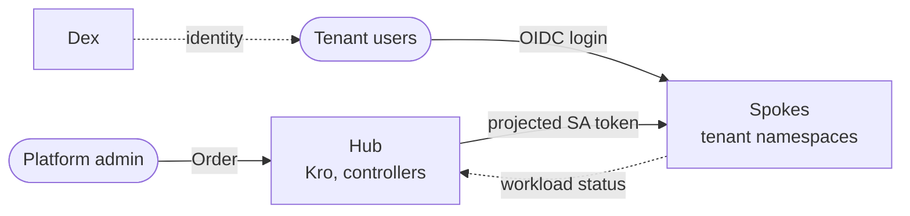
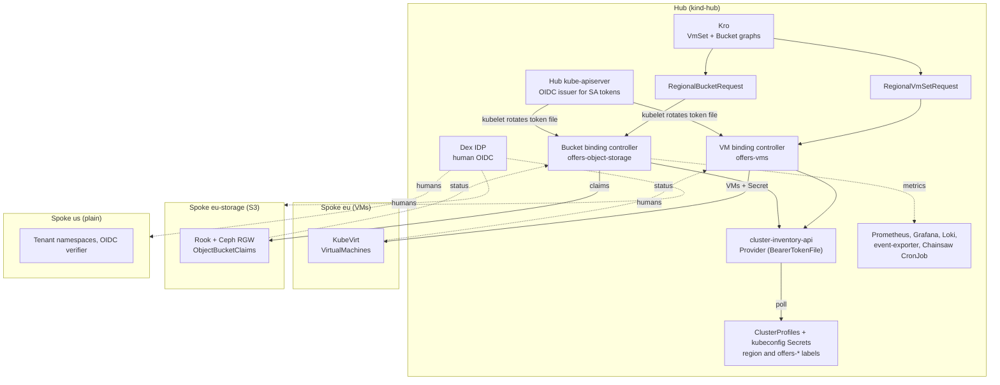
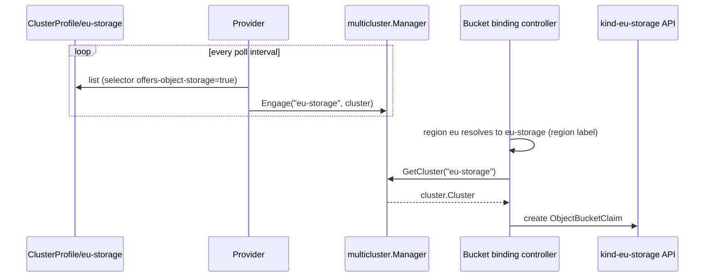
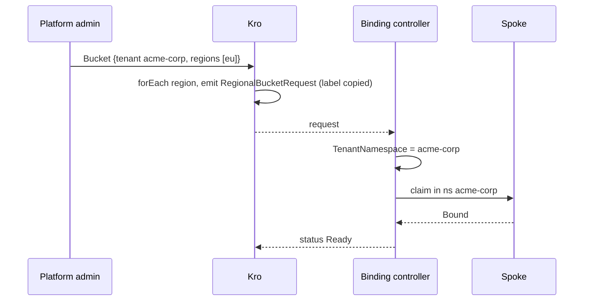

# Architecture

## Overview

The platform lets an operator offer self-service infrastructure to tenants from a single control plane. A tenant's **order** is declared once on a **hub** cluster. The platform places it on the appropriate **spoke** cluster, isolates it per tenant, and reports status back to the hub.

Two services are offered:

| Service | Order | Hosted on | Reference |
|---------|-------|-----------|-----------|
| Virtual machines | `VmSet` — 1–3 VMs, tier S or M | spoke `eu` ([KubeVirt](https://kubevirt.io/user-guide/) on KVM) | [Virtual machines](virtual-machines.md) |
| Object storage | `Bucket` — tier S or M with a quota | spoke `eu-storage` ([Rook](https://rook.io/docs/rook/latest-release/Getting-Started/intro/) with the [Ceph RADOS Gateway](https://docs.ceph.com/en/latest/radosgw/)) | [Object storage](object-storage.md) |

The design vocabulary — orders, tiers, placement requests, bounded contexts — is defined in the [Domain model](domain-model.md).

## Design principles

1. **Scale out by configuration.** A region, or a new service host, is a `ClusterProfile` plus a kubeconfig Secret plus a spoke deployment. Controllers discover clusters through labels and the multicluster provider; no per-region branches exist in code. See [Adding a region](adding-a-region.md).
2. **Tenancy is data, not schema.** A tenant is a label value, not a field in any API. Onboarding a tenant adds a namespace and three role bindings in Helm values; controllers and resource graphs are unchanged. See [Multi-tenancy](multi-tenancy.md).
3. **Split identity, least privilege, fail closed.** Controllers authenticate to spokes with audience-bound, kubelet-rotated [projected service account tokens](https://kubernetes.io/docs/concepts/storage/projected-volumes/#serviceaccounttoken); humans authenticate through [Dex](https://dexidp.io/docs/) (OIDC). Each controller may write only its own resource kind in tenant namespaces. A missing token fails the request instead of falling back to a client certificate. See [Identity and trust](identity-and-trust.md).
4. **One controller per service.** Each service has its own request type, controller and spoke permissions, and engages only the clusters that offer it.

## System context

Tenants have no identity on the hub. The platform admin places orders on their behalf; tenants sign in to spokes only, where RBAC limits them to their own namespace.

## Containers

Every spoke also carries the baseline from the spoke chart: tenant namespaces and roles, an [`AuthenticationConfiguration`](https://kubernetes.io/docs/reference/access-authn-authz/authentication/#using-authentication-configuration) (hub issuer for controllers, Dex for humans), the OIDC verifier, and [admission guardrails](admission-guardrails.md).

## Multi-cluster runtime

Controllers use [multicluster-runtime](https://github.com/kubernetes-sigs/multicluster-runtime), which extends [controller-runtime](https://github.com/kubernetes-sigs/controller-runtime) to reconcile across many clusters. The repository provides a `multicluster.Provider` backed by the [Cluster Inventory API](https://github.com/kubernetes-sigs/cluster-inventory-api) (`providers/cluster-inventory-api`):

1. **Discovery** — lists `ClusterProfile` objects, optionally only those matching a label selector.
2. **Engagement** — reads each `<name>-kubeconfig` Secret and engages the cluster with the manager.
3. **Change detection** — a cluster key derived from server URL and CA data; token changes are not a change, because tokens are read from a file.
4. **Delegation** — controllers call `GetCluster(name)` for a client scoped to that spoke.

See [Fleet inventory](fleet-inventory.md) for the cluster model.

## Order lifecycle

## Components

| Component | Cluster | Source | Purpose |
|-----------|---------|--------|---------|
| [Kro](https://kro.run/docs/overview/) | hub | upstream | Resource graph engine; expands `VmSet` and `Bucket` into regional requests |
| VmSet and Bucket graphs | hub | `chart/hub-services/templates/{vmset,bucket}-rgd.yaml` | Customer APIs; tiers rendered from Helm values |
| ClusterProfile objects | hub | `chart/hub-services/templates/fleet.yaml` | Declare spokes with `region` and `offers-*` labels |
| cluster-inventory-api Provider | hub | `providers/cluster-inventory-api/` | Discovers and engages spokes; token via `BearerTokenFile` |
| VM binding controller | hub | `platform-mvp/vm-binding-controller/` | `RegionalVmSetRequest` → KubeVirt VMs and Secret |
| Bucket binding controller | hub | `platform-mvp/bucket-binding-controller/` | `RegionalBucketRequest` → `ObjectBucketClaim`; exposes metrics |
| Hub kube-apiserver | hub | Kubernetes | OIDC issuer for controller tokens |
| [Dex](https://dexidp.io/docs/) | hub | Helm subchart | OIDC for humans |
| [cert-manager](https://cert-manager.io/docs/), [ingress-nginx](https://kubernetes.github.io/ingress-nginx/) | hub | Helm subcharts | TLS and external access to Dex and Grafana |
| [Prometheus](https://prometheus-operator.dev/docs/developer/getting-started/), [Grafana](https://grafana.com/docs/grafana/latest/), [Loki](https://grafana.com/docs/loki/latest/) | hub | Helm subcharts | Metrics, dashboards, logs ([Observability](observability.md)) |
| Event exporter | hub | `chart/infrastructure/templates/event-exporter.yaml` | Kubernetes events to Loki |
| [Chainsaw](https://kyverno.github.io/chainsaw/latest/) CronJob | hub | `chart/infrastructure/templates/chainsaw-cronjob.yaml` | Continuous verification of a test subset ([Testing](testing.md)) |
| KubeVirt | spoke `eu` | `crds/kubevirt-operator.yaml`, `chart/spoke/templates/kubevirt.yaml` | Virtual machines on KVM |
| Rook and Ceph RGW | spoke `eu-storage` | `deploy/platform-mvp/rook/` | S3 object storage; `ceph-bucket` StorageClass |
| OIDC verifier | every spoke | `platform-mvp/oidc-verifier/` | Validates Dex JWTs; emits audit logs |
| AuthenticationConfiguration | every spoke | `chart/spoke/templates/auth-config.yaml` | Hub issuer (controllers) and Dex issuer (humans) |
| ValidatingAdmissionPolicy | every spoke | `chart/spoke/templates/admission-guardrails.yaml` | Guardrails for ClusterRoles, system namespaces and auth config |

## Key decisions

1. **Hub and spokes, not a mesh.** The hub is the single source of truth; spokes are consumers.
2. **Split identity.** Controllers use projected service account tokens with the hub API server as issuer; humans use Dex.
3. **No long-lived spoke credentials.** The provider builds REST configs with `BearerTokenFile`; the kubelet rotates tokens roughly hourly.
4. **Declarative cluster inventory.** Controllers select clusters by label; the resource graphs and the provider need no change for a new region or service host.
5. **Selectors keep services apart.** `offers-vms` and `offers-object-storage` keep VM work off `us` and storage work off `eu`.
6. **Namespace-based tenant isolation.** Routing is by the tenant label; tenants only read what the platform created for them.
7. **Continuous verification.** A CronJob runs a subset of the test suite every two minutes and pushes results to Loki.
8. **Platform-wins guardrails.** Admission policies stop non-platform-admin identities from changing ClusterRoles, system namespaces or the authentication configuration.

## Further reading

- [Domain model](domain-model.md), [Ordering API](ordering-api.md), [Placement controllers](placement-controllers.md)
- [Build and deploy](build-and-deploy.md), [Local topology](local-topology.md)
- [Identity and trust](identity-and-trust.md), [Admission guardrails](admission-guardrails.md)
