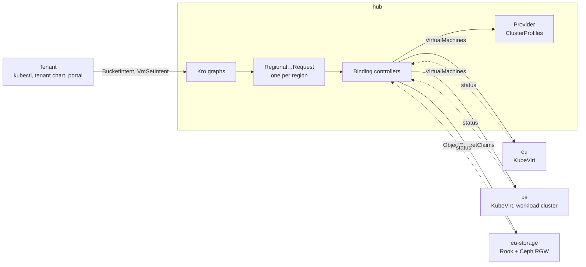
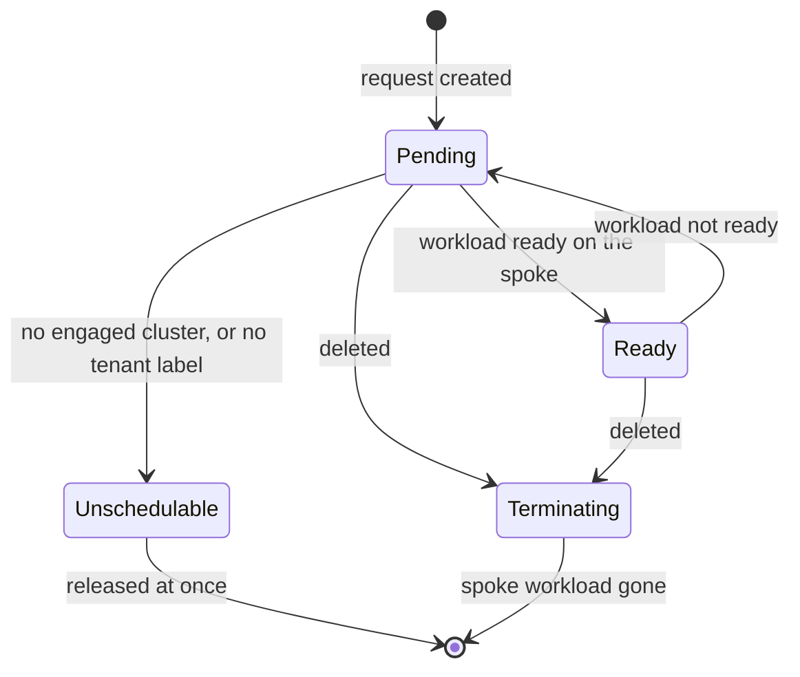
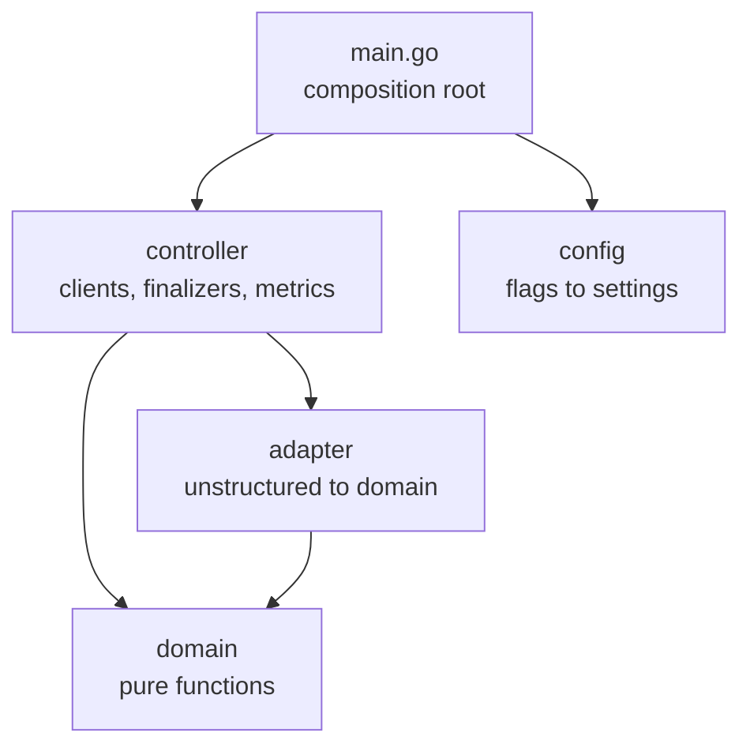
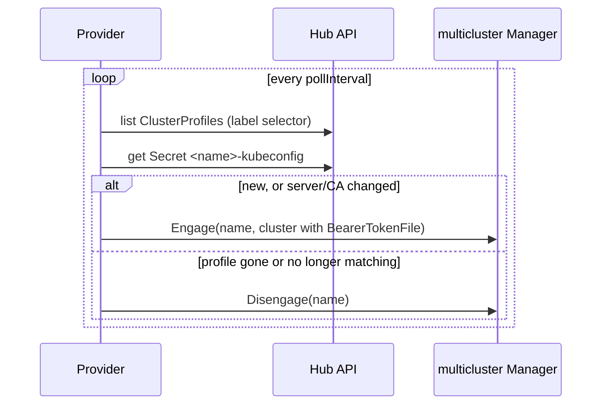

# Architecture

A tenant declares an **intent** once on the **hub**. Kro expands it into one **placement request** per region; a binding controller places each request on the **spoke** that offers the service and copies status back. Four kind clusters run it: `hub`, `eu` and `us` (VMs) and `eu-storage` (S3).



| Term | Meaning | In code |
|------|---------|---------|
| Tenant | A customer; its hub namespace is its account | label `platform.example.com/tenant` |
| Tenant principal | A human in a Dex group `<tenant>-<role>`, or the tenant's workload identity | Dex groups, `platform-provisioner` |
| Intent | What a tenant wants, in one or more regions | `BucketIntent`, `VmSetIntent` |
| Tier | A named size, immutable per intent | `spec.size`: `S`, `M` |
| Placement request | An intent narrowed to one region, with numbers instead of a tier | `RegionalBucketRequest`, `RegionalVmSetRequest` |
| Service host | A spoke offering a service | `offers-vms`, `offers-object-storage` |
| Ready | Every region's request is Ready | Kro `readyWhen` |

## Intent: a Kro graph

Each service is one `ResourceGraphDefinition` in `chart/hub-services/templates/`. The bucket graph, trimmed:

```yaml
spec:
  schema:
    kind: BucketIntent
    spec:
      regions: '[]string | minItems=1'
      size: 'string | default="S" enum="M,S" immutable=true'      # keys of bucket.tiers
    status:
      regions: ${regionalBucketRequest.map(r, r.status)}
  resources:
    - id: regionalBucketRequest
      forEach:
        - region: "${schema.spec.regions}"                          # fan-out
      readyWhen:
        - ${each.?status.regions.orValue([]).size() > 0 && each.status.regions.all(x, x.phase == "Ready")}
      template:
        kind: RegionalBucketRequest
        metadata:
          name: "${schema.metadata.name}-${region}"
          labels:
            platform.example.com/tenant: "${schema.metadata.namespace}"   # nobody can set it
        spec:
          region: "${region}"
          maxSize: ${ {"S":{...},"M":{...}}[schema.spec.size].maxSize }
```

- **Fan-out:** one request per region, named `<intent>-<region>`.
- **Tenant label:** copied from the namespace; the schema has no tenant field.
- **Tiers:** Helm values render a CEL map; its keys are the `size` enum. Requests carry numbers, so controllers never learn what a tier is.
- **Validation at the door:** empty `regions`, unknown size, a size change, replicas outside `1..3` and a malformed SSH key are rejected.
- **Ready means usable:** without `readyWhen`, Kro calls an intent Ready once its requests exist.
- **Status:** each request's whole status is mapped, so it nests: `status.regions[0].regions[0].phase`.

The request CRDs ship in wave 1 (`chart/crds`) because Kro resolves templates through discovery; the graphs follow in wave 3. Kro's ClusterRole must list every kind it generates (`kro-rbac.yaml`).

## Placement: one controller per service

| | VM binding controller | Bucket binding controller |
|---|---|---|
| Code | `platform-mvp/vm-binding-controller/` | `platform-mvp/bucket-binding-controller/` |
| Watches on the hub | `RegionalVmSetRequest` | `RegionalBucketRequest` |
| Creates on the spoke | `VirtualMachine` × replicas, cloud-init `Secret` | `ObjectBucketClaim` |
| Engages | `offers-vms=true` | `offers-object-storage=true` |
| Region to cluster | cluster named like the region | cluster whose `region` label matches |
| Finalizer | `platform.example.com/vm-cleanup` | `platform.example.com/bucket-cleanup` |



A second reconciler watches the workloads on every engaged spoke and recomputes the owning request, so status follows the spoke without polling; a requeue every 30 s (`requeueInterval`) repairs drift. A delete waits until the spoke confirms the workload is gone.

The rules are pure functions in each controller's `domain` package, with no Kubernetes imports:

```go
// bucket-binding-controller/domain/domain.go
func ResolveCluster(region, regionLabel string, profiles []Profile) (string, bool) {
	var names []string
	for _, p := range profiles {
		if p.Labels[regionLabel] == region {
			names = append(names, p.Name)
		}
	}
	if len(names) == 0 {
		return "", false // the request becomes Unschedulable
	}
	sort.Strings(names)
	return names[0], true
}

func TenantNamespace(labels map[string]string) (tenant string, ok bool) {
	tenant = labels[LabelTenant] // no label: Unschedulable, nothing is created
	return tenant, tenant != ""
}
```



KubeVirt and Rook objects stay `unstructured` in the `adapter` package; their types never reach `domain`.

## Fleet: which clusters exist

Each spoke is a `ClusterProfile` on the hub plus a `<name>-kubeconfig` Secret, from `fleet.clusters` in the hub-services values:

```yaml
apiVersion: multicluster.x-k8s.io/v1alpha1
kind: ClusterProfile
metadata:
  name: eu-storage
  labels:
    platform.example.com/region: eu
    platform.example.com/offers-object-storage: "true"
```

| Profile | `region` | Offers |
|---------|----------|--------|
| `us` | us | VMs |
| `eu` | eu | VMs |
| `eu-storage` | eu | object storage |

The provider (`providers/cluster-inventory-api/provider.go`) implements multicluster-runtime's `Provider`. Every 10 s (`pollInterval`) it lists the profiles that match the controller's label selector and engages or disengages clusters:



The token comes from a file the kubelet rotates, so a rotation changes nothing; the provider removes any client certificate, so a missing token fails instead of falling back. Adding a region is data, not code ([Operations](operations.md#adding-a-region)).

**Proven by:** 03-05 (profiles and labels), 16 and 22 (fan-out, tiers, validation), 17 and 23 (lifecycle, cleanup), 20 and 26 (Unschedulable, no tenant label), 25 (tenant routing), 33 (`readyWhen`). Unit tests: `make test`.
