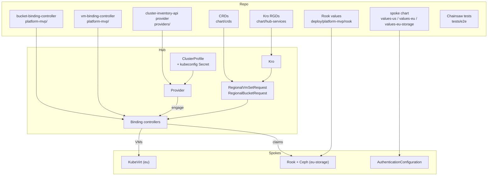
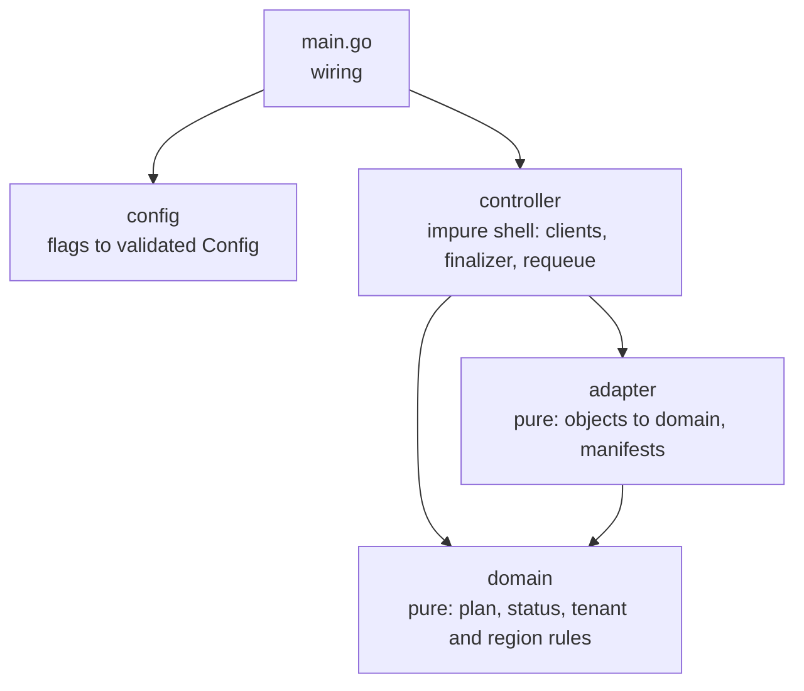
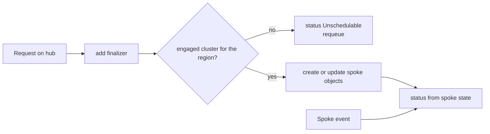
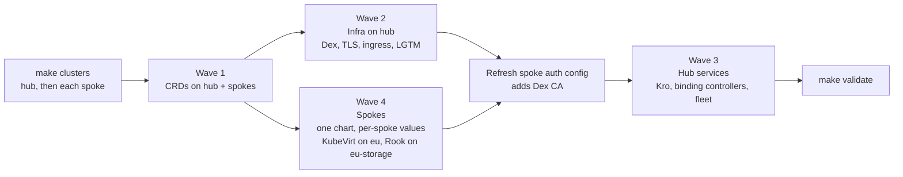
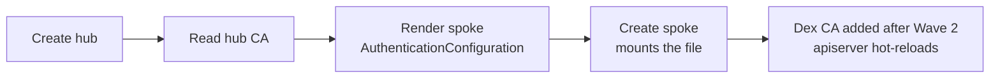
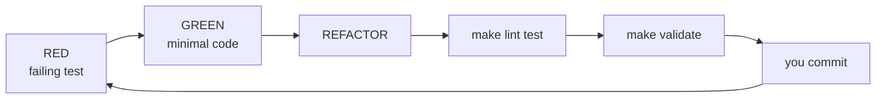

# Build and deploy

How the platform is built from this repository, the order in which it is deployed, and the development loop. The system design is in the [Architecture](architecture.md); the vocabulary in the [Domain model](domain-model.md). Clusters are [kind](https://kind.sigs.k8s.io/) clusters and every component is installed with [Helm](https://helm.sh/docs/) charts; [Flux](https://fluxcd.io/flux/) can take over the hub charts (`make deploy-cd`).

## Building blocks

Rule of thumb: **Kro owns the customer API**, **controllers own placement**, **the provider owns "which clusters exist"**.

## The binding controllers

Both are built test first in the same layers. Decisions live in pure packages; only `controller` touches clusters.

Two watches share one manager: requests on the hub, VMs or claims on every engaged spoke. The provider engages only clusters matching `--cluster-selector` (`offers-vms=true` or `offers-object-storage=true`), so `us` never sees service work. Details: [Placement controllers](placement-controllers.md).

## Deploy order

`make deploy` builds the images and creates the clusters, loads the images into kind (no registry, no push; the charts use `pullPolicy: IfNotPresent`), then installs in waves.

## Why hub comes first

A spoke API server reads its auth config at boot, and that config needs the hub's CA. So clusters cannot start in parallel.

## Dev loop

- Unit tests first for pure logic; Chainsaw tests first for cluster behaviour.
- Config lives in Helm values and Makefile variables, never in code.

## Where things live

| Path | What |
|------|------|
| `platform-mvp/*` | Go services: vm-binding-controller, bucket-binding-controller, oidc-verifier |
| `providers/cluster-inventory-api` | Multicluster provider; `SetLabelSelector` limits which clusters a controller engages |
| `deploy/platform-mvp/chart/{crds,infrastructure,hub-services,spoke}` | The four Helm charts |
| `deploy/platform-mvp/kind` | Hub config, spoke templates (plain and storage) |
| `deploy/platform-mvp/rook` | Rook operator and Ceph cluster values for `eu-storage` |
| `tests/e2e/tests/NN-*` | One Chainsaw test per directory |
| `.claude/plans`, `.claude/specs` | Local planning notes (gitignored) |

## Extension points

| To add | Touch |
|--------|-------|
| A region | `SPOKES`, node image, `values-<name>.yaml` (audience), `fleet.clusters` (`region` label), the serving controller's `spokeTokens` |
| A tenant | `tenants:` in spoke values, Dex group |
| A service (VmSet, Bucket) | Request CRD + Kro RGD + a controller (copy the layers) that engages an `offers-<service>` subset of spokes + spoke RBAC |
