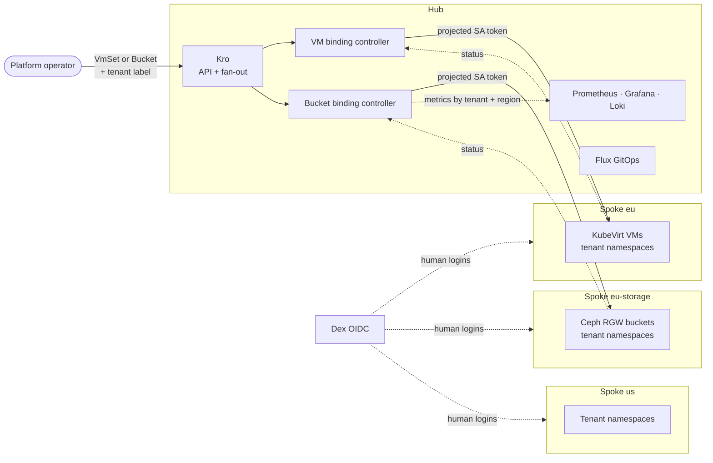
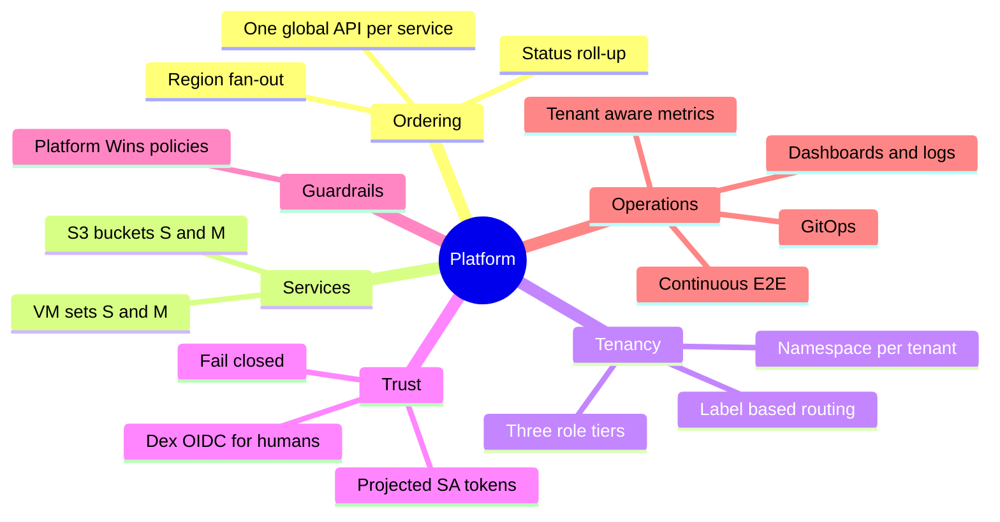
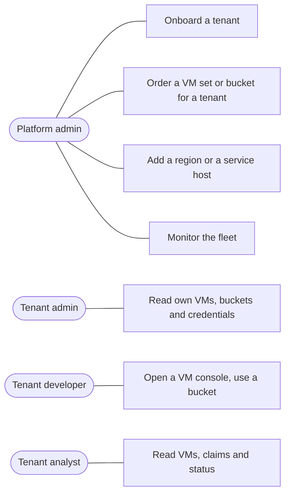

# Capabilities

The platform is a hub-and-spoke, multi-tenant control plane that runs on local [kind](https://kind.sigs.k8s.io/) clusters. A customer's order is placed once on the **hub**; the platform runs it on the right **spoke**, isolates it per tenant, and reports status back.

## The platform at a glance

One order, one place to look: the operator talks only to the hub. Controllers reach spokes with short-lived tokens; humans reach spokes through Dex.

## Capability map

## What each capability gives you

| # | Capability | You get | Proven by |
|---|-----------|---------|-----------|
| C1 | Global ordering | One `VmSet` or `Bucket` becomes one request per region | tests 19, 26 |
| C2 | Region fan-out | `regions: [eu, us]` creates a request per region; status per region, `Unschedulable` where a service is not offered | tests 26, 23, 29 |
| C3 | Tenant isolation | Tenant label → own namespace on every spoke; no cross-tenant visibility | tests 10, 15 |
| C4 | Role tiers | admin / developer / analyst per tenant, scoped to what the spoke hosts | tests 22, 28 |
| C5 | Split identity | Controllers: rotating SA tokens. Humans: Dex OIDC | tests 07, 08, 12, 13 |
| C6 | Guardrails | Non-admins cannot touch ClusterRoles, system namespaces or auth config | tests 14, 16 |
| C7 | Observability | Metrics per tenant and region, 3 dashboards, audit logs in Loki | tests 04, 06, 09, 11 |
| C8 | Continuous verification | Chainsaw subset every 2 min in-cluster, full suite via `make validate` | test 05 |
| C9 | GitOps | Flux reconciles the hub charts (`make deploy-cd`) | manual |
| C10 | VM tiers | `VmSet` of S (1 vCPU, 1 GiB) or M (2 vCPU, 2 GiB) CirrOS VMs on KVM, per tenant; cloud-init Secret with the customer SSH key; console by role | tests 17–23 |
| C11 | S3 buckets | `Bucket` of S (1 GiB, 10 000 objects) or M (10 GiB, 100 000 objects) on Ceph RGW, per tenant; quota enforced by Ceph; credentials only for admin and developer | tests 24–29 |

## Use cases

Scenarios and flows for each: [Use cases](use-cases.md).

## Who can do what

Tenants never create or delete VMs or buckets on a spoke; the platform does, from the hub order.

| Role | Dex group | VMs in own namespace | Buckets in own namespace | Platform config |
|------|-----------|---------------------|--------------------------|-----------------|
| Platform admin | `dex:platform-admin` | everything | everything | ClusterRoles, auth config |
| Tenant admin | `dex:<tenant>-admin` | read + console | read claim and endpoint, read credentials | no |
| Tenant developer | `dex:<tenant>-developer` | read + console | read claim and endpoint, read credentials | no |
| Tenant analyst | `dex:<tenant>-analyst` | read | read claim and endpoint | no |

## Known limits

| Limit | Effect |
|-------|--------|
| No tenant identity on the hub | The operator creates `VmSet`s and `Bucket`s on a tenant's behalf; tenants log in to spokes only |
| S3 endpoint is cluster-internal | Buckets are reachable from inside `eu-storage`, not from outside |
| One Ceph OSD, pool size 1 | Lab storage; data is not replicated |
| Deleting an order needs the spoke | A delete stays pending until the spoke confirms cleanup; if the spoke refuses the controller, fix that and restart the controller |
| `status.regions` nests one level | `regions[0].regions[0]`, because Kro maps each request's whole status |
| `region` is a CRD enum (`us`, `eu`, `asia`) | A region with another name needs the enum extended |
| Demo credentials | Dex static users and demo secrets; not for production |
| Local only | kind clusters on one host, self-signed TLS |
