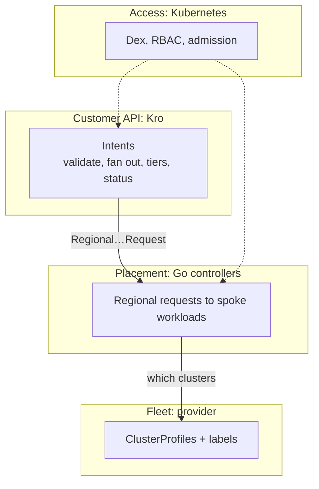

# Decisions and limits

Why the lab is built this way, what each choice costs, and where it stops. Each decision names the test that shows it working; limits marked *observed* were seen on this lab but no test asserts them.



## Decisions

| Decision | Gives | Costs | Shown by |
|----------|-------|-------|----------|
| **Kro is the customer API.** A 35-line graph per service | fan-out, tiers as values, generated CRD with validation, status roll-up, no Go | Kro is `v1alpha1`; status nests one level; Kro's ClusterRole must list each kind; a removed graph leaves its CRD | 16, 22 |
| **Intent and request are separate CRDs** | controllers never learn tiers; Kro stays thin | two contracts; `region` is an enum in the request CRDs | 16, 22 |
| **Placement in Go, one controller per service** | CEL cannot place work; each controller has its own selector and spoke rights | two binaries; one replica, no leader election | 17, 23 |
| **multicluster-runtime with a ClusterProfile provider** | one binary reconciles N clusters; a region is configuration | alpha APIs (`v0.20.4-alpha.7`, `v1alpha1`); the provider polls every 10 s; each spoke needs a token volume and spoke RBAC | 03-05, 17, 20, 26 |
| **A tenant is a hub namespace** | the label comes from the namespace; onboarding is a `tenants.yaml` entry | logical isolation only; kind enforces no NetworkPolicy | 25, 29 |
| **Admission decides who, RBAC decides which verb** | even `system:masters` cannot write a tenant's intent | `failurePolicy: Fail`; support staff cannot fix an intent, only offboard | 14, 29 |
| **Projected tokens for controllers, Dex for people** | a stolen login carries no controller rights; no stored controller secret | a spoke trusts two issuers | 12, 13 |
| **One Dex client for kubectl and the portal** | one login works on every cluster; RBAC there decides | a portal token is a cluster token everywhere | 30, 34 |
| **Workload identity by token exchange** | a `us` workload creates intents with no stored secret | Dex is in every exchange | 27, 28 |
| **The portal forwards the user's token** | no second authorization model | a generic Kubernetes UI; tenants read every CRD's schema | 34 |
| **Measure timestamps, not counts** | creation and Ready times stay true after deletes | no count of live intents by state | 33 |
| **A tenant chart for the order** | buckets and VM sets in one file, applied with the tenant's login | `helm template` plus `kubectl`; Helm keeps no release | 31 |

The `readyWhen` line is the clearest example of a cost: without it Kro calls an intent Ready once its requests exist, even when a region is `Unschedulable`.

```yaml
readyWhen:
  - ${each.?status.regions.orValue([]).size() > 0 && each.status.regions.all(x, x.phase == "Ready")}
```

## Limits

| Limit | Effect | Basis |
|-------|--------|-------|
| One Ceph OSD, pool size 1 | data is not replicated | config |
| S3 is plain HTTP on a host port | no TLS on `S3_NODE_PORT` | 31 |
| The CirrOS guest's SSH server is old | RSA keys only; `ssh` needs `HostKeyAlgorithms` and `PubkeyAcceptedAlgorithms` widened | 31 |
| `virtctl ssh` drops `--kubeconfig` and `--context` in its proxy command | use `ssh` with a `virtctl port-forward` ProxyCommand | observed |
| A delete needs the spoke | it waits until the spoke confirms cleanup | 17, 23 |
| A VM region is one cluster, named like the region | a second VM cluster in a region needs a label lookup like the bucket controller's | code |
| The VM controller may get and delete any Secret in a tenant namespace | RBAC cannot name Secrets before they exist; on `us` that includes workload Secrets | 19 |
| Dex ignores the audience of the token it exchanges | any token `us` signs is exchangeable; only `platform-provisioner` has rights | observed |
| The portal logs in per cluster | Dex keeps no session | 34 |
| Tenants cannot list namespaces | each sets its namespace once in the portal | 34 |
| Headlamp reads its settings at start | restart it after changing its OIDC Secret or spoke kubeconfig | observed |
| Restarting Dex locks Dex users out for 1 to 5 minutes | API servers cache its signing keys; controllers are unaffected | observed |
| Series of deleted intents persist until the operator restarts | adoption counts creations in a window | 33 |
| The Kro plugin is `0.1.0-alpha`, fetched at pod start | offline, the portal runs without it | observed |
| Satisfaction and cost per tenant are not measured | no feedback source | — |
| Demo credentials, one host | static Dex users, self-signed TLS | config |
