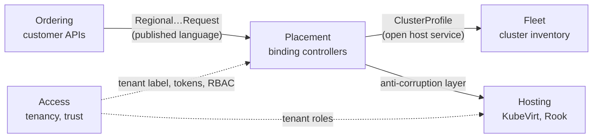
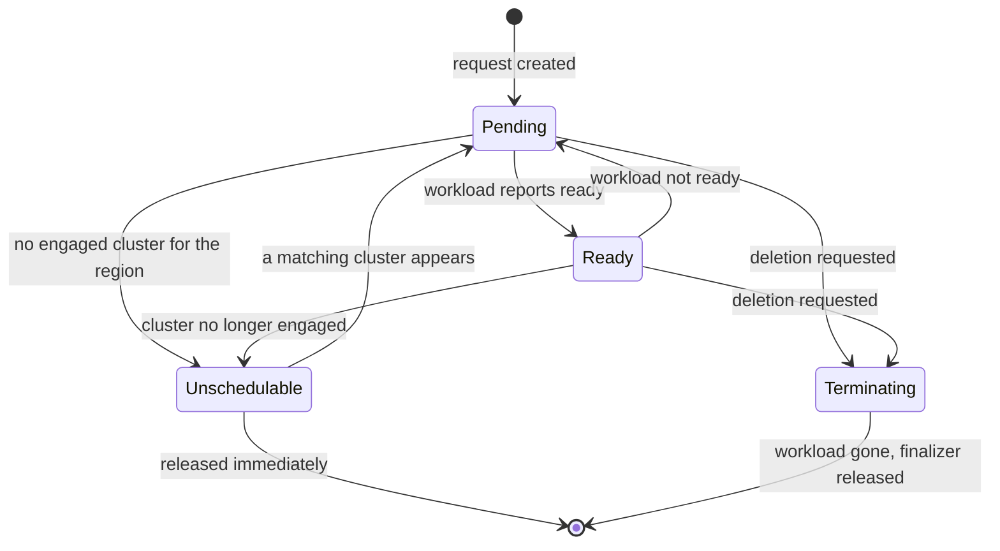
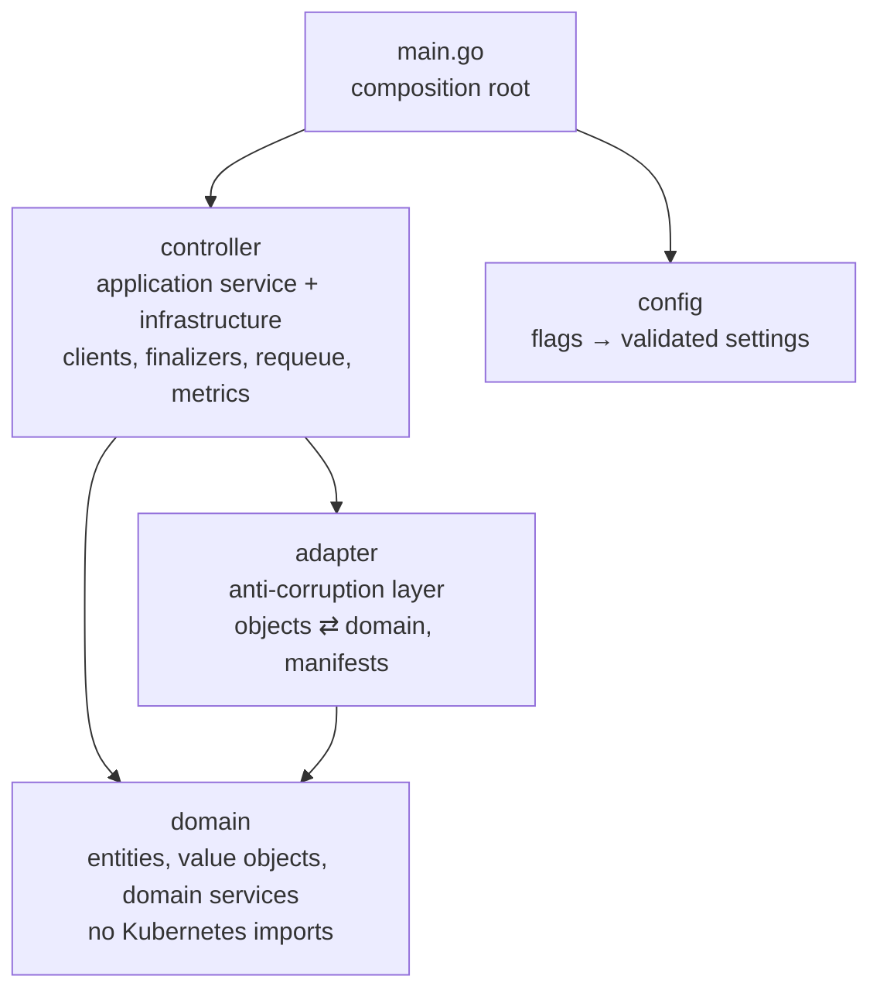

# Domain model

This document defines the ubiquitous language of the platform and its strategic design: bounded contexts, aggregates, domain services and the layering that keeps the domain independent of Kubernetes. It follows [domain-driven design](https://martinfowler.com/bliki/DomainDrivenDesign.html) vocabulary.

## Ubiquitous language

The same terms are used in code, APIs, metrics and documentation.

| Term | Meaning | Representation |
|------|---------|----------------|
| **Tenant** | A customer organization. Owns a namespace of the same name on every spoke. | Label `platform.example.com/tenant` |
| **Order** | A tenant's request for a service. Placed on the hub, in one or more regions. | `Bucket`, `VmSet` |
| **Tier** | A named size with fixed resources (`S`, `M`). Immutable once ordered. | Helm values; `spec.size` enum |
| **Region** | The scope of a placement (`us`, `eu`, `asia`). | `spec.region`; ClusterProfile label `platform.example.com/region` |
| **Placement request** | An order narrowed to one region. Carries concrete resources, not a tier. | `RegionalBucketRequest`, `RegionalVmSetRequest` |
| **Hub** | The control-plane cluster: customer APIs, controllers, observability. | `kind-hub` |
| **Spoke** | A workload cluster that hosts services. | `kind-us`, `kind-eu`, `kind-eu-storage` |
| **Service host** | A spoke that offers a service. | Label `platform.example.com/offers-vms`, `…/offers-object-storage` |
| **Fleet** | The set of registered spokes. | `ClusterProfile` objects |
| **Workload** | What a placement request becomes on a spoke. | `VirtualMachine`, `ObjectBucketClaim` |
| **Platform admin** | Operates the platform; places orders on behalf of tenants. | Dex group `platform-admin` |

## Bounded contexts

| Context | Responsibility | Owned model | Implemented by |
|---------|---------------|-------------|----------------|
| **Ordering** | What a customer can order and what is valid | `Bucket`, `VmSet`, tiers, limits | [Kro](https://kro.run/docs/overview/) `ResourceGraphDefinition`s and CRD validation ([Ordering API](ordering-api.md)) |
| **Placement** | Where an order runs and whether it is running | `Regional…Request`, placement status | Binding controllers ([Placement controllers](placement-controllers.md)) |
| **Fleet** | Which clusters exist and what they offer | `ClusterProfile`, region and service labels | [Cluster Inventory API](https://github.com/kubernetes-sigs/cluster-inventory-api) and the provider ([Fleet inventory](fleet-inventory.md)) |
| **Hosting** | Running the workload | `VirtualMachine`, `ObjectBucketClaim` | [KubeVirt](https://kubevirt.io/user-guide/), [Rook](https://rook.io/docs/rook/latest-release/Getting-Started/intro/) (not owned; consumed) |
| **Access** | Who may do what, and how controllers prove who they are | Tenant, roles, trust configuration | Kubernetes RBAC, projected tokens, Dex ([Multi-tenancy](multi-tenancy.md), [Identity and trust](identity-and-trust.md)) |

### Context relationships

- **Ordering → Placement** is a customer–supplier relationship. The placement request CRD is the published language between them: Ordering expresses a tier as concrete resources, so Placement never learns what a tier is.
- **Placement → Fleet** consumes an open host service. Placement asks Fleet only for labelled `ClusterProfile`s, through the multicluster provider.
- **Placement → Hosting** is a conformist relationship guarded by an anti-corruption layer. KubeVirt and Rook define their own models; the `adapter` package translates between them and the domain, and handles those objects as `unstructured` so their types never enter the domain.

## Aggregates and invariants

### Ordering

| Aggregate root | Value objects | Invariants | Enforced by |
|----------------|---------------|-----------|-------------|
| `Bucket` | tier, regions | At least one region; `size` is one of the configured tiers; `size` never changes | CRD schema generated by Kro: `minItems`, `enum`, `immutable` |
| `VmSet` | tier, regions, replicas, SSH public key | As above; replicas within `1..maxReplicas`; the key matches `sshPublicKeyPattern` | CRD schema generated by Kro |

Tiers and limits are configuration (Helm values), not code.

### Placement

| Aggregate root | Identity | Value objects | Invariants |
|----------------|----------|---------------|-----------|
| `RegionalBucketRequest` | order name + region | quota (`maxSize`, `maxObjects`), status | Quota is immutable (CEL `self == oldSelf`); the workload is created once and never rewritten; deleting the request removes the workload first |
| `RegionalVmSetRequest` | order name + region | shape (`cpu`, `memory`, `image`), replicas, status | Shape is immutable; replicas scale down highest index first; deleting the request removes VMs and the Secret first |

A request's lifecycle:

The `phase` is part of the request's status; there is no separate event store. Reconciliation is level-triggered, as in any [Kubernetes controller](https://kubernetes.io/docs/concepts/architecture/controller/): spoke watch events trigger a recomputation of status from observed state.

### Fleet

`ClusterProfile` is an entity identified by name. Its labels are value objects: `region` names the region it serves, `offers-*` names the services it hosts. A region can be served by several clusters, one per service.

## Domain services

Pure functions in each controller's `domain` package. They take values and return values; they have no clients and no I/O.

| Service | Package | Rule |
|---------|---------|------|
| `ResolveCluster(region, regionLabel, profiles)` | bucket | The cluster serving a region is the profile whose region label matches; ties go to the first by name |
| `PlanVMs(request, existing)` | vm | The VMs to create and to delete so the spoke matches the request; deletions run highest index first |
| `TenantNamespace(labels, fallback)` | both | A tenant's namespace is its label value, or the fallback when absent |
| `BucketName`, `CheckBucketName` | bucket | An S3 bucket is `<tenant>-<request>` and must be 3–63 characters |
| `ReadyStatus`, `UnschedulableStatus` | both | A request is `Ready` only when every desired workload is ready; `Unschedulable` names the region |

## Layering

Each controller is organised as an onion ([hexagonal](https://alistair.cockburn.us/hexagonal-architecture/) / [clean](https://blog.cleancoder.com/uncle-bob/2012/08/13/the-clean-architecture.html) architecture). Dependencies point inwards.

| Layer | May import | Tested with |
|-------|-----------|-------------|
| `domain` | the standard library | table tests |
| `adapter` | `domain`, Kubernetes API types | table tests on `unstructured` objects |
| `controller` | all of the above, [controller-runtime](https://github.com/kubernetes-sigs/controller-runtime), [multicluster-runtime](https://github.com/kubernetes-sigs/multicluster-runtime) | fake clients |
| `config` | the standard library | flag-parsing tests |

Side effects are isolated in `controller`; everything below it is deterministic.

## Related documents

- [Architecture](architecture.md) — system context and components
- [Ordering API](ordering-api.md) — how orders become placement requests
- [Placement controllers](placement-controllers.md) — reconciliation, cleanup, deployment
