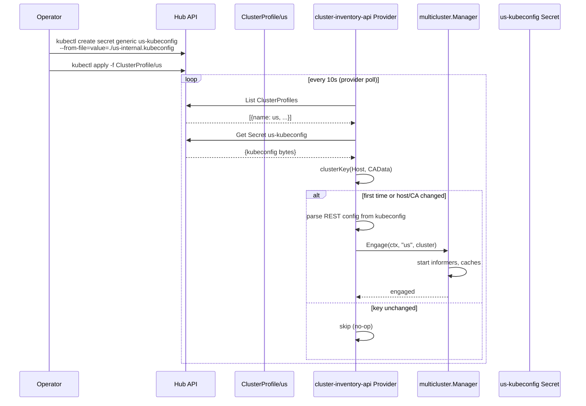

# Fleet inventory

The Fleet context records which clusters exist and what they offer. Each spoke (`us`, `eu`, `eu-storage`) is registered on the hub as a [`ClusterProfile`](https://github.com/kubernetes-sigs/cluster-inventory-api) (the Cluster Inventory API, [KEP-4322](https://github.com/kubernetes/enhancements/tree/master/keps/sig-multicluster/4322-cluster-inventory)). A multicluster provider turns those profiles into clusters that controllers can use. The terms are defined in the [Domain model](domain-model.md).

## How it works



## Provider Implementation

The provider at `providers/cluster-inventory-api/provider.go` implements the `Provider` interface of [multicluster-runtime](https://github.com/kubernetes-sigs/multicluster-runtime):

```go
type Provider interface {
    Get(ctx context.Context, clusterName string) (cluster.Cluster, error)
    IndexField(ctx context.Context, obj client.Object, field string, extractValue client.IndexerFunc) error
}
```

Plus the convention-based `Run(ctx, mgr)` method for cluster discovery.

### Poll loop

1. **Discover** — `hubClient.List(ctx, &clusterProfiles)` at configured interval (default 10s)
2. **Locate kubeconfig** — Look up `<name>-kubeconfig` Secret in same namespace as ClusterProfile
3. **Change detection** — Compute a cluster key from server URL and CA certificate data; skip if unchanged. Token changes are irrelevant: tokens come from `BearerTokenFile`, not from the kubeconfig
4. **Disengage old** — If clusterKey changed (server URL or CA), cancel old cluster's context
5. **Build cluster** — Parse kubeconfig → `cluster.New(restConfig, scheme)`, override auth with `BearerTokenFile`
6. **Engage** — `mgr.Engage(ctx, name, cl)` registers the spoke
7. **Replay indexes** — Replay any registered `IndexField` calls against the new cluster
8. **Cleanup** — Remove clusters whose ClusterProfile has been deleted

### Change detection

The provider keys each cluster by a SHA-256 of `Host + CAData`:

- **Server URL change** → disengage and re-engage
- **CA certificate change** → disengage and re-engage
- **Token change** → no-op (tokens come from `BearerTokenFile` and are rotated by the kubelet)

Credential rotation is therefore independent of cluster engagement.

## ClusterProfile

Rendered from `fleet.clusters` in `chart/hub-services/values.yaml`, one object per spoke. Labels are optional:

```yaml
apiVersion: multicluster.x-k8s.io/v1alpha1
kind: ClusterProfile
metadata:
  name: eu
  namespace: default
  labels:
    platform.example.com/region: eu
    platform.example.com/offers-vms: "true"
```

Two label families: `platform.example.com/region` names the region a spoke serves, and `offers-<service>` marks the services it hosts. Today: `us` (region us, no services), `eu` (region eu, `offers-vms`) and `eu-storage` (region eu, `offers-object-storage`). A region can be served by several clusters, one per service.

The kubeconfig Secret is `<name>-kubeconfig` in the same namespace, with the kubeconfig under the key `value`.

### Scoping a controller to some spokes

A controller can engage only the ClusterProfiles whose labels match (`Provider.SetLabelSelector`). The VM binding controller uses `platform.example.com/offers-vms=true` (sees `eu`); the bucket binding controller uses `platform.example.com/offers-object-storage=true` (sees `eu-storage`). Neither ever sees `us`. A profile that stops matching is disengaged on the next poll. No selector engages every profile.

Within the engaged set, the VM controller finds a cluster by name (`GetCluster(region)`), while the bucket controller picks the cluster whose `region` label equals the request's region, because `eu` and `eu-storage` both serve region `eu`.

The provider reads only the profile's name and labels and the `<name>-kubeconfig` Secret (server address and CA); it does not consume the profile's `status`.

## Acceptance

- `ClusterProfile us` visible on hub
- Provider discovers and engages the spoke
- `multicluster.Manager.GetCluster(ctx, "us")` returns a working cluster client
- `03-fleet-registration` Chainsaw test passes

## Key Files

| File | Purpose |
|------|---------|
| `providers/cluster-inventory-api/provider.go` | Provider: poll loop, engagement, clusterKey change detection (Host+CAData) |
| `deploy/platform-mvp/chart/hub-services/templates/fleet.yaml` | One ClusterProfile per `fleet.clusters` entry |