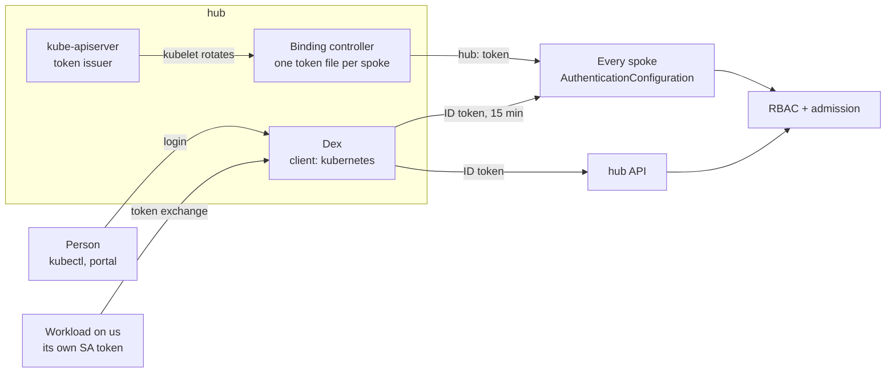
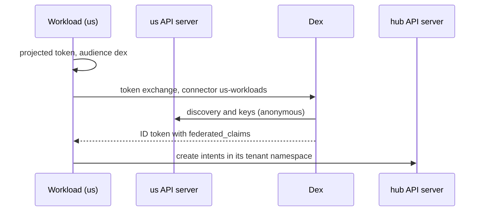

# Identity and access

Who may do what, and how they prove it. Controllers use projected service account tokens issued by the hub; people and tenant workloads use Dex. Every API server trusts both, RBAC decides the verb, and admission policies decide who belongs to a tenant.



| Identity | Issued by | Token | Username on the API server |
|----------|-----------|-------|----------------------------|
| Controller | hub API server | projected, audience `homelab:<spoke>-spoke`, 1 h, rotated | `hub:system:serviceaccount:default:<controller>` |
| Person | Dex, client `kubernetes` | ID token, 15 min | `dex:<sub>`, groups `dex:<group>` |
| Workload identity | Dex, after exchanging a `us` service account token | ID token, 15 min | `dex:us-workloads:system:serviceaccount:<tenant>:platform-provisioner` |

## Trust on every API server

The spoke chart renders each spoke's `AuthenticationConfiguration`; kind mounts it into the API server. The `eu` file:

```yaml
jwt:
  - issuer:
      url: "https://hub-control-plane:6443"          # controllers
      audiences: ["homelab:eu-spoke"]
    claimValidationRules:
      - expression: claims.sub.startsWith("system:serviceaccount:default:")
    claimMappings:
      username: { claim: sub, prefix: 'hub:' }
  - issuer:
      url: "https://<INGRESS_HOST>/dex"              # people and workloads
      audiences: [kubernetes]
    claimMappings:
      groups: { claim: groups, prefix: 'dex:' }
      username:
        expression: "has(claims.federated_claims) && claims.federated_claims.connector_id in ['us-workloads']
          ? 'dex:' + claims.federated_claims.connector_id + ':' + claims.federated_claims.user_id
          : 'dex:' + claims.sub"
```

The hub has only the Dex issuer (`kind/hub-auth-values.yaml`). One public client, `kubernetes`, serves `kubectl` and the portal, so every API server expects that one audience and a login works everywhere; RBAC on each cluster decides.

## People: kubectl

`make tenant-kubeconfigs` writes `hack/platform-mvp/kubeconfig-<tenant>`: contexts `hub`, `us`, `eu`, `eu-storage`, each in the tenant's namespace, and one exec user:

```yaml
users:
  - name: dex
    user:
      exec:
        command: kubelogin
        args: [get-token, --oidc-issuer-url=https://<INGRESS_HOST>/dex, --oidc-client-id=kubernetes,
               --oidc-extra-scope=email, --oidc-extra-scope=groups,
               --grant-type=authcode-keyboard, --oidc-redirect-url=urn:ietf:wg:oauth:2.0:oob,
               --token-cache-dir=~/.kube/cache/oidc-login/acme-corp]
        interactiveMode: IfAvailable
```

The keyboard flow prints Dex's URL and takes the code back in the terminal, so it also works over ssh. One login serves all four clusters. The tests switch the same kubeconfig to `--grant-type=password`.

The portal uses the same client with the authorization code flow and PKCE, one login per cluster ([Management plane](management-plane.md#portal)).

## Workloads: token exchange

A workload on `us` proves who it is without a stored secret: it trades its own service account token for a Dex ID token.



Settings: `workloadIdentity` in `deploy/platform-mvp/tenants.yaml`, `dex.workloadConnectors` in the infrastructure values, `oidcDiscovery.anonymous` in `chart/spoke/values-us.yaml`.

## Tenants

A tenant is an entry in `tenants.yaml`, shared by the hub-services and spoke charts:

```yaml
tenants:
  - id: acme-corp
  - id: globex-inc
workloadIdentity:
  serviceAccount: platform-provisioner
  connectorId: us-workloads
  userPrefix: "dex:"
```

On the hub each tenant gets its namespace and Roles on intents only, bound from one table for people and the workload identity:

```yaml
tenancy:
  intentRoles:
    writer: { verbs: [get, list, watch, create, update, patch, delete], groupSuffixes: [admin, developer], workloadIdentity: true }
    reader: { verbs: [get, list, watch],                                groupSuffixes: [analyst] }
```

On each spoke (`chart/spoke/templates/tenant.yaml`) tenants only read; the controllers create and delete:

| Right | admin | developer | analyst |
|-------|:-----:|:---------:|:-------:|
| Intents on the hub: create, change, delete | yes | yes | read |
| VMs on `eu` and `us`: read | yes | yes | yes |
| VM console and port-forward (ssh) | yes | yes | no |
| Bucket claims and ConfigMaps on `eu-storage`: read | yes | yes | yes |
| S3 credentials Secret: get by name | yes | yes | no |
| CRDs on every cluster: read (schemas, for the portal) | yes | yes | yes |

The platform admin (`dex:platform-admin`) reads the hub except Secrets, manages the spokes, and changes no intent. Its one hub write is deleting a tenant namespace, which offboards the tenant.

Demo users, password `password`: `admin@example.com` (platform admin); `alice@`, `bob@`, `carol@acme-corp.example.com` (acme-corp admin, developer, analyst); `dave@`, `eve@`, `frank@globex-inc.example.com` (globex-inc).

## Admission guardrails

Five `ValidatingAdmissionPolicy` resources, `failurePolicy: Fail`.

| Policy | Where | Refuses |
|--------|-------|---------|
| `restrict-clusterrole-management` | spokes | ClusterRole changes by anyone outside the bypass below |
| `protect-system-namespaces` | spokes | changes in `kube-system`, `kube-public`, `kube-node-lease` (the `auth-configuration` copy included) |
| `intent-in-tenant-namespace` | hub | an intent outside a namespace labelled `tenant-namespace: "true"` |
| `intent-by-tenant-principal` | hub | an intent create, delete or spec change by anyone but the namespace's principals |
| `platform-admin-offboards-tenants` | hub | the platform admin deleting a namespace that is not a tenant's |

The spoke bypass is `system:masters`, `kubeadm:cluster-admins`, `dex:platform-admin` and `system:*` users. The hub intent rule (`intent-policies.yaml`):

```yaml
validations:
  - expression: >-
      variables.user == "dex:us-workloads:system:serviceaccount:" + variables.tenant + ":platform-provisioner"
      || variables.groups.exists(g, ["admin","developer"].exists(s, g == "dex:" + variables.tenant + '-' + s))
      || (request.operation == 'DELETE' && variables.user == "system:serviceaccount:kube-system:namespace-controller")
```

An update that leaves `spec` alone always passes, because Kro writes finalizers and status. Who is kept out of an intent, and by what:

| Caller | Refused by |
|--------|------------|
| Tenant analyst, another tenant | RBAC |
| Platform admin | RBAC: it has no write verbs on intents |
| Kind admin (`system:masters`) | admission: RBAC allows it everything |

**Proven by:** 11 (Dex, client, JWKS), 12 (`AuthenticationConfiguration`, Dex token accepted), 13 (projected tokens), 14 (spoke guardrails), 19 and 24 (spoke roles and controller scope), 25 (no cross-tenant claims), 27 and 28 (token exchange, mapping, rejected forged tokens), 29 (hub roles, admission, offboarding), 30 (kubectl login on four clusters), 34 (portal isolation).
