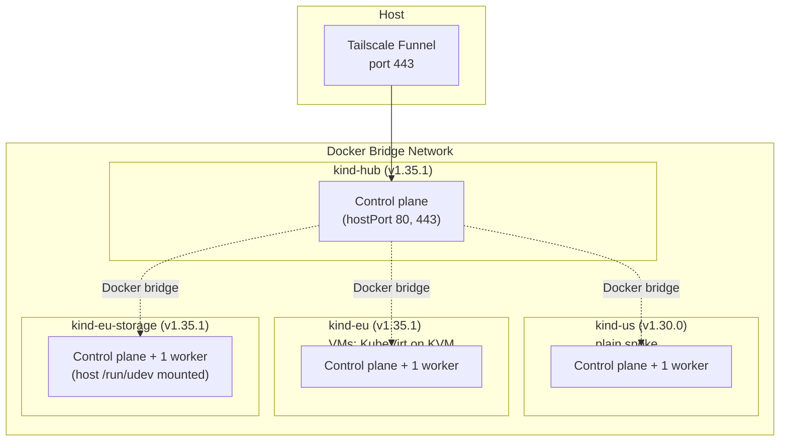

# Local topology

One hub and three spokes, all [kind](https://kind.sigs.k8s.io/) clusters on one host, connected through the Docker bridge network.

## Topology



- **Hub**: 1 control-plane node with hostPort 80 + 443 (nginx-ingress).
- **Spokes**: 1 control plane + 1 worker each, no hostPort.
- **Cross-cluster**: internal Docker IPs; controllers authenticate with projected tokens ([Identity and trust](identity-and-trust.md)).

| Spoke | Kubernetes | Hosts |
|-------|-----------|-------|
| `us` | v1.30.0 | tenant namespaces and the oidc-verifier only |
| `eu` | v1.35.1 (KubeVirt 1.9 needs 1.34+) | VMs |
| `eu-storage` | v1.35.1 | Ceph + RADOS Gateway (a loop-device OSD) |

## Prerequisites

Docker, kind, kubectl, Helm. `eu` needs `/dev/kvm` on the host.

## Steps

```bash
# Hub first (spokes trust its CA), then every spoke in SPOKES (default: us eu eu-storage).
# Each spoke's kind config is rendered from a template with its own node image
# and auth-mount dir; kubeconfigs land in hack/platform-mvp/.
make clusters
```

Add a spoke by extending `SPOKES`, adding `KIND_NODE_IMAGE_<name>`, `chart/spoke/values-<name>.yaml` (token audience is required) and a `fleet.clusters` entry in `chart/hub-services/values.yaml` ([Adding a region](adding-a-region.md)).

`./hack/platform-mvp/create-clusters.sh` and `destroy-clusters.sh` wrap `make clusters` / `make clean`.

## Files produced

| File | Purpose |
|------|---------|
| `deploy/platform-mvp/kind/kind-hub.yaml` | Hub cluster config (hostPort 80 + 443) |
| `deploy/platform-mvp/kind/kind-spoke.yaml.tmpl` | Spoke template (1 CP + 1 worker; node image + auth dir injected) |
| `deploy/platform-mvp/kind/kind-spoke-storage.yaml.tmpl` | Same, plus the host udev database mounted on the worker (`KIND_SPOKE_CONFIG_TMPL_<name>` selects it per spoke) |
| `deploy/platform-mvp/kind/rendered/kind-<spoke>.yaml` | Generated by `make render-kind-config-<spoke>` (gitignored) |
| `hack/platform-mvp/render-spoke-auth-config.sh` | Renders a spoke's AuthenticationConfiguration from the chart + `values-<spoke>.yaml` |
| `hack/platform-mvp/create-clusters.sh`, `destroy-clusters.sh` | Wrappers for `make clusters` / `make clean` |

## Acceptance

- `kubectl --context kind-hub get nodes` — 1 node Ready
- `kubectl --context kind-<spoke> get nodes` — 2 nodes Ready, for `us`, `eu` and `eu-storage`
- Tests `01-hub-cluster-ready`, `02-us-cluster-ready`, `17-eu-cluster-ready`, `24-eu-storage-cluster-ready`
