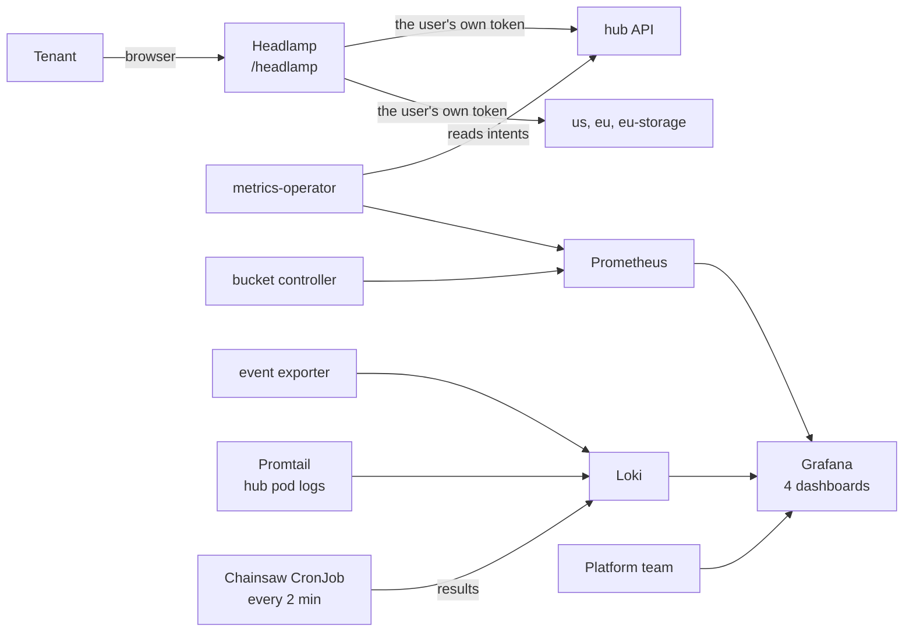

# Management plane

What people use and read on the hub: a Headlamp portal on all four clusters, metrics, logs, dashboards, and a Chainsaw CronJob that tests the platform every 2 minutes.



One ingress host (`INGRESS_HOST`) serves Dex at `/dex`, Headlamp at `/headlamp` and Grafana at `/`, behind ingress-nginx on the hub's ports 80 and 443 with a self-signed cert-manager certificate. Two charts install it: `infrastructure` (wave 2) and `management-plane` (after wave 3).

## Portal

Headlamp 0.46 with the Kro plugin. `hub` is its in-cluster context; the spokes come from a kubeconfig in the Secret `monitoring/headlamp-clusters`, which `make ensure-portal-clusters` writes. Chart values:

```yaml
headlamp:
  config:
    inClusterContextName: hub
    extraArgs: ["-kubeconfig=/etc/headlamp-clusters/kubeconfig"]
portal:
  oidc:
    clientID: kubernetes        # Dex's one client, the same as kubectl
```

- **Login.** Authorization code with PKCE at Dex, one login per cluster: each spoke user in the kubeconfig is an OIDC `auth-provider`. Dex keeps no session, so each cluster asks for the password once.
- **Authorization.** Headlamp sends the user's own token; its service account has no rights. A tenant sees its own namespace on every cluster and gets `403` elsewhere, as with `kubectl`. Tenants may not list namespaces, so each sets its namespace once under **Settings**, **Cluster**, **Allowed namespaces**, or opens a page with `?namespace=<tenant>`.
- **Platform admin.** Every cluster; the hub read-only, without Secrets.

`make check-portal-trust` (in `make lint`) checks that the portal uses Dex's client, the hub trusts exactly that audience, and the callback path is registered.

## Measurement

The OpenControlPlane metrics-operator turns intents into timestamps. One `Metric` per kind and series comes from `measurement.targets`; its role reads intents only, no Secrets.

| Series | Value | Labels |
|--------|-------|--------|
| `platform_intent_created_timestamp_seconds` | `metadata.creationTimestamp` | `tenant`, `name`, `resource` |
| `platform_intent_ready_timestamp_seconds` | `lastTransitionTime` of `Ready` | `tenant`, `name`, `ready`, `resource` |

```promql
# adoption: intents created per tenant in the last 7 days
count by (tenant) (platform_intent_created_timestamp_seconds > time() - 7*86400)
# time to Ready
(platform_intent_ready_timestamp_seconds{ready="True"} - on(resource, tenant, name) platform_intent_created_timestamp_seconds) >= 0
```

The operator keeps a series until it restarts, so a deleted intent leaves its last value. Timestamps stay true where a count of live intents would not: adoption counts intents created in a window, deleted ones included. The **Platform adoption** dashboard (`/d/platform-adoption`) shows active tenants, intents created and the median time to Ready, per tenant and kind. It is for the platform team; Prometheus has no tenant isolation.

## Metrics, logs, dashboards

| Source | Goes to | What |
|--------|---------|------|
| Bucket controller `:8080/metrics`, ServiceMonitor every 15 s | Prometheus | `bucket_binding_controller_reconcile_total{tenant_id,region,result}` and controller-runtime metrics |
| metrics-operator, every 30 s | Prometheus | the intent timestamps above |
| Event exporter, all namespaces | Loki, `job="kubernetes-events"` | each Kubernetes event as JSON; it reads nothing but events |
| Promtail | Loki | hub pod logs |
| Chainsaw CronJob | Loki, `job="chainsaw-runner"` | per-test and per-run results |

| Dashboard | Shows |
|-----------|-------|
| Cluster Fitness (`/d/cluster-fitness`) | nodes, pods, CPU, memory, API server |
| Controller Deep Dive (`/d/controller-deep-dive`) | reconcile rate and latency, queue depth, reconciles by tenant |
| Chainsaw Results (`/d/chainsaw-results`) | pass and fail trend, the suite table |
| Platform adoption (`/d/platform-adoption`) | adoption and time to Ready |

Dashboards are JSON in `chart/infrastructure/dashboards/` and `chart/management-plane/dashboards/`. Prometheus keeps 2 days, Loki runs single-binary on filesystem storage, Grafana's login is `admin`/`admin`: development settings. `make grafana` port-forwards Grafana to `localhost:3000`.

The CronJob runs the 12 tests listed in `cronjob.tests` (`chart/infrastructure/values.yaml`), the ones that need only `hub` and `us`. Its image bundles `tests/e2e/tests/`, so a changed test needs `make chainsaw-runner`.

## Operate

- **Headlamp reads its settings at start.** After changing `portal.oidc.*` or rerunning `make ensure-portal-clusters` (a recreated spoke has a new CA): `kubectl -n monitoring rollout restart deploy/headlamp`.
- **The Kro plugin is fetched from the network** when the pod starts; offline the portal works without it.

**Proven by:** 06 (stack), 07 (an event the test creates reaches Loki), 08 and 09 (metric scraped, dashboards return data), 10 (CronJob), 32 (operator, its rights, Headlamp's PKCE login), 33 (this run's timestamps, every adoption panel), 34 (portal login and isolation on all four clusters).
