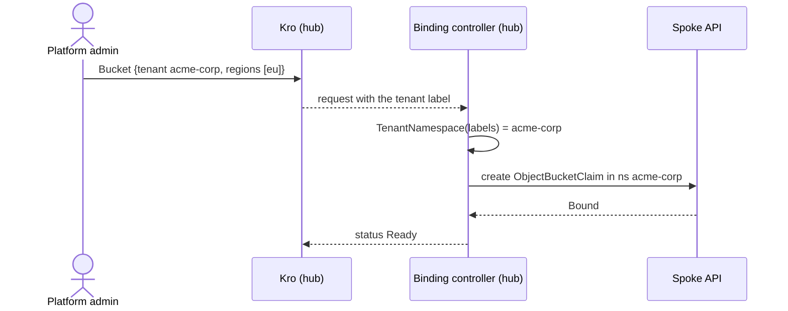

# Multi-tenancy

Tenants are isolated by a `platform.example.com/tenant` label on every order, a namespace per tenant on each spoke, and spoke-side [RBAC](https://kubernetes.io/docs/reference/access-authn-authz/rbac/) with admin, developer and analyst tiers. The tenant is a term of the [Domain model](domain-model.md).

---

## Data model

There is no `spec.tenant` field anywhere. The tenant is a label, copied by the Kro RGD from the order onto every object it emits:

```yaml
apiVersion: platform.example.com/v1alpha1
kind: Bucket                       # or VmSet
metadata:
  name: media
  labels:
    platform.example.com/tenant: acme-corp
spec:
  regions: [eu]
```

The label reaches the `RegionalBucketRequest` / `RegionalVmSetRequest` (hub) and every spoke object the controller creates. Onboarding a tenant changes no CRD and no controller code.

## Isolation flow



`domain.TenantNamespace(labels, fallback)` in each controller maps the label to the namespace and falls back to `defaultNamespace` (`default`) when the label is missing.

## Spoke-side tenant RBAC

`chart/spoke/templates/tenant.yaml` renders, for every entry in `tenants:` (`acme-corp`, `globex-inc`), a Namespace, three Roles and three RoleBindings to the Dex groups `dex:<tenant>-admin|developer|analyst`.

Tenants do **not** create or delete platform objects on a spoke: the platform does, through the binding controllers. Tenant roles only read, and only the service resources a spoke actually offers:

| Resource | admin | developer | analyst | enabled by |
|----------|:-----:|:---------:|:-------:|-----------|
| `virtualmachines`, `virtualmachineinstances` get/list/watch | ✅ | ✅ | ✅ | `kubevirt.enabled` |
| VM `console` | ✅ | ✅ | ❌ | `kubevirt.enabled` |
| `objectbucketclaims`, `configmaps` get/list/watch | ✅ | ✅ | ✅ | `objectStorage.enabled` |
| `secrets` get (S3 credentials, by name) | ✅ | ✅ | ❌ | `objectStorage.enabled` |

Admin and developer currently carry the same rights; the tiers differ for analysts. A tenant never has any right in another tenant's namespace.

Platform-wide, `dex:platform-admin` holds cluster-level rights, bounded by ValidatingAdmissionPolicies ([Admission guardrails](admission-guardrails.md)).

### Demo users

| Email | Tenant | Role | Dex group |
|-------|--------|------|-----------|
| admin@example.com | (platform) | platform-admin | platform-admin |
| alice@acme-corp.example.com | acme-corp | admin | acme-corp-admin |
| bob@acme-corp.example.com | acme-corp | developer | acme-corp-developer |
| carol@acme-corp.example.com | acme-corp | analyst | acme-corp-analyst |
| dave@globex-inc.example.com | globex-inc | admin | globex-inc-admin |
| eve@globex-inc.example.com | globex-inc | developer | globex-inc-developer |
| frank@globex-inc.example.com | globex-inc | analyst | globex-inc-analyst |

## Security properties

| Property | How enforced |
|----------|-------------|
| Workload isolation | Each tenant's objects live in a dedicated namespace; no cross-tenant access |
| Network isolation | kind has no NetworkPolicy support; namespaces give logical separation only |
| RBAC isolation | Namespaced Roles per tenant; no cluster-wide read of tenant objects for tenants |
| Credential scope | S3 credentials are readable by name by admin and developer only, and only in their own namespace |
| Controller least privilege | Each hub controller may write only its own kind (claims or VMs) in tenant namespaces; the bucket controller cannot read Secrets ([Identity and trust](identity-and-trust.md)) |
| Audit separation | Metrics carry `tenant_id`; event-exporter captures per-namespace events |
| Admission policies | Non-admins cannot manage ClusterRoles, system namespaces or the auth config |

## Testing

| Test | Proves |
|------|--------|
| `10-tenant-isolation` | An acme-corp `Bucket` becomes a claim in namespace `acme-corp` on `eu-storage`; metrics carry `tenant_id="acme-corp"` |
| `15-multi-tenant-isolation` | acme-corp and globex-inc buckets land in separate namespaces; each tenant reads its own claim and credentials and is denied the other's |
| `22-vm-console-rbac` | VM read and console rights by tier; other tenants denied |
| `28-bucket-tenant-rbac` | Claim, endpoint and credential rights by tier; controller scope |

Tenant users are simulated with `kubectl --as=dex:<user> --as-group=dex:<group>` or `SubjectAccessReview`.

## Key files

| File | Purpose |
|------|---------|
| `platform-mvp/*-binding-controller/domain/domain.go` | `TenantNamespace()` |
| `chart/spoke/templates/tenant.yaml` | Per-tenant Namespace, Roles, RoleBindings |
| `chart/spoke/values.yaml` (`tenants:`) | Tenant list with Dex groups |
| `chart/spoke/templates/admission-guardrails.yaml` | Admission policies |
| `chart/infrastructure/templates/dex.yaml` | Demo users and groups |
| `tests/e2e/tests/{10,15,22,28}-*/` | The tests above |
