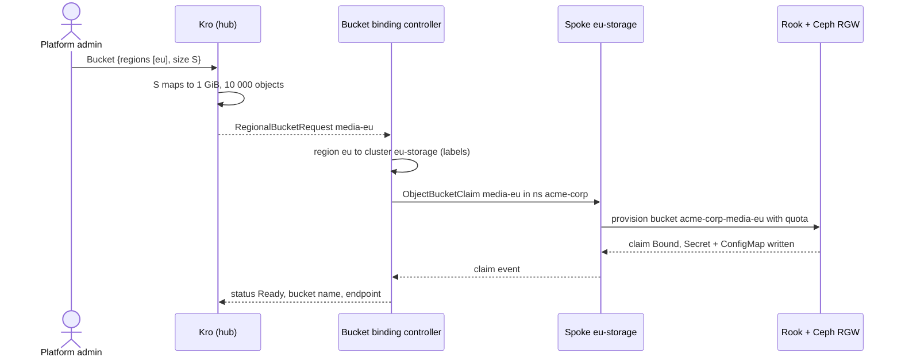

# Object storage

Tenants order an S3 bucket with a size tier. [Kro](https://kro.run/docs/overview/) on the hub expands the order, the **bucket binding controller** places it on the storage spoke as an [`ObjectBucketClaim`](https://rook.io/docs/rook/latest-release/Storage-Configuration/Object-Storage-RGW/ceph-object-bucket-claim/) (the [lib-bucket-provisioner](https://github.com/kube-object-storage/lib-bucket-provisioner) API), and [Rook](https://rook.io/docs/rook/latest-release/Getting-Started/intro/) provisions the bucket on the [Ceph RADOS Gateway](https://docs.ceph.com/en/latest/radosgw/) (RGW).

## Order

```yaml
apiVersion: platform.example.com/v1alpha1
kind: Bucket
metadata:
  name: media
  labels: { platform.example.com/tenant: acme-corp }
spec:
  regions: [eu]
  size: S            # default S, immutable
```

| Tier | Max size | Max objects |
|------|---------:|------------:|
| S | 1 GiB | 10 000 |
| M | 10 GiB | 100 000 |

The tiers are Helm values (`bucket.tiers` in `chart/hub-services/values.yaml`); their keys become the allowed `size` values. The e2e suite adds a tiny test-only tier `T` in `chart/hub-services/e2e-values.yaml`.

## Flow



What lands on `eu-storage`, in the tenant namespace:

| Object | Name | Written by |
|--------|------|-----------|
| `ObjectBucketClaim` | `<bucket>-<region>` (quota in `additionalConfig`) | bucket controller |
| `Secret` | same name: `AWS_ACCESS_KEY_ID`, `AWS_SECRET_ACCESS_KEY` | Rook |
| `ConfigMap` | same name: `BUCKET_HOST`, `BUCKET_PORT`, `BUCKET_NAME` | Rook |

The S3 bucket is called `<tenant>-<bucket>-<region>` (3–63 characters, validated before anything is created). A claim's quota is fixed once ordered; the controller never rewrites an existing claim.

## Region to cluster

`eu` has two clusters: `eu` runs VMs and `eu-storage` runs Ceph. A region is therefore resolved by labels, not by name (`ResolveCluster`, see the [Domain model](domain-model.md)):

| ClusterProfile | `region` | `offers-vms` | `offers-object-storage` |
|---------------|----------|:------------:|:-----------------------:|
| `us` | us | | |
| `eu` | eu | ✅ | |
| `eu-storage` | eu | | ✅ |

The controller engages only clusters carrying its selector (`bucketBindingController.clusterSelector`) and picks the one whose `platform.example.com/region` label equals the request's region (pure and deterministic; ties go to the first name). A region with no such cluster is reported `Unschedulable`, creates nothing, and does not block deletion.

## Ceph on `eu-storage`

`make deploy-rook-eu-storage` (part of `make deploy-wave4`) installs Rook 1.21.1 as two [Helm](https://helm.sh/docs/) releases in `rook-ceph` (the operator and the cluster chart), with values in `deploy/platform-mvp/rook/`:

- 1 mon, 1 mgr, **1 OSD on a loop device**, pools of size 1: a lab setup, not durable storage.
- The loop device is created inside the kind worker (`truncate` + `losetup`), reused if it exists, and detached by `make clean`. Loop numbers are host-global.
- The kind node mounts the host's `/run/udev` (`kind-spoke-storage.yaml.tmpl`); without it `ceph-volume` finds no devices and no OSD is created.
- A [`CephObjectStore`](https://rook.io/docs/rook/latest-release/CRDs/Object-Storage/ceph-object-store-crd/) named `s3` serves RGW on port 80; the `ceph-bucket` StorageClass (`reclaimPolicy: Delete`) is what claims reference.

Knobs (Makefile): `ROOK_VERSION`, `ROOK_SPOKES`, `CEPH_LOOP_SIZE`, `CEPH_LOOP_IMG`, `HOST_UDEV_DIR`.

## Using a bucket

Credentials never leave the spoke. A tenant admin or developer reads them on `eu-storage`:

```bash
kubectl --context kind-eu-storage -n acme-corp get secret media-eu -o jsonpath='{.data.AWS_ACCESS_KEY_ID}' | base64 -d
kubectl --context kind-eu-storage -n acme-corp get configmap media-eu -o jsonpath='{.data}'
```

The endpoint is cluster-internal (`http://rook-ceph-rgw-s3.rook-ceph.svc:80`), so S3 clients run inside the cluster; test 26 does it with an `aws-cli` pod fed from the Secret and ConfigMap (`envFrom`).

## Who can do what (on `eu-storage`)

| Identity | Claims | Endpoint ConfigMap | Credentials Secret |
|----------|--------|--------------------|--------------------|
| `bucket-binding-controller` (hub) | read everywhere; create/update/delete in tenant namespaces | get in tenant namespaces | no |
| tenant admin, developer | read | read | `get` by name, no list |
| tenant analyst | read | read | no |
| another tenant | no | no | no |

Nobody but the platform creates or deletes claims. RBAC is in `chart/spoke/templates/bucket-binding-controller-rbac.yaml` and `tenant.yaml`; test 28 checks it.

## Lifecycle and cleanup

- The controller puts the [finalizer](https://kubernetes.io/docs/concepts/overview/working-with-objects/finalizers/) `platform.example.com/bucket-cleanup` on each request.
- Deleting a `Bucket` deletes its claim and **waits** until Rook has removed the bucket, its Secret and ConfigMap, then releases the request (`bucketBindingController.cleanupInterval`).
- Status is recomputed on claim events and every `requeueInterval` (30 s) to repair drift.
- If the spoke refuses the controller (RBAC missing, cluster down) a delete stays pending. That is deliberate: cleanup cannot be confirmed. Fix the cause, then restart the controller to flush its retry backoff.

## Observability

`bucket_binding_controller_reconcile_total{tenant_id,region,result}` is scraped from the controller's `metrics` Service by a ServiceMonitor and drawn on the Controller Deep Dive dashboard.

## Configuration

| Where | Key |
|-------|-----|
| `chart/hub-services/values.yaml` | `bucket.tiers`, `bucket.defaultSize`, `bucketBindingController.*` (`clusterSelector`, `regionLabel`, `storageClass`, `requeueInterval`, `cleanupInterval`, `pollInterval`, `defaultNamespace`, `metricsPort`, `spokeTokens`), `fleet.clusters[]` |
| `chart/spoke/values-eu-storage.yaml` | `objectStorage.enabled`, `bucketBindingControllerRBAC.enabled`, token audience |
| `deploy/platform-mvp/rook/*.yaml` | Ceph cluster and object store |

## Tests

| # | Test | Proves |
|---|------|--------|
| 24 | `eu-storage-cluster-ready` | nodes Ready; every spoke has a `region` label; `eu-storage` offers object storage |
| 25 | `ceph-rgw-ready` | CephCluster and CephObjectStore Ready; `ceph-bucket` StorageClass exists |
| 26 | `bucket-provisioning` | tier maps to quota; claim Bound; endpoint on the hub; S3 put/get; bad input and size changes rejected |
| 27 | `bucket-lifecycle` | Ceph refuses an object over `maxSize` and one past `maxObjects`; delete removes claim, Secret, ConfigMap |
| 28 | `bucket-tenant-rbac` | controller scope; tenant tiers; credentials only for admin and developer |
| 29 | `bucket-unschedulable` | region without Ceph → `Unschedulable`; delete not blocked |

## Known limits

| Limit | Effect |
|-------|--------|
| Endpoint is cluster-internal | No S3 ingress from outside `eu-storage` |
| Credentials live on the spoke | Tenants have no hub identity, so they read them on the spoke |
| One OSD, pool size 1 | Data is not replicated |
| `status.regions` nests one level (`regions[0].regions[0]`) | Kro maps each request's whole status; `VmSet` behaves the same |
| Quota is fixed at order time | Changing size means ordering a new bucket |

Code: `platform-mvp/bucket-binding-controller/` (`domain` pure rules, `adapter` pure translation, `controller` the only impure part, `config` flags).
