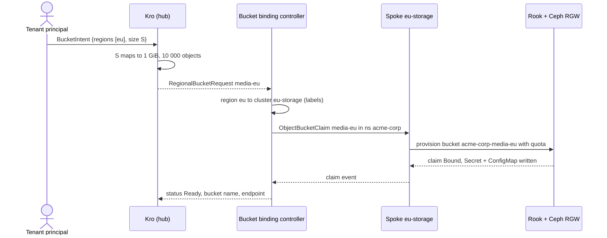

# Object storage

Tenants ask for an S3 bucket by creating a `BucketIntent` in their hub namespace; Kro expands it, the bucket binding controller places it on the storage spoke as an `ObjectBucketClaim` (the lib-bucket-provisioner API), and Rook provisions the bucket on the Ceph RADOS Gateway. Ceph itself enforces the quota tiers, not the platform.

```yaml
apiVersion: platform.example.com/v1alpha1
kind: BucketIntent
metadata:
  name: media
  namespace: acme-corp   # the tenant; the label is derived from it
spec:
  regions: [eu]
  size: S            # default S, immutable
```

| Tier | Max size | Max objects |
|------|---------:|------------:|
| S | 1 GiB | 10 000 |
| M | 10 GiB | 100 000 |

The tiers are `bucket.tiers` in `chart/hub-services/values.yaml`; their keys become the allowed `size` values. The e2e suite adds a tiny test-only tier `T` in `chart/hub-services/e2e-values.yaml`.

## Flow



In the tenant namespace on `eu-storage`: the claim `<bucket>-<region>` (quota in `additionalConfig`, written by the controller), and a Secret and ConfigMap of the same name written by Rook (`AWS_ACCESS_KEY_ID`, `AWS_SECRET_ACCESS_KEY`; `BUCKET_HOST`, `BUCKET_PORT`, `BUCKET_NAME`). The S3 bucket is `<tenant>-<bucket>-<region>` (3-63 characters, validated before anything is created). A claim's quota is fixed at creation; the controller never rewrites a claim.

## Region to cluster

`eu` has two clusters: `eu` runs VMs and `eu-storage` runs Ceph. A region is therefore resolved by labels, not by name (`ResolveCluster`):

| ClusterProfile | `region` | `offers-vms` | `offers-object-storage` |
|---------------|----------|:------------:|:-----------------------:|
| `us` | us | yes | |
| `eu` | eu | yes | |
| `eu-storage` | eu | | yes |

The controller engages only clusters matching `bucketBindingController.clusterSelector` and picks the one whose `platform.example.com/region` label equals the request's region (ties go to the first name). A region with no such cluster is `Unschedulable`, creates nothing, and does not block deletion.

## Ceph on `eu-storage`

`make deploy-rook-eu-storage` (part of `make deploy-wave4`) installs Rook 1.21.1 as two Helm releases in `rook-ceph` (operator and cluster), with values in `deploy/platform-mvp/rook/`:

- 1 mon, 1 mgr, **1 OSD on a loop device**, pools of size 1: a lab setup, not durable storage.
- The loop device is created inside the kind worker (`truncate` and `losetup`), reused if present, and detached by `make clean`. Loop numbers are host-global.
- The kind node mounts the host's `/run/udev` (`kind-spoke-storage.yaml.tmpl`); without it `ceph-volume` finds no devices and no OSD is created.
- A `CephObjectStore` named `s3` serves RGW on port 80; the `ceph-bucket` StorageClass (`reclaimPolicy: Delete`) is what claims reference.

Makefile knobs: `ROOK_VERSION`, `ROOK_SPOKES`, `CEPH_LOOP_SIZE`, `CEPH_LOOP_IMG`, `HOST_UDEV_DIR`, `S3_NODE_PORT`. The public Service is `rook/s3-public-service.yaml.tmpl`, applied by `make deploy-rook-<spoke>`; the host port needs the cluster created with it.

## Using a bucket

A tenant admin or developer reads the key and the bucket name on the spoke with its own `kubectl` login, then talks S3 to the public port of the gateway: a NodePort (`rook-ceph-rgw-s3-public`, `S3_NODE_PORT`, default 30080) that the storage spoke's kind config publishes on the host.

```bash
S="kubectl --kubeconfig hack/platform-mvp/kubeconfig-acme-corp --context eu-storage"
AK=$($S get secret photos-eu -o jsonpath='{.data.AWS_ACCESS_KEY_ID}' | base64 -d)
SK=$($S get secret photos-eu -o jsonpath='{.data.AWS_SECRET_ACCESS_KEY}' | base64 -d)
BUCKET=$($S get configmap photos-eu -o jsonpath='{.data.BUCKET_NAME}')
curl --aws-sigv4 aws:amz:us-east-1:s3 --user "$AK:$SK" -T hello.txt http://localhost:30080/$BUCKET/hello.txt
```

Inside the cluster the endpoint is `http://rook-ceph-rgw-s3.rook-ceph.svc:80` (the ConfigMap's `BUCKET_HOST`); test 22 uses it from an `aws-cli` pod fed from the Secret and ConfigMap (`envFrom`), test 31 the public port with `curl`.

On `eu-storage` the controller reads everywhere, creates, updates and deletes claims in tenant namespaces and gets the endpoint ConfigMap, but cannot read the credentials Secret. Tenant admins and developers read claims, the ConfigMap, and the Secret by name (no list); analysts read claims and the ConfigMap; another tenant has nothing. Tenants never create or delete claims (`bucket-binding-controller-rbac.yaml`, `tenant.yaml`).

## Lifecycle

- The finalizer `platform.example.com/bucket-cleanup` is on each request. Deleting a `BucketIntent` deletes its claim and **waits** until Rook has removed the bucket, Secret and ConfigMap (`cleanupInterval`), then releases the request.
- Status is recomputed on claim events and every `requeueInterval` (30 s) to repair drift.
- If the spoke refuses the controller, a delete stays pending: cleanup cannot be confirmed. Fix the cause, then restart the controller.

The only custom metric is `bucket_binding_controller_reconcile_total{tenant_id,region,result}`, scraped by a ServiceMonitor ([Management plane](management-plane.md#metrics-logs-dashboards)).

Values: `bucket.*` and `bucketBindingController.*` (`clusterSelector`, `regionLabel`, `storageClass`, `requeueInterval`, `cleanupInterval`, `pollInterval`, `metricsPort`, `spokeTokens`) in `chart/hub-services/values.yaml`; `objectStorage.enabled`, `bucketBindingControllerRBAC.enabled` in `chart/spoke/values-eu-storage.yaml`.

**Proven by:** 04 and 05 (profiles), 21 (Ceph Ready), 22 (provisioning, S3 put and get), 23 (quota, cleanup), 24 (roles), 25 (tenant isolation), 26 (Unschedulable), 31 (`curl` through the public port as a tenant).

Limits: the public port is plain HTTP on the lab host; one OSD with pool size 1 means no replication; quota is fixed at creation, so a new size means a new intent.
