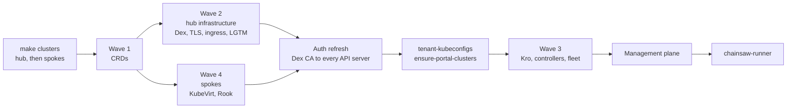
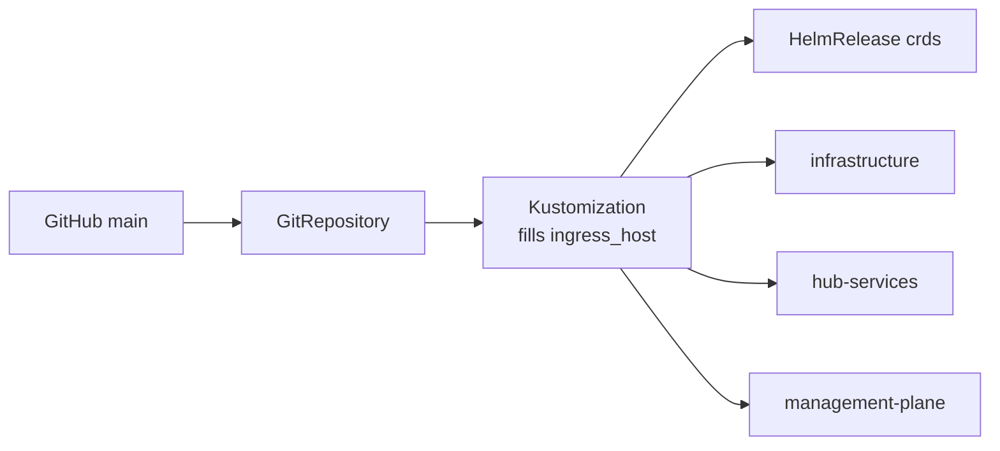

# Operations

The clusters, the deploy order, GitOps, and how to add a region. Configuration lives in Helm values and Makefile variables.

## Clusters

| Cluster | Kubernetes | Hosts |
|---------|-----------|-------|
| `hub` | v1.35.1 | Kro, controllers, Dex, portal, observability; one node, host ports 80 and 443 |
| `us` | v1.35.1 | KubeVirt 1.9.1 VMs; the workload cluster whose tokens Dex exchanges; needs `/dev/kvm` |
| `eu` | v1.35.1 | KubeVirt 1.9.1 VMs; needs `/dev/kvm` |
| `eu-storage` | v1.35.1 | Rook 1.21.1, Ceph RGW on a loop-device OSD; S3 on host port `S3_NODE_PORT` (30080) |

Spokes are one control plane plus one worker, rendered from `deploy/platform-mvp/kind/*.yaml.tmpl`; kubeconfigs land in `hack/platform-mvp/`. Cross-cluster traffic uses Docker addresses such as `https://eu-control-plane:6443`.

## Deploy order

```bash
make deploy      # images, clusters, waves 1-4, auth refresh, kubeconfigs, management plane, runner
make validate    # the 34 tests
make clean       # destroy everything, detach the Ceph loop device
```



| Chart | Wave | Contents |
|-------|------|----------|
| `chart/crds` | 1 | request CRDs, upstream CRDs |
| `chart/infrastructure` | 2 | Dex, cert-manager, ingress-nginx, Prometheus, Grafana, Loki, event exporter, CronJob |
| `chart/hub-services` | 3 | Kro graphs, binding controllers, ClusterProfiles, tenant namespaces, hub policies |
| `chart/spoke` | 4 | per spoke: tenant RBAC, `AuthenticationConfiguration`, OIDC verifier, guardrails, KubeVirt |
| `chart/management-plane` | after 3 | Headlamp, metrics-operator, adoption dashboard |
| `chart/tenant` | — | a tenant's order, applied by the tenant ([Use cases](use-cases.md#3-order-with-your-chart-then-watch)) |

**Why the hub comes first.** A spoke API server reads its `AuthenticationConfiguration` at boot, and that needs the hub's CA. The hub's own file needs Dex's CA, which exists only after wave 2, so the hub boots on a placeholder and `make ensure-hub-auth-config` writes the real file later; API servers reload it. The spokes get the Dex CA the same way (`make ensure-spoke-auth-config`), and so do the tenant kubeconfigs and the portal's spoke kubeconfig. `make check-deploy-order` (in `make lint`) keeps this order.

Images are built and loaded into kind (`pullPolicy: IfNotPresent`); no registry is needed.

## GitOps

`make deploy-cd` installs Flux on a lab that `make deploy` built. Flux tracks `main` on GitHub and adopts the four hub releases, so a change reaches the lab only after a merge and push.



Each HelmRelease carries the `releaseName`, namespaces and `valuesFiles` that `make deploy` uses, so Flux upgrades the existing release instead of installing a second one. `make check-flux-releases` and `check-flux-build` keep that true without a cluster; `make verify-flux` checks a live lab. Flux bumps a release only when the chart's version changes, so bump `Chart.yaml` with every chart change. To try a chart locally, `flux suspend helmrelease <name> -n <ns>` first. The spokes stay outside Flux.

## Adding a region

A region, or a host for a service, is configuration: `eu` and `eu-storage` were added this way, and `us` became a VM host the same way.

| # | Where | Change |
|---|-------|--------|
| 1 | `Makefile` | add the name to `SPOKES` and a `KIND_NODE_IMAGE_<name>`; a VM host needs a Kubernetes version KubeVirt supports |
| 2 | `chart/spoke/values-<name>.yaml` | `authConfiguration.hubIssuer.audience: homelab:<name>-spoke`; for a service host `kubevirt.enabled` and `vmBindingControllerRBAC.enabled`, or `objectStorage.enabled` and `bucketBindingControllerRBAC.enabled` |
| 3 | `chart/hub-services/values.yaml` | a `fleet.clusters` entry with `region` and `offers-*` labels |
| 4 | same file | a `spokeTokens` entry in each controller that engages it |
| 5 | `tests/e2e/.chainsaw.yaml` | the cluster, so tests can target it |
| 6 | `Makefile` | `KUBEVIRT_SPOKES` or `ROOK_SPOKES` for a service host |
| 7 | shell | `make deploy`; `make clean deploy` if an existing cluster's node image changed, because `make deploy` keeps existing clusters |

`make check-service-hosts` fails when rows 2, 3, 4 and 6 disagree about which spokes host a service.

On the next poll the provider engages the spoke. The one code change: `spec.region` is an enum (`us`, `eu`, `asia`) in both request CRDs, so a new name extends it.

## Development loop

Test first. `make lint test` before and after a change, then `make validate`. Lint runs the repository's checks (tests, runner list, Flux, tenants, portal trust, guardrails, docs, service hosts), `go vet` and `gofmt`.

**Proven by:** 01-04 (clusters Ready), 03-05 (profiles), `make verify-flux` (GitOps, outside `make validate`).
