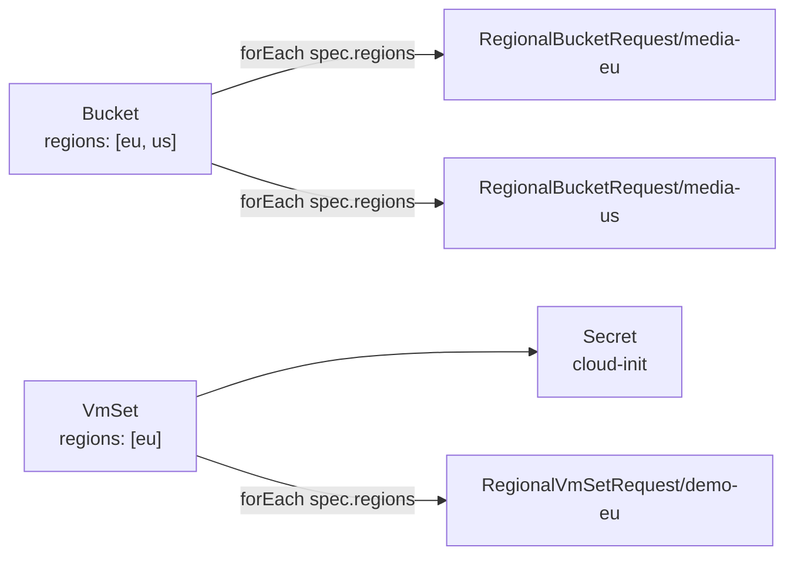

# Ordering API

The Ordering context exposes one customer-facing API per service on the hub. Each is a [Kro](https://kro.run/docs/overview/) `ResourceGraphDefinition` (RGD): Kro generates the CRD for the order, and for every order it creates the hub-side objects a controller needs. Two services use it:

| Service | Customer object | RGD | Emits per order |
|---------|----------------|-----|-----------------|
| VMs | `VmSet` | `chart/hub-services/templates/vmset-rgd.yaml` | a cloud-init `Secret` + one `RegionalVmSetRequest` per region |
| S3 buckets | `Bucket` | `chart/hub-services/templates/bucket-rgd.yaml` | one `RegionalBucketRequest` per region |

Kro owns the customer API; a binding controller owns placement ([Placement controllers](placement-controllers.md)). The terms are defined in the [Domain model](domain-model.md).

## Resource graph



## What both RGDs do

- **Fan-out**: `forEach` over `spec.regions`; each request is named `<order>-<region>`. Adding a region to the list adds a request, no code.
- **Tenant label**: `platform.example.com/tenant` is copied from the order to every emitted object. The tenant is a label, not a schema field.
- **Tiers from Helm values**: the tier table is rendered into the RGD as a [CEL](https://kubernetes.io/docs/reference/using-api/cel/) map, e.g. `{"S":{...},"M":{...}}[schema.spec.size].maxSize`. The tier names also become the `enum` of `spec.size`, which is `immutable` and defaults to `bucket.defaultSize` / `vmSet.defaultSize`. Requests carry the concrete numbers, so controllers know nothing about tiers.
- **Validation at the door**: unknown sizes, an empty `regions` list, and (VmSet) replicas outside `1..maxReplicas` or a key that does not match `vmSet.sshPublicKeyPattern` are rejected at admission.
- **Status roll-up**: `status.regions: ${regionalBucketRequest.map(r, r.status)}` collects each request's status. Because each request's status is itself `{regions: [...]}`, the order's `status.regions` nests one level (`regions[0].regions[0].phase`).

```yaml
# Bucket tier numbers, rendered from chart/hub-services/values.yaml
spec:
  region: "${region}"
  maxSize: ${ {"M":{...},"S":{...}}[schema.spec.size].maxSize }
  maxObjects: ${ {"M":{...},"S":{...}}[schema.spec.size].maxObjects }
```

## The request CRDs

`RegionalBucketRequest` and `RegionalVmSetRequest` live in `chart/crds/templates/`. Immutability is expressed with [CRD validation rules](https://kubernetes.io/docs/tasks/extend-kubernetes/custom-resources/custom-resource-definitions/#validation-rules) (`self == oldSelf`).

| Field | Bucket request | VmSet request |
|-------|----------------|---------------|
| `spec.region` | enum `us, eu, asia` | enum `us, eu, asia` |
| quota / shape | `maxSize`, `maxObjects` (immutable) | `replicas`, `cpu`, `memory`, `image` (cpu/memory/image immutable) |
| extra | | `cloudInitSecretName` |
| `status.regions[0]` | `region`, `phase`, `bucketName`, `endpoint`, `message` | `region`, `phase`, `readyReplicas`, `message` |

`phase` is `Pending`, `Ready` or `Unschedulable`. A new region name needs the `region` enum extended ([Adding a region](adding-a-region.md)).

## Installation order

Kro resolves templates through API discovery, so the request CRDs must exist first: they ship in Wave 1 (`chart/crds`), the RGDs in Wave 3 (`chart/hub-services`). Kro's controller also needs RBAC for `platform.example.com` and, for VmSet, core `secrets`: `chart/hub-services/templates/kro-rbac.yaml`.

Kro v0.9.2 does not delete the CRD it generated for an RGD you remove; delete it by hand.

## Acceptance

- A `Bucket{regions:[eu], size:S}` with a tenant label yields `RegionalBucketRequest/<name>-eu` with `maxSize: 1Gi`, `maxObjects: 10000` and the same label.
- `size: M` yields the M numbers; omitting `size` yields S; changing `size` is rejected.
- A `VmSet{size:S, replicas:2}` yields a cloud-init Secret and a request with `cpu: 1`, `memory: 1Gi`.
- Tests `19-vmset-provisioning` and `26-bucket-provisioning` pass.

## Key files

| File | Purpose |
|------|---------|
| `chart/hub-services/templates/{vmset,bucket}-rgd.yaml` | The two RGDs |
| `chart/crds/templates/regional{vmset,bucket}request-crd.yaml` | Request CRDs |
| `chart/hub-services/templates/kro-rbac.yaml` | Kro RBAC for the API group |
| `chart/hub-services/values.yaml` | `vmSet.*`, `bucket.*` tiers and limits |
