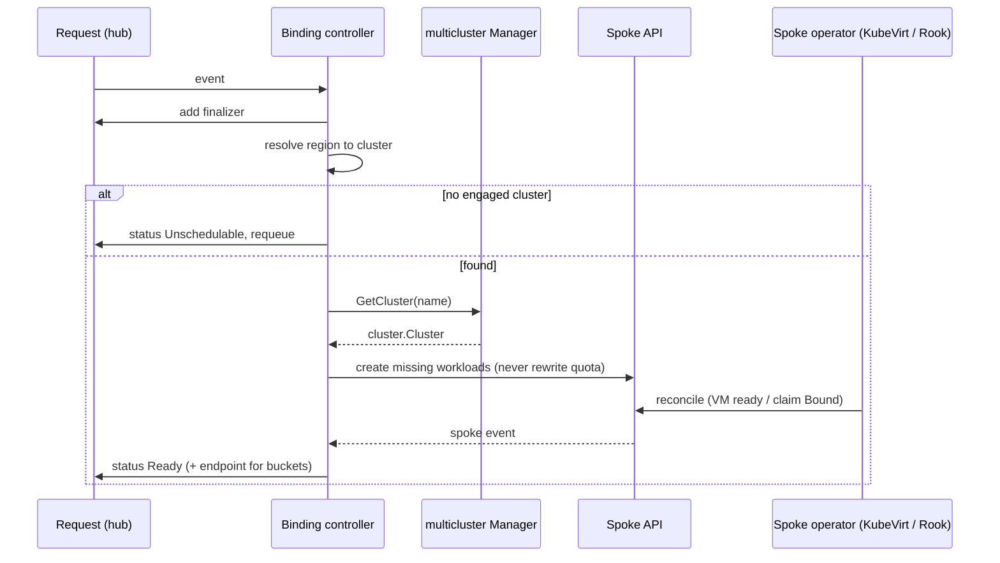

# Placement controllers

The Placement context decides where an order runs and reports whether it is running. It is implemented by one controller per service on the hub. Each turns a regional placement request into workloads on the right spoke, then reports status back. The controllers are built on [controller-runtime](https://github.com/kubernetes-sigs/controller-runtime) and [multicluster-runtime](https://github.com/kubernetes-sigs/multicluster-runtime).

| | VM binding controller | Bucket binding controller |
|---|----------------------|---------------------------|
| Code | `platform-mvp/vm-binding-controller/` | `platform-mvp/bucket-binding-controller/` |
| Watches (hub) | `RegionalVmSetRequest` | `RegionalBucketRequest` |
| Creates (spoke) | `VirtualMachine` × replicas and a cloud-init `Secret` | `ObjectBucketClaim` |
| Watches (spoke) | `VirtualMachine` | `ObjectBucketClaim` |
| Engages only | clusters labelled `offers-vms=true` | clusters labelled `offers-object-storage=true` |
| Region to cluster | cluster named like the region | cluster whose `region` label matches |
| Finalizer | `platform.example.com/vm-cleanup` | `platform.example.com/bucket-cleanup` |
| Custom metrics | none (no ServiceMonitor) | `bucket_binding_controller_reconcile_total` |

Service details: [Virtual machines](virtual-machines.md), [Object storage](object-storage.md).

## Reconciliation

Two controllers share one manager: one reconciles requests on the hub's local manager, the other watches workloads on every engaged spoke and recomputes the owning request's status. Status therefore follows spoke state without polling. A periodic requeue (`requeueInterval`, 30 s) repairs workloads deleted out of band.

The request's lifecycle and invariants are described in the [Domain model](domain-model.md); the layering (`domain`, `adapter`, `controller`, `config`) is the same in both controllers.

## Tenant routing

`TenantNamespace` maps the `platform.example.com/tenant` label to the spoke namespace and falls back to `defaultNamespace` when the label is missing.

| Label | Spoke namespace |
|-------|-----------------|
| `acme-corp` | `acme-corp` |
| (absent) | `default` |

Namespaces and roles come from the spoke chart ([Multi-tenancy](multi-tenancy.md)).

## Cleanup

Deleting the order deletes the request. The [finalizer](https://kubernetes.io/docs/concepts/overview/working-with-objects/finalizers/) then removes the workloads from the spoke and waits until they are gone; a bucket waits for Rook to delete the bucket itself. A request that cannot be placed, or whose spec is unreadable, is released immediately. A spoke that refuses the controller keeps the request pending, because cleanup cannot be confirmed; fix the cause and restart the controller to clear its retry backoff.

## Deployment

Each controller is a Deployment with a ServiceAccount and ClusterRole (`chart/hub-services/templates/{vm,bucket}-binding-controller.yaml`); the bucket controller adds a metrics Service. It mounts one projected token per spoke it serves, `<cluster>-token` with audience `homelab:<cluster>-spoke` (`spokeTokens`), and reaches spokes through the [provider](fleet-inventory.md). Images are `$(DOCKER_REGISTRY)/{vm,bucket}-binding-controller:$(IMAGE_TAG)` (default `sojoner/…:dev`); `make deploy` builds them, loads them into the hub, and passes the repository and tag to Helm.

Flags are set from Helm values; the defaults only keep a bare binary runnable: `--cluster-selector`, `--requeue-interval`, `--poll-interval`, `--default-namespace`. The bucket controller adds `--region-label`, `--storage-class`, `--cleanup-interval` and `--metrics-bind-address`; the VM controller adds `--run-strategy`.

## Acceptance

- A request on the hub produces its workloads in the tenant namespace on the matching spoke.
- Status returns to the hub (`Ready`, or `Unschedulable` naming the region).
- Scaling (VMs) and deleting (both) leave nothing behind on the spoke.
- Verified by tests 19–23 (VMs) and 26–29 (buckets); see [Testing](testing.md).

## Key files

| File | Purpose |
|------|---------|
| `platform-mvp/*-binding-controller/{domain,adapter,controller,config}/` | The layers |
| `platform-mvp/*-binding-controller/main.go` | Composition root: provider and manager wiring |
| `chart/hub-services/templates/*-binding-controller.yaml` | Deployments and hub RBAC |
| `chart/spoke/templates/*-binding-controller-rbac.yaml` | What each controller may do on a spoke |
