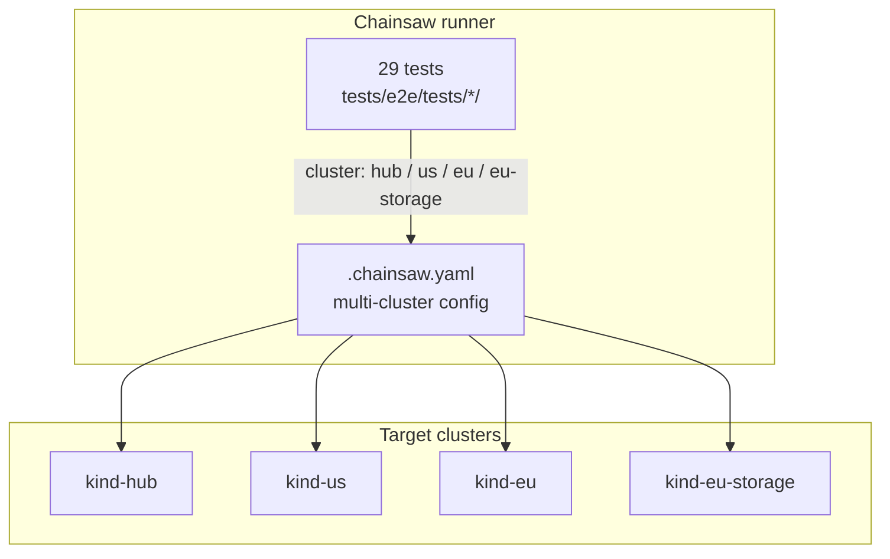
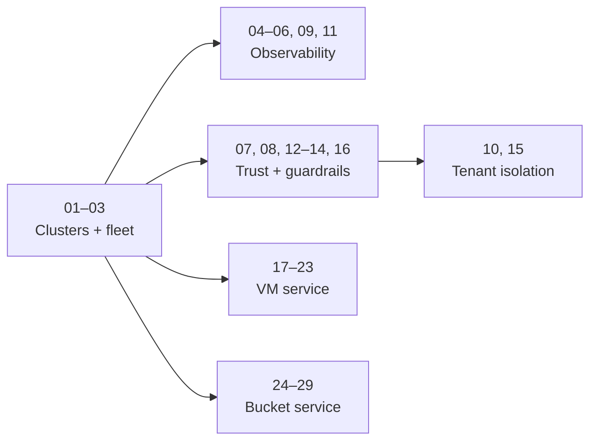
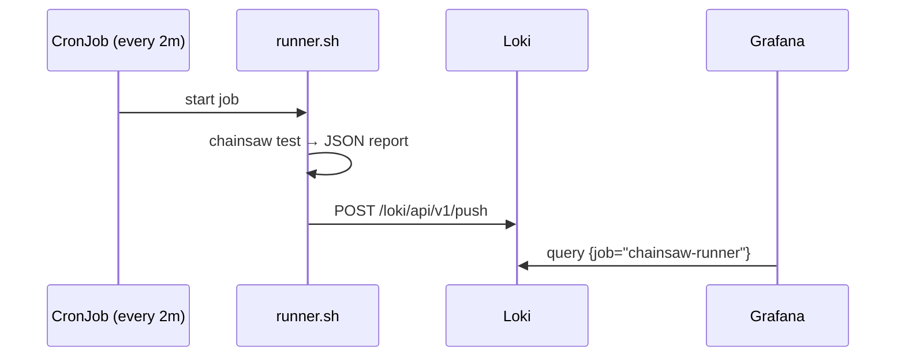

# Testing

The platform is verified by 29 end-to-end tests written for [Chainsaw](https://kyverno.github.io/chainsaw/latest/) and run with `make validate`. Tests are declarative YAML under `tests/e2e/tests/<NN>-<name>/chainsaw-test.yaml`, numbered `01`–`29` without gaps.

---

## Test architecture



`tests/e2e/.chainsaw.yaml` maps each cluster name to a kubeconfig (`make validate` and `make clusters` write `kubeconfig-<name>-internal`). A test picks its target with `cluster:` on the test, step or operation; cross-cluster steps switch between them.

---

## All 29 tests

| # | Test | Cluster | What it validates |
|---|------|---------|-------------------|
| 01 | `hub-cluster-ready` | hub | Hub nodes Ready |
| 02 | `us-cluster-ready` | us | Us nodes Ready |
| 03 | `fleet-registration` | hub | `ClusterProfile us` exists on the hub |
| 04 | `observability-stack` | hub | Prometheus, Grafana, Loki Ready; ServiceMonitors present (incl. `bucket-binding-controller`) |
| 05 | `chainsaw-cronjob` | hub | CronJob scheduled; previous job succeeded |
| 06 | `ingress-log-shipping` | hub | Dex and Grafana ingresses with TLS; event-exporter ships events to Loki |
| 07 | `oidc-trust` | hub, us | Dex healthy; OIDC discovery; JWKS; spoke oidc-verifier validates a Dex-signed JWT; audit trail |
| 08 | `rotating-trust` | hub | Projected service account token volume on the controller; Dex kept for humans |
| 09 | `dashboard-metrics` | hub | Dashboards exist; Prometheus has `bucket_binding_controller_reconcile_total` |
| 10 | `tenant-isolation` | hub, eu-storage | A tenant's Bucket becomes a bound claim in that tenant's namespace; metrics carry `tenant_id` |
| 11 | `dashboard-data` | hub | Dashboard panel queries return data |
| 12 | `auth-configuration` | hub, us | Spoke apiserver uses `AuthenticationConfiguration` (hub + Dex issuers), no legacy `oidc-*` flags |
| 13 | `projected-sa-tokens` | hub, us | Hub OIDC discovery; controller token volume with the right audience; spoke trust setup |
| 14 | `admission-guardrails` | us | Three `ValidatingAdmissionPolicy` resources bound; platform-admin RBAC present |
| 15 | `multi-tenant-isolation` | hub, eu-storage | acme-corp and globex-inc buckets in separate namespaces; no cross-tenant claims or credentials |
| 16 | `platform-admin-access` | us | Platform admin manages ClusterRoles; others cannot |
| 17 | `eu-cluster-ready` | hub, eu | eu Ready; `ClusterProfile eu` has `offers-vms`; kubeconfig Secret present |
| 18 | `kubevirt-ready` | eu | KubeVirt `Deployed`; schedulable node; hardware virtualization |
| 19 | `vmset-provisioning` | hub | `VmSet` → cloud-init Secret + request with tier cpu/memory; bad input and size changes rejected |
| 20 | `vmset-lifecycle` | hub, eu | VMs run; status flows back; scale-down removes the highest index; delete cleans eu |
| 21 | `vm-cloudinit` | hub, eu | Cloud-init marker appears in the guest serial log |
| 22 | `vm-console-rbac` | eu | VM controller scope; console and read rights by tier |
| 23 | `vmset-unschedulable` | hub | Region without KubeVirt → `Unschedulable`; delete not blocked |
| 24 | `eu-storage-cluster-ready` | hub, eu-storage | eu-storage Ready; every spoke has a `region` label; `offers-object-storage` on eu-storage |
| 25 | `ceph-rgw-ready` | eu-storage | CephCluster and CephObjectStore Ready; `ceph-bucket` StorageClass |
| 26 | `bucket-provisioning` | hub, eu-storage | Tier → quota; claim Bound; endpoint on hub; S3 put/get; bad input rejected |
| 27 | `bucket-lifecycle` | hub, eu-storage | Ceph refuses over `maxSize` and past `maxObjects`; delete removes claim, Secret, ConfigMap |
| 28 | `bucket-tenant-rbac` | eu-storage | Controller scope; tenant tiers; credentials only for admin and developer |
| 29 | `bucket-unschedulable` | hub, eu-storage | Region without Ceph → `Unschedulable`; no claim; delete not blocked |

---

## Test flow map

Tests run in order; earlier ones leave the platform in the state later ones assume.



---

## Running tests

```bash
# Full suite
make validate

# One test (from tests/e2e; --config is required there)
cd tests/e2e
chainsaw test --config .chainsaw.yaml tests/07-oidc-trust

# A few
chainsaw test --config .chainsaw.yaml tests/26-bucket-provisioning tests/27-bucket-lifecycle
```

`chainsaw` is installed by `make install-chainsaw` (into `$GOPATH/bin`).

## In-cluster continuous testing

The **Chainsaw CronJob** (`chart/infrastructure/templates/chainsaw-cronjob.yaml`) runs a subset of the real tests every 2 minutes and pushes JSON results to Loki; the **Chainsaw Results** dashboard draws pass/fail trends. The runner image bundles `tests/e2e/tests/`; the Helm value `cronjob.tests` lists which directories run (13 today: 01–09, 12–14, 16). Only tests that need nothing beyond the hub and `us` belong there; the VM and bucket suites and the tenant-isolation tests (10, 11, 15) run through `make validate` only. `make check-runner-tests` (part of `make lint`) fails if a listed directory does not exist, so renumbering cannot silently break the CronJob.

`make deploy` builds the runner image, loads it into the hub and creates the `kubeconfigs` Secret (`make chainsaw-runner`); without them the CronJob's pod cannot start.



## Design patterns used

| Pattern | Examples |
|---------|----------|
| Apply a resource, assert it becomes Ready | 19, 26, 27, 29 |
| `expect` an error for invalid input | 19, 26 |
| Script with `kubectl auth can-i` / `SubjectAccessReview` | 22, 28 |
| Throwaway Pod using the order's own credentials (`envFrom`) | 26, 27 |
| Read controller metrics through the API-server service proxy | 10, 15 |
| Port-forward to Prometheus / Grafana | 09, 11 |
| Two clusters in one test (hub apply, spoke assert) | 10, 15, 20, 26 |

## Key files

| File | Purpose |
|------|---------|
| `tests/e2e/.chainsaw.yaml` | Cluster → kubeconfig map and timeouts |
| `tests/e2e/tests/<NN>-<name>/chainsaw-test.yaml` | One test each (table above) |
| `chart/infrastructure/values.yaml` (`cronjob.tests`) | Which tests the in-cluster CronJob runs |
| `deploy/platform-mvp/observability/runner.sh` | CronJob entrypoint: runs the listed tests, pushes results to Loki |
| `chart/infrastructure/dashboards/chainsaw-results.json` | Includes the suite table shown in Grafana |
