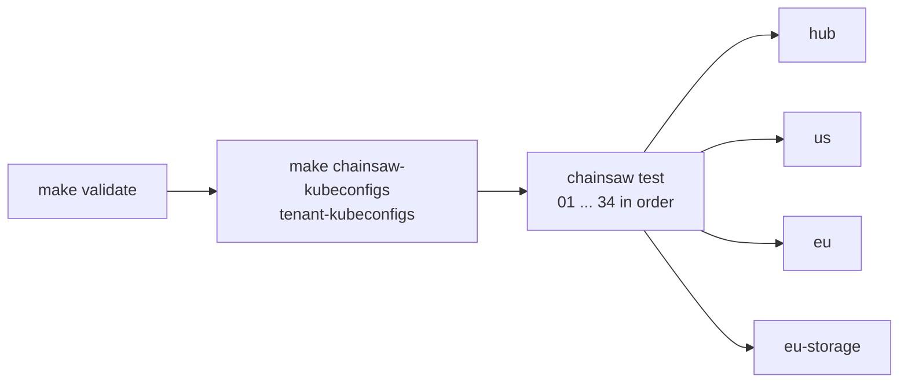
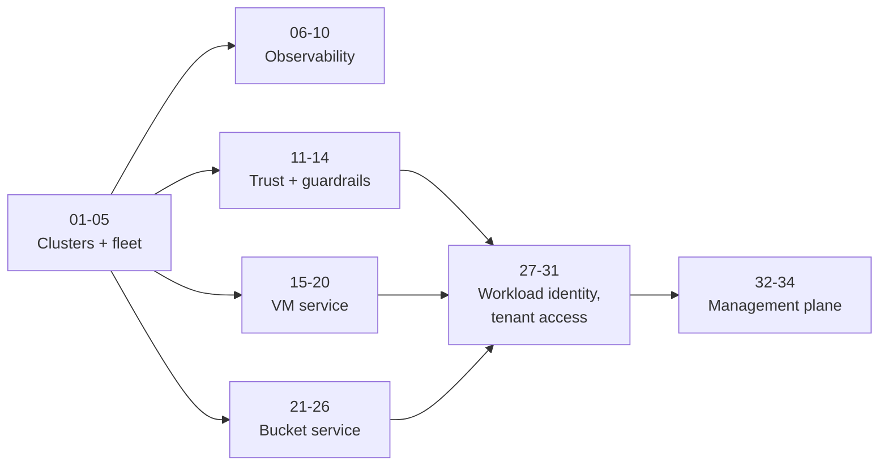

# Testing

34 end-to-end Chainsaw tests, run with `make validate`, verify the platform. This is the one test table; other documents refer to tests by number.



Tests are declarative YAML in `tests/e2e/tests/<NN>-<name>/chainsaw-test.yaml`, numbered `01` to `34` without gaps.

`tests/e2e/.chainsaw.yaml` maps each cluster name (`hub`, `us`, `eu`, `eu-storage`, and `hub-acme-corp`, `hub-globex-inc`) to a kubeconfig; a test, step or operation picks its target with `cluster:`. `make clusters` and `make validate` write the `kubeconfig-<name>-internal` files.

## The tests

| # | Test | Cluster | What it validates |
|---|------|---------|-------------------|
| 01 | `hub-cluster-ready` | hub | Hub nodes Ready |
| 02 | `us-cluster-ready` | us | `us` nodes Ready |
| 03 | `eu-cluster-ready` | hub, eu | `eu` Ready; `ClusterProfile eu` has `offers-vms`; kubeconfig Secret present |
| 04 | `eu-storage-cluster-ready` | hub, eu-storage | `eu-storage` Ready; every spoke has a `region` label; `offers-object-storage` on `eu-storage` |
| 05 | `fleet-registration` | hub | `ClusterProfile us` on the hub has `region=us` and `offers-vms`; kubeconfig Secret present |
| 06 | `observability-stack` | hub | Prometheus operator and Prometheus deployed; Grafana Available and healthy; Loki rolled out; `bucket-binding-controller` ServiceMonitor |
| 07 | `ingress-log-shipping` | hub | Ingress controller and Grafana ingress exist; event exporter deployed; Loki ready; an event the test creates reaches Loki under `job="kubernetes-events"` |
| 08 | `dashboard-metrics` | hub | Controller exposes `bucket_binding_controller_reconcile_total`; the three infrastructure dashboards exist; Prometheus scrapes it |
| 09 | `dashboard-data` | hub | Dashboard panel queries return data |
| 10 | `chainsaw-cronjob` | hub | The `chainsaw-runner` CronJob exists |
| 11 | `oidc-trust` | hub | Dex healthy; issuer is the ingress URL; token exchange advertised; Dex version; public client `kubernetes`; JWKS serves keys |
| 12 | `auth-configuration` | hub, us | Spoke API server uses `AuthenticationConfiguration`, no legacy `oidc-*` flags; a real Dex ID token authenticates as `dex:<sub>` |
| 13 | `projected-sa-tokens` | hub, us | Hub OIDC discovery; controller token volume with the right audience, mounted; spoke loads an `AuthenticationConfiguration` |
| 14 | `platform-admin-access` | us | Two `ValidatingAdmissionPolicy` resources bound (none for a kind the API server does not serve); platform admin manages ClusterRoles and reads the auth config; tenants can neither create ClusterRoles nor change the auth config |
| 15 | `kubevirt-ready` | eu, us | On each: KubeVirt `Deployed`; schedulable node; hardware virtualization |
| 16 | `vmset-provisioning` | hub | `VmSetIntent` to cloud-init Secret and request with tier cpu and memory; bad input and size changes rejected |
| 17 | `vmset-lifecycle` | hub, eu, us | One VM set in `eu` and `us`: VMs run on both; status of both flows back; scale-down removes the highest index in each; delete cleans both |
| 18 | `vm-cloudinit` | hub, eu | Cloud-init marker appears in the guest serial log |
| 19 | `vm-console-rbac` | eu, us | On each: VM controller scope; console and read rights by tier |
| 20 | `vmset-unschedulable` | hub, eu | A region no cluster serves (`asia`) is `Unschedulable`; delete not blocked; a request without a tenant label is `Unschedulable`, no VM |
| 21 | `ceph-rgw-ready` | eu-storage | CephCluster and CephObjectStore Ready; `ceph-bucket` StorageClass |
| 22 | `bucket-provisioning` | hub, eu-storage | Tier to quota; claim Bound; endpoint on hub; S3 put and get; bad input rejected |
| 23 | `bucket-lifecycle` | hub, eu-storage | Ceph refuses over `maxSize` and past `maxObjects`; delete removes claim, Secret, ConfigMap |
| 24 | `bucket-tenant-rbac` | eu-storage | Controller scope; tenant tiers; credentials only for admin and developer |
| 25 | `bucket-tenant-isolation` | hub, eu-storage | acme-corp and globex-inc buckets land as tenant-labelled claims in separate namespaces; no cross-tenant claims or credentials; metrics carry both `tenant_id`s |
| 26 | `bucket-unschedulable` | hub, eu-storage | Region without Ceph is `Unschedulable`; no claim; delete not blocked; a request without a tenant label is `Unschedulable`, no claim |
| 27 | `workload-issuer` | hub, us | `us` publishes its token issuer anonymously; Dex exchanges a `us` service account token |
| 28 | `hub-workload-auth` | hub, us | The hub maps the exchanged token to `dex:us-workloads:...`; humans keep `dex:<sub>`; foreign, tampered and garbage tokens are rejected |
| 29 | `hub-tenant-intents` | hub | One RBAC table for humans and the workload identity; admission lets only tenant principals create, change and delete intents in their own namespace; platform admin and kind admin refused; key injection rejected; label from the namespace; the platform admin lists every kind but Secrets, deletes tenant namespaces only and offboards a tenant |
| 30 | `tenant-kubectl-login` | hub | alice's tenant kubeconfig logs in through Dex (`kubectl oidc-login`, password grant) on hub, us, eu and eu-storage in group `dex:acme-corp-admin`, and reaches acme-corp, not globex-inc |
| 31 | `tenant-chart-access` | eu-storage | dave applies globex-inc's chart with his own login, waits until every intent is Ready, logs in to his VM in `eu` and in `us` over ssh through `virtctl port-forward`, and writes and reads an object in his bucket with `curl` through the public S3 port; then deletes his order |
| 32 | `management-plane-ready` | hub | The metrics-operator runs and all its Metrics are Ready; it reads intents but not Secrets or CRDs; Prometheus scrapes it; Headlamp runs and sends logins to Dex with PKCE and the right callback; Grafana has the adoption dashboard |
| 33 | `intent-metrics` | hub | This run's creation times reach Prometheus per tenant; a provisioned bucket has a time to Ready; an unschedulable one never has a ready series; every panel of the adoption dashboard returns data and no duration is negative |
| 34 | `portal-tenant-isolation` | hub, us, eu, eu-storage | Two tenants log in through Headlamp's OIDC flow and work only in their own namespace, on the hub and the spokes; CRDs readable, no objects of other kinds; the platform admin sees every cluster, on the hub no Secrets; no login, no access; token audience `kubernetes`; the Kro plugin is listed |

## Order and tenants

Tests run in number order, and earlier ones leave the state later ones assume. Chainsaw runs concurrent tests in no fixed order, so every test sets `spec.concurrent: false`; `make check-tests` (part of `make lint`) enforces that, the gapless numbering, and `metadata.name` equal to the directory name without the number.



Intents are created by their tenant, never by the cluster admin (admission refuses it). Tests 16, 17, 18, 20, 22, 23, 25 and 26 therefore use the clusters `hub-acme-corp` and `hub-globex-inc`: kubeconfigs that act as each tenant's workload identity, written by `make chainsaw-kubeconfigs` (part of `make validate`). Test 29 impersonates with `--as`; tests 30 and 31 log in as a tenant through Dex, as people do.

## Running tests

```bash
make validate                                    # full suite
cd tests/e2e                                     # --config is required there
chainsaw test --config .chainsaw.yaml tests/11-oidc-trust
chainsaw test --config .chainsaw.yaml tests/22-bucket-provisioning tests/23-bucket-lifecycle
```

`make install-chainsaw` installs the pinned `CHAINSAW_VERSION` (v0.2.15). Tests 30 and 31 also need `make install-kubelogin install-virtctl`, `ssh` and `curl` where they run, and the tenant kubeconfigs (`make tenant-kubeconfigs`, part of `make validate`).

## In-cluster continuous testing

The CronJob runs the 12 tests in `cronjob.tests` (`chart/infrastructure/values.yaml`) every 2 minutes and pushes results to Loki: 01, 02, 05-08, 10-14 and 32, the ones that need only `hub` and `us`. Its image bundles the tests, so a changed test needs `make chainsaw-runner`. `make check-runner-tests` fails on a listed test that does not exist; `make check-test-reference` keeps the Chainsaw Results dashboard's table in step.

## Patterns used

| Pattern | Tests |
|---------|-------|
| Apply, assert Ready; `expect` an error for invalid input | 16, 22, 23, 26 |
| `kubectl auth can-i` or `SubjectAccessReview` for rights | 19, 24, 29, 30 |
| Hub apply, spoke assert | 17, 22, 25 |
| Pass a token between steps through a file | 12, 22, 23, 27-29, 34 |
| Log in as a tenant: its kubeconfig switched to the password grant | 30, 31 |
| Scripted OIDC browser flow (cookie jar, Dex's form, PKCE) | 34 |
| Run each dashboard panel's own query | 33 |

## Writing tests: three traps

- In a script, `${CHAINSAW_KUBECONFIG_HUB}` is empty and `kubectl` already points at the step's cluster; call plain `kubectl`, never a variable or a function around it.
- Start a background `kubectl port-forward` directly (so `$!` is its PID) with `>/dev/null 2>&1`; an orphan that keeps chainsaw's pipes open hangs the run.
- Pass JSON that contains `\n` through `printf '%s'`, not `echo`, which expands it.
