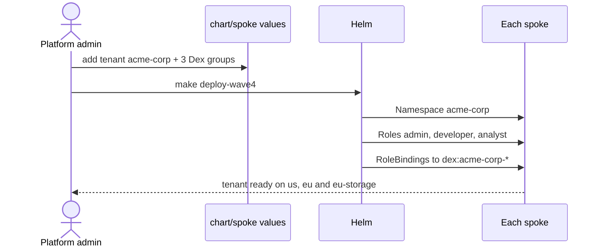
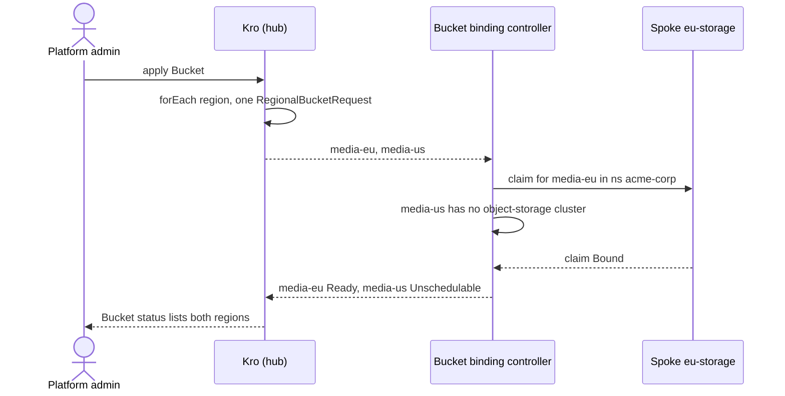
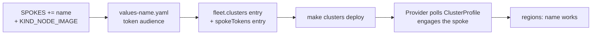
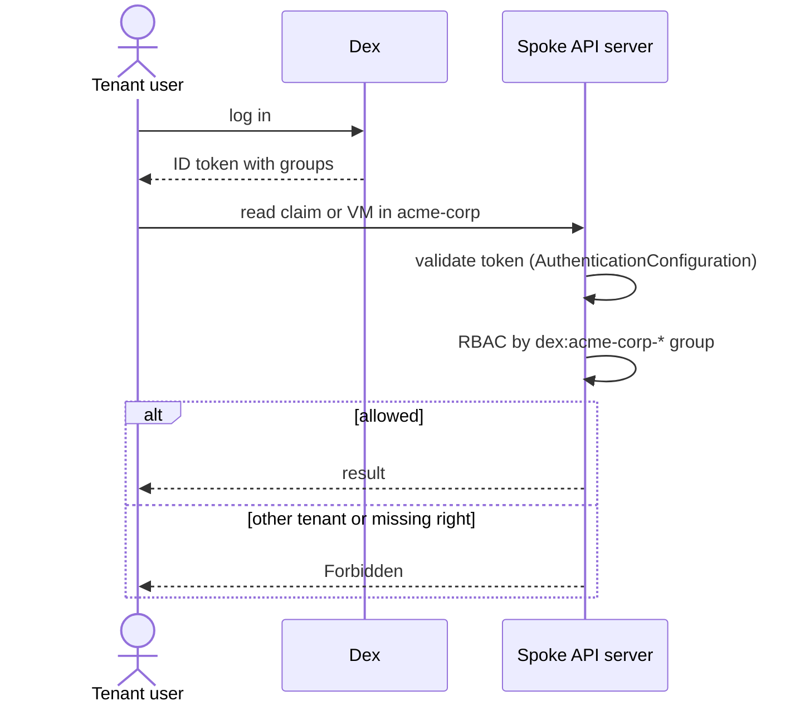
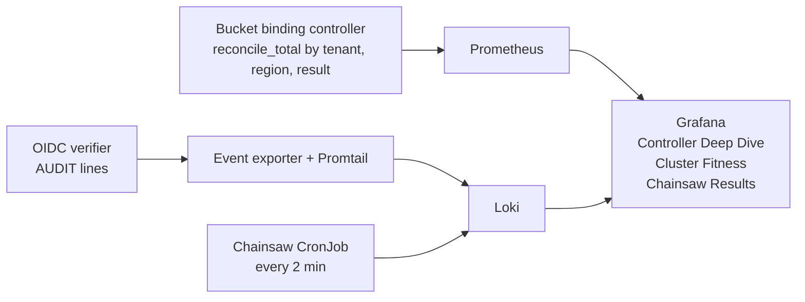
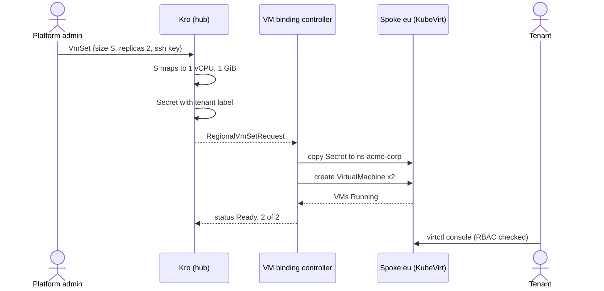
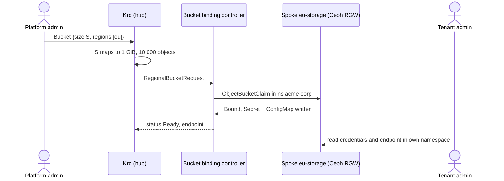

# Use cases

The capabilities are listed in [Capabilities](capabilities.md). This page shows how each role uses them.

## Scenarios

| ID | As a | I want to | So that |
|----|------|-----------|---------|
| S1 | Platform admin | onboard a tenant with one values entry | the tenant gets a namespace and three roles on every spoke |
| S2 | Platform admin | order a bucket or VM set for a tenant in several regions with one object | I do not repeat work per region |
| S3 | Platform admin | add a region without changing controller code | the platform grows by configuration |
| S4 | Platform admin | see reconcile rates and errors per tenant and region | I can spot a failing tenant or region |
| S5 | Tenant admin | see my VMs, buckets and credentials | my team can use what was ordered |
| S6 | Tenant developer | open a console on my VM and use my bucket | I can work without any network exposure |
| S7 | Tenant analyst | read VMs, claims and status only | I can report without risk or seeing credentials |
| S8 | Tenant | be unable to see or touch another tenant | my data stays mine |
| S9 | Platform admin | order 1–3 small VMs, size S or M, for a tenant | the tenant gets a cheap Linux machine to try things on |
| S10 | Platform admin | order an S3 bucket, size S or M, for a tenant | the tenant gets object storage with a quota |

## S1 · Onboard a tenant

Add the tenant to `tenants:` in `chart/spoke/values.yaml` and its group to Dex, then `make deploy-wave4`.



## S2 · Order in several regions

Tenants have no identity on the hub, so the platform admin places the order on their behalf.

```yaml
apiVersion: platform.example.com/v1alpha1
kind: Bucket
metadata:
  name: media
  labels: { platform.example.com/tenant: acme-corp }
spec:
  regions: [eu, us]
  size: S
```



A region that does not host the service is reported `Unschedulable` and creates nothing; the other regions are unaffected.

## S3 · Add a region



No Go code changes. `eu` and `eu-storage` were added this way. Steps: [Adding a region](adding-a-region.md).

## S5–S8 · Day to day on a spoke



| Role | read VMs / claims | VM console | read S3 credentials | create or delete | other tenant |
|------|:-----------------:|:----------:|:-------------------:|:----------------:|:------------:|
| admin | ✅ | ✅ | ✅ | ❌ | ❌ |
| developer | ✅ | ✅ | ✅ | ❌ | ❌ |
| analyst | ✅ | ❌ | ❌ | ❌ | ❌ |

Nobody but the platform creates or deletes VMs and claims; they come from the hub order. Tests 15, 22 and 28 simulate users with `--as` / `--as-group` and `SubjectAccessReview`.

## S4 · Watch the platform



## S9 · Order VMs



| Tier | vCPU | Memory |
|------|-----:|-------:|
| S | 1 | 1 GiB |
| M | 2 | 2 GiB |

Replicas scale down highest index first; deleting the `VmSet` removes its VMs and Secret from `eu`. Console access is enforced by RBAC (test 22); an interactive `virtctl console` session itself is not part of the automated suite. Tests 17–23.

## S10 · Order a bucket



| Tier | Max size | Max objects |
|------|---------:|------------:|
| S | 1 GiB | 10 000 |
| M | 10 GiB | 100 000 |

Ceph refuses writes past the quota (test 27); deleting the `Bucket` removes the claim, Secret and ConfigMap. Details: [Object storage](object-storage.md). Tests 24–29.
