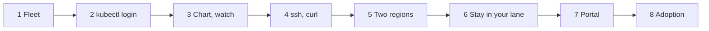

# Use cases

The demo: eight acts, about 15 minutes. A tenant logs in with `kubectl`, orders with its chart, watches, then proves access with `ssh` and `curl`. Every step shows something a test asserts, and each act ends with the command that runs it live ([Testing](testing.md)). Run the acts in order on a fresh `make deploy`. The tests use globex-inc's chart and other names, so a proof run leaves the demo alone. Outputs were captured on this lab.

## Setup

Tools: `make install-chainsaw install-kubelogin install-virtctl`, plus `helm`, `ssh` and `curl`. `make deploy` writes a kubeconfig per tenant to `hack/platform-mvp/` (`make tenant-kubeconfigs`).

```bash
T="kubectl --kubeconfig hack/platform-mvp/kubeconfig-acme-corp"     # alice's tenant: contexts hub, us, eu, eu-storage
HUB="kubectl --kubeconfig $HOME/.kube/config --context kind-hub"     # the platform team (kind admin)
C=deploy/platform-mvp/chart/tenant
prove() { (cd tests/e2e && chainsaw test --config .chainsaw.yaml "tests/$1"); }
ssh-keygen -q -t rsa -b 3072 -N '' -f ~/.ssh/demo_rsa                 # the CirrOS guest takes RSA keys only
```

The cast ([demo users](identity-and-access.md#tenants), password `password`): alice is acme-corp's admin, dave globex-inc's; `admin@example.com` is the platform admin; the kind admin (`system:masters`) passes RBAC for everything.

### Open the UIs

| UI | Address | Port-forward | Login | Tests |
|----|---------|--------------|-------|-------|
| Grafana | `https://<INGRESS_HOST>/`; `make grafana-url` lists the dashboards | `make grafana`, then <http://localhost:3000> | `admin` / `admin` | 06, 07, 09 |
| Portal (Headlamp) | `https://<INGRESS_HOST>/headlamp/`: clusters `hub`, `us`, `eu`, `eu-storage` | none: Dex returns logins only to the ingress host | **Log in with Email**, once per cluster | 32, 34 |
| S3 | `http://localhost:30080` on the lab host, `http://<INGRESS_HOST>:30080` elsewhere (`S3_NODE_PORT`) | none | the bucket's own key | 31 |
| Prometheus | none | `$HUB -n monitoring port-forward svc/hub-kube-prometheus-stack-prometheus 9090:9090`, then <http://localhost:9090> | none | 08, 33 |
| Loki | Grafana, **Explore**, data source Loki | as Grafana | as Grafana | 07 |
| Dex | `https://<INGRESS_HOST>/dex/.well-known/openid-configuration` | none | none | 11 |

The browser must resolve `INGRESS_HOST` (Makefile) to the lab host; on the lab host itself, `127.0.0.1 <INGRESS_HOST>` in `/etc/hosts` does it. The certificate is self-signed.

| # | Act | Min | Proof |
|---|-----|----:|-------|
| 1 | [Meet the fleet](#1-meet-the-fleet) | 1 | 04, 05 |
| 2 | [Log in with kubectl](#2-log-in-with-kubectl) | 2 | 30 |
| 3 | [Order with your chart, then watch](#3-order-with-your-chart-then-watch) | 2 | 31 |
| 4 | [Prove it: ssh and curl](#4-prove-it-ssh-and-curl) | 2 | 31 |
| 5 | [Two regions, the honest answer](#5-two-regions-the-honest-answer) | 1.5 | 26 |
| 6 | [Stay in your lane](#6-stay-in-your-lane) | 1.5 | 29 |
| 7 | [Every cluster in the portal](#7-every-cluster-in-the-portal) | 2.5 | 34 |
| 8 | [Is anyone using it?](#8-is-anyone-using-it) | 2.5 | 33 |



## 1. Meet the fleet

> **Say:** One controller, N clusters, chosen by labels. The APIs underneath are alpha.

1. The registered clusters and what each offers:

   ```bash
   $HUB get clusterprofiles --show-labels
   ```

   `eu` and `us` offer VMs, `eu-storage` object storage; each carries its `region` ([Architecture](architecture.md#fleet-which-clusters-exist)).

2. The services, as Kro graphs: `$HUB get rgd` shows `bucketintent.platform.example.com` and `vmsetintent.platform.example.com`, both `Active` ([Architecture](architecture.md#intent-a-kro-graph)).

**Proof:** `prove 04-eu-storage-cluster-ready` (6 s) and `prove 05-fleet-registration`.

## 2. Log in with kubectl

> **Say:** One login for every cluster, with the tenant's own identity. RBAC on each cluster decides what it sees.

1. Ask the hub for alice's intents. `kubectl oidc-login` prints a Dex URL: open it, choose **Log in with Email**, sign in as `alice@acme-corp.example.com`, and paste Dex's code back into the terminal:

   ```bash
   $T --context hub get bucketintents
   ```

   `No resources found in acme-corp namespace.` The other clusters reuse the cached token.

2. Who the clusters see:

   ```bash
   $T --context eu auth whoami
   ```

   `dex:CiQx…` with the group `dex:acme-corp-admin`: Dex's opaque subject, and her tenant role.

3. Another tenant's namespace is refused on every cluster:

   ```bash
   $T --context eu-storage -n globex-inc get objectbucketclaims
   ```

   `Forbidden` ([Identity and access](identity-and-access.md#people-kubectl)).

**Proof:** `prove 30-tenant-kubectl-login` (6 s): alice logs in to all four clusters and stays in acme-corp.

## 3. Order with your chart, then watch

> **Say:** The tenant's order is a small chart of buckets and VM sets. It installs with the tenant's own login; admission refuses anyone else.

1. Render acme-corp's chart with your key and apply it as alice:

   ```bash
   helm template acme-corp $C -f $C/values-acme-corp.yaml --set-file sshPublicKey=$HOME/.ssh/demo_rsa.pub | $T --context hub apply -f -
   ```

   `bucketintent.platform.example.com/photos created`, `vmsetintent.platform.example.com/web created`.

2. Watch the VM set become ready (Ctrl-C when `READY` is `True`):

   ```bash
   $T --context hub get vmsetintent web --watch
   ```

   The row updates until `ACTIVE`, `True`, within seconds.

3. The work landed on the spokes, in alice's namespace, seen with her login:

   ```bash
   $T --context eu get vm
   $T --context us get vm
   $T --context eu-storage get objectbucketclaim
   ```

   `web-eu-0`, `web-eu-1`, `web-us-0`, `web-us-1` `Running`; `photos-eu` `Bound` ([Virtual machines](virtual-machines.md), [Object storage](object-storage.md)).

**Proof:** `prove 31-tenant-chart-access` (21 s): dave orders with globex-inc's chart, waits, then does the next act.

## 4. Prove it: ssh and curl

> **Say:** Access, not just status: the tenant reaches its VM and its bucket with standard tools.

1. Log in to a VM over ssh, through `virtctl port-forward` with alice's login:

   ```bash
   ssh -i ~/.ssh/demo_rsa -o HostKeyAlgorithms=+ssh-rsa -o PubkeyAcceptedAlgorithms=+ssh-rsa -o StrictHostKeyChecking=no -o UserKnownHostsFile=/dev/null \
     -o "ProxyCommand=virtctl --kubeconfig hack/platform-mvp/kubeconfig-acme-corp --context eu port-forward --stdio=true vmi/web-eu-0/acme-corp 22" \
     cirros@web-eu-0 uname -n
   ```

   `web-eu-0`; `--context us` and `web-us-0` reach the other region. The CirrOS SSH server is old, hence the RSA options.

2. Read the bucket's key and name on the storage spoke:

   ```bash
   S="$T --context eu-storage"
   AK=$($S get secret photos-eu -o jsonpath='{.data.AWS_ACCESS_KEY_ID}' | base64 -d)
   SK=$($S get secret photos-eu -o jsonpath='{.data.AWS_SECRET_ACCESS_KEY}' | base64 -d)
   BUCKET=$($S get configmap photos-eu -o jsonpath='{.data.BUCKET_NAME}')
   ```

3. Write an object with curl and read it back, signed with the bucket's key:

   ```bash
   echo hello > /tmp/hello.txt
   curl -s --aws-sigv4 aws:amz:us-east-1:s3 --user "$AK:$SK" -T /tmp/hello.txt http://localhost:30080/$BUCKET/hello.txt
   curl -s --aws-sigv4 aws:amz:us-east-1:s3 --user "$AK:$SK" http://localhost:30080/$BUCKET/hello.txt
   ```

   `hello`.

**Proof:** `prove 31-tenant-chart-access`: the same ssh and curl, as dave.

## 5. Two regions, the honest answer

> **Say:** Status flows back without polling. A region that cannot run the service says so, and the intent is not Ready.

1. One bucket in `eu` and `us`:

   ```bash
   printf 'apiVersion: platform.example.com/v1alpha1\nkind: BucketIntent\nmetadata: {name: everywhere}\nspec: {regions: [eu, us], size: S}\n' | $T --context hub apply -f -
   ```

2. The status per region, then the intent:

   ```bash
   $T --context hub get bucketintent everywhere -o jsonpath='{range .status.regions[*].regions[*]}{.region}{"\t"}{.phase}{"\t"}{.message}{"\n"}{end}'
   $T --context hub get bucketintent everywhere
   ```

   `eu` `Ready`; `us` `Unschedulable`, `region "us" does not offer object storage`; then `IN_PROGRESS`, `False` ([Architecture](architecture.md#intent-a-kro-graph)).

3. An unschedulable region never blocks a delete: `$T --context hub delete bucketintent everywhere`.

**Proof:** `prove 26-bucket-unschedulable` (7 s).

## 6. Stay in your lane

> **Say:** Admission plus RBAC keeps out even `system:masters`. The cost: kind gives no network isolation.

1. Dave, with his own login (`kubeconfig-globex-inc`, log in as `dave@globex-inc.example.com`), cannot look at acme-corp:

   ```bash
   kubectl --kubeconfig hack/platform-mvp/kubeconfig-globex-inc --context hub -n acme-corp get bucketintents
   ```

   `Forbidden: User "dex:CiQ0…" cannot list resource "bucketintents" … in the namespace "acme-corp"`.

2. The kind admin passes RBAC, and admission stops it:

   ```bash
   printf 'apiVersion: platform.example.com/v1alpha1\nkind: BucketIntent\nmetadata: {name: sneaky, namespace: acme-corp}\nspec: {regions: [eu]}\n' | $HUB apply -f -
   ```

   `ValidatingAdmissionPolicy 'intent-by-tenant-principal' … only the tenant principals of acme-corp may change its intents` ([Identity and access](identity-and-access.md#admission-guardrails)).

3. The platform admin may read but not write: the same command with `--as=dex:admin@example.com --as-group=dex:platform-admin` gives `cannot create resource "bucketintents"`.

**Proof:** `prove 29-hub-tenant-intents` (53 s): every refusal, and offboarding.

## 7. Every cluster in the portal

> **Say:** The portal forwards the user's own token to each cluster, so it adds no authorization model. Each cluster is its own login, and RBAC on it decides.

1. Open `https://<INGRESS_HOST>/headlamp/`: **Home** lists the clusters `hub`, `us`, `eu` and `eu-storage`. Open `hub`, **Sign In** as alice (type the address: Dex keeps a pasted trailing space). Set her namespace once: **Settings**, **Cluster**, **Allowed namespaces**: `acme-corp`.
2. **Custom Resources**, then **BucketIntent**: `photos`, `ACTIVE`, `True`.
3. Open her VMs on `eu`: `https://<INGRESS_HOST>/headlamp/c/eu/customresources/virtualmachines.kubevirt.io?namespace=acme-corp`. The portal asks for the `eu` login once, then shows `web-eu-0` and `web-eu-1`. With `?namespace=globex-inc`: `You don't have permissions to view this resource`.
4. Log in as `admin@example.com`: every cluster's namespaces and workloads; on the hub every tenant's intents, no Secrets.

**Proof:** `prove 34-portal-tenant-isolation` (12 s) ([Management plane](management-plane.md#portal)).

## 8. Is anyone using it?

> **Say:** Adoption counts timestamps, because the operator keeps a series until it restarts. Nothing measures satisfaction yet.

1. Open **Platform adoption** at `https://<INGRESS_HOST>/d/platform-adoption`: active tenants, intents created, the median time to Ready by kind.
2. Ask Prometheus at <http://localhost:9090> (port-forward above): `count by (tenant) (platform_intent_created_timestamp_seconds > time() - 7*86400)`.
3. Delete the order; do the next step while you wait two minutes:

   ```bash
   helm template acme-corp $C -f $C/values-acme-corp.yaml --set-file sshPublicKey=$HOME/.ssh/demo_rsa.pub | $T --context hub delete -f -
   ```

   **Intents created** does not drop: adoption counts creations, never what exists now ([Management plane](management-plane.md#measurement)).

4. Open **Chainsaw Results**: 12 of these tests run in the cluster every 2 minutes. In **Explore**, `{job="chainsaw-runner"}` shows each run's results and `{job="kubernetes-events"} |= "ChainsawProbe"` the event test 07 sends through the event pipeline ([Management plane](management-plane.md#metrics-logs-dashboards)).

**Proof:** `prove 33-intent-metrics` (1 min): this run's timestamps reach Prometheus, and every panel of the dashboard returns data.

## Finale

`make validate` runs all 34 tests, everything above and the layers underneath, in about 7 minutes. Where it stops: [Decisions and limits](decisions.md#limits).
