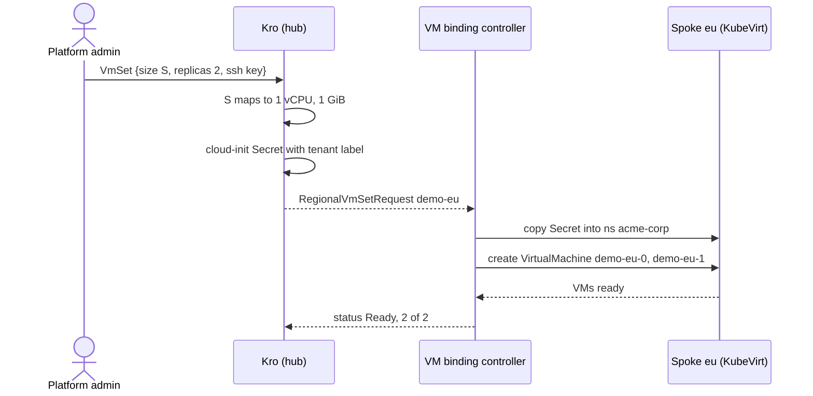

# Virtual machines

Tenants order a set of small virtual machines with a size tier. [Kro](https://kro.run/docs/overview/) on the hub expands the order, the **VM binding controller** places it on the VM-capable spoke, and [KubeVirt](https://kubevirt.io/user-guide/) runs the machines on hardware virtualization.

## Order

```yaml
apiVersion: platform.example.com/v1alpha1
kind: VmSet
metadata:
  name: demo
  labels: { platform.example.com/tenant: acme-corp }
spec:
  regions: [eu]
  size: S            # default S, immutable
  replicas: 2        # 1..3
  sshPublicKey: "ssh-ed25519 AAAA… user@host"
```

| Tier | vCPU | Memory |
|------|-----:|-------:|
| S | 1 | 1 GiB |
| M | 2 | 2 GiB |

Tiers, `maxReplicas` (3), the guest image and the accepted key pattern are Helm values under `vmSet` in `chart/hub-services/values.yaml`. The key must match `sshPublicKeyPattern` (ed25519, RSA or ECDSA, base64 body, safe comment characters), which keeps it from breaking out of the generated shell script.

## Flow



The graph emits two objects on the hub:

| Object | Name | Content |
|--------|------|---------|
| `Secret` | `<vmset>-cloudinit` | `userdata` script (cloud-init NoCloud): appends the public key to the guest user's `authorized_keys` and prints a marker to the serial console |
| `RegionalVmSetRequest` | `<vmset>-<region>` | region, replicas, `cpu`, `memory`, `image`, `cloudInitSecretName` |

On the spoke, in the tenant namespace:

| Object | Name | Notes |
|--------|------|-------|
| `Secret` | `<vmset>-cloudinit` | Copy of the hub Secret; read through an uncached reader so no cluster-wide Secret informer exists on the spoke |
| `VirtualMachine` | `<request>-<i>`, `i` in `[0, replicas)` | `runStrategy` from configuration; cores and guest memory from the request; a `containerDisk` root volume; the Secret attached as `cloudInitNoCloud`; serial console logging enabled |

A machine is ready when KubeVirt reports `status.ready`. The request is `Ready` only when every desired machine is ready.

## Lifecycle

- Scaling up creates only the missing machines; scaling down deletes the highest indices first.
- The tier is immutable. The request's `cpu`, `memory` and `image` are guarded by CEL rules (`self == oldSelf`).
- The controller sets the finalizer `platform.example.com/vm-cleanup`. Deleting the order removes the machines and the Secret from the spoke, then releases the request. A request for a region without a VM host is released immediately.
- A region with no engaged VM host is reported `Unschedulable`, creates nothing, and does not block deletion.

## The VM host

Spoke `eu` runs Kubernetes 1.35 (KubeVirt 1.9 supports 1.34–1.36) and is labelled `platform.example.com/offers-vms=true`. `make deploy-wave4` applies the cached KubeVirt operator manifest, then the spoke chart creates the `KubeVirt` custom resource (`useEmulation: false`, so the host needs `/dev/kvm`). The VM binding controller engages only clusters with that label, so `us` never sees VM work.

## Access

| Identity | VMs | Console |
|----------|-----|---------|
| `vm-binding-controller` (hub) | read everywhere; create, update, patch, delete in tenant namespaces; manage the cloud-init Secret there | no |
| tenant admin, developer | read | yes (`virtualmachineinstances/console`) |
| tenant analyst | read | no |
| another tenant | no | no |

Tenants do not create or delete machines; they come from the hub order. A console is opened with `virtctl console` against the spoke API server and is gated by the RBAC above. RBAC is defined in `chart/spoke/templates/vm-binding-controller-rbac.yaml` and `tenant.yaml`.

## Configuration

| Where | Key |
|-------|-----|
| `chart/hub-services/values.yaml` | `vmSet.*`, `vmBindingController.*` (`clusterSelector`, `runStrategy`, `requeueInterval`, `pollInterval`, `defaultNamespace`, `spokeTokens`), `fleet.clusters[]` |
| `chart/spoke/values-eu.yaml` | `kubevirt.enabled`, `vmBindingControllerRBAC.enabled`, token audience |
| Makefile | `KUBEVIRT_VERSION`, `KUBEVIRT_SPOKES` |

## Tests

| # | Test | Verifies |
|---|------|----------|
| 17 | `eu-cluster-ready` | eu Ready; `ClusterProfile eu` carries `offers-vms`; kubeconfig Secret present |
| 18 | `kubevirt-ready` | KubeVirt `Deployed`; schedulable node; hardware virtualization |
| 19 | `vmset-provisioning` | order expands to Secret and request with the tier's cpu and memory; invalid input and size changes rejected |
| 20 | `vmset-lifecycle` | machines run; status flows back; scale-down order; delete cleans the spoke |
| 21 | `vm-cloudinit` | the cloud-init marker appears in the guest serial log |
| 22 | `vm-console-rbac` | controller scope; read and console rights by tier |
| 23 | `vmset-unschedulable` | region without KubeVirt is `Unschedulable`; delete not blocked |

An interactive `virtctl console` session is not part of the automated suite.

## Limits

- The guest is the [CirrOS](https://github.com/cirros-dev/cirros) demo image from KubeVirt's container disks; it is intended for trying the platform, not for workloads.
- Machines have no network exposure; access is the console through the spoke API server.
- `status.regions` on the order nests one level (`regions[0].regions[0]`), because Kro maps each request's whole status.
