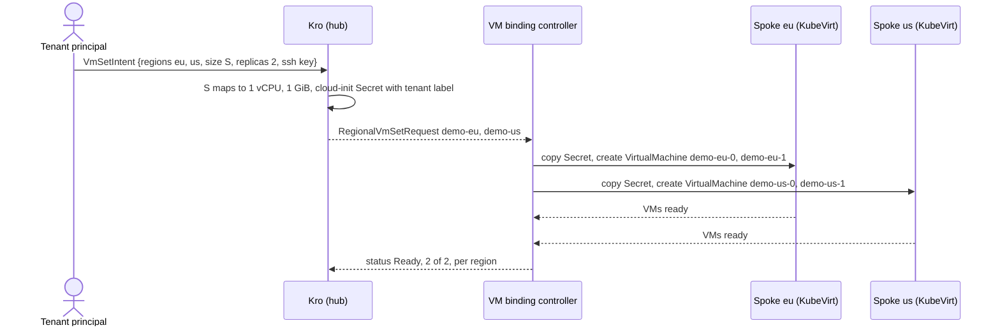

# Virtual machines

Tenants ask for a set of small virtual machines by creating a `VmSetIntent` in their hub namespace; Kro expands it, the VM binding controller places each region's share on that region's VM spoke (`eu` or `us`), and KubeVirt runs the machines on hardware virtualization.

```yaml
apiVersion: platform.example.com/v1alpha1
kind: VmSetIntent
metadata:
  name: demo
  namespace: acme-corp   # the tenant; the label is derived from it
spec:
  regions: [eu, us]  # one RegionalVmSetRequest per region
  size: S            # default S, immutable
  replicas: 2        # 1..3, per region
  sshPublicKey: "ssh-rsa AAAA… user@host"   # the CirrOS guest takes RSA only
```

| Tier | vCPU | Memory |
|------|-----:|-------:|
| S | 1 | 1 GiB |
| M | 2 | 2 GiB |

Tiers, `maxReplicas` (3), the guest image and the key pattern are Helm values under `vmSet` in `chart/hub-services/values.yaml`. The key must match `sshPublicKeyPattern` (ed25519, RSA or ECDSA; base64 body; safe comment characters), which keeps it from breaking out of the generated shell script.

## Flow



On the hub the graph emits a `Secret` `<vmset>-cloudinit` (a `userdata` script that appends the key to the guest user's `authorized_keys` and prints a marker to the serial console) and a `RegionalVmSetRequest` `<vmset>-<region>`. On the spoke, in the tenant namespace, the controller creates:

- a copy of the Secret, read through an uncached reader so no cluster-wide Secret informer exists on the spoke;
- `VirtualMachine` `<request>-<i>` for `i` in `[0, replicas)`: `runStrategy` from configuration, cores and memory from the request, a `containerDisk` root volume, the Secret as `cloudInitNoCloud`, serial console logging.

A request is `Ready` only when every machine reports `status.ready`; the intent is `Ready` only when every region's request is.

## Lifecycle

- Scaling up creates the missing machines; scaling down deletes the highest indices first.
- The tier is immutable; `cpu`, `memory` and `image` on the request are guarded by `self == oldSelf`.
- The finalizer `platform.example.com/vm-cleanup` removes machines and Secret from the spoke before the request is released. A region without a VM host is `Unschedulable`, creates nothing, and does not block deletion.

## The VM hosts

Spokes `eu` and `us` run Kubernetes 1.35 (KubeVirt 1.9 supports 1.34-1.36) and carry `offers-vms=true`. The controller engages both and asks for the cluster named like the request's region. `make deploy-wave4` applies the cached KubeVirt operator manifest (`KUBEVIRT_VERSION`, `KUBEVIRT_SPOKES`), then the spoke chart creates the `KubeVirt` resource with `useEmulation: false`, so the host needs `/dev/kvm`.

## Access

The controller reads VMs everywhere and creates, updates, patches and deletes them, plus Secrets (it writes the cloud-init copy), in tenant namespaces only. Tenant admins and developers read VMs, open the console and port-forward to them (`virtualmachineinstances/console`, `/portforward`); analysts read only; another tenant has nothing. With the tenant's own `kubectl` login, `virtctl console vm/<name>` opens the console, and ssh runs through `virtctl port-forward` as its proxy command:

```bash
ssh -i ~/.ssh/demo_rsa -o HostKeyAlgorithms=+ssh-rsa -o PubkeyAcceptedAlgorithms=+ssh-rsa \
  -o "ProxyCommand=virtctl --kubeconfig hack/platform-mvp/kubeconfig-acme-corp --context eu port-forward --stdio=true vmi/web-eu-0/acme-corp 22" \
  cirros@web-eu-0
```

The machine in `us` is the same command with `--context us` and `web-us-0`.

`virtctl ssh` would be shorter, but it drops `--kubeconfig` and `--context` in the proxy command it starts, so it reaches the wrong cluster. Rules: `vm-binding-controller-rbac.yaml`, `tenant.yaml`. Values: `vmSet.*` and `vmBindingController.*` in `chart/hub-services/values.yaml`; `kubevirt.enabled`, `vmBindingControllerRBAC.enabled` in `chart/spoke/values-eu.yaml` and `values-us.yaml`.

**Proven by:** 03 and 05 (profiles), 15 (KubeVirt Ready on both), 16 (tiers, validation), 17 (lifecycle, scale-down, cleanup in both regions), 18 (cloud-init marker in the serial log), 19 (roles on both), 20 (Unschedulable), 31 (ssh as a tenant, in each region). An interactive `virtctl console` session is not automated.

Limits: the guest is the CirrOS 0.5.2 demo container disk, not for workloads. Its SSH server takes RSA keys only and signs with `ssh-rsa`, which OpenSSH disables by default, hence the two options; an ed25519 key passes the key pattern but cannot log in. Machines have no network exposure beyond the port-forward.
